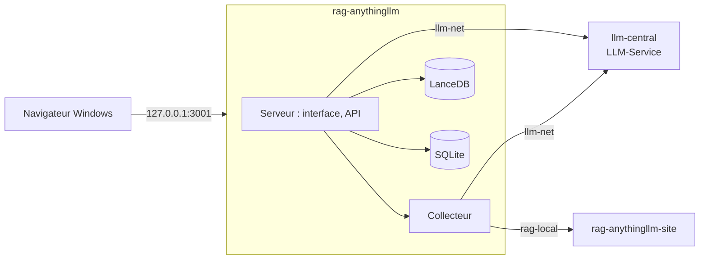

# AnythingLLM — banc d'essai et manuels vérifiés

**Interroger ses propres documents, faire travailler un agent et ouvrir le tout à une équipe, sur sa machine et sans service en ligne : AnythingLLM 1.19.0 installé, branché sur un service de modèles local, mesuré sur 38 questions et documenté en un manuel utilisateur de 16 chapitres suivis de 6 annexes, avec 133 captures d'écran annotées.**

**Le manuel utilisateur commence ici : [docs/anythingllm/README.md](docs/anythingllm/README.md).**


AnythingLLM 1.19.0 (édition Docker) branché sur le service LLM central (LLM-Service : `chat`, `embed`, `transcribe`), le corpus d'entreprise fictive de la série avec ses pièges (scan, tableaux, audio, document en anglais), un banc de 38 questions dont les réponses sont connues, et un manuel écrit à partir de ce qui a réellement tourné : chaque action de la partie 1 a été faite à la souris par Playwright et photographiée, chaque chiffre renvoie à un résultat brut dans `outils/resultats/`.

Troisième banc de la série après Open Notebook et RAGFlow : mêmes documents, mêmes questions, même machine. Le comparatif est dans [docs/README.md](docs/README.md).

## Sommaire

- [Le parcours](#le-parcours)
- [Architecture](#architecture)
- [Démarrage](#démarrage)
- [Configuration](#configuration)
- [API / Endpoints](#api--endpoints)
- [Tests](#tests)
- [Structure du projet](#structure-du-projet)
- [Licences & composants](#licences--composants)
- [Commandes utiles](#commandes-utiles)
- [Données du banc](#données-du-banc)
- [Les pièges que ce banc documente](#les-pièges-que-ce-banc-documente)
- [Résultats](#résultats)
- [Versions](#versions)
- [Ressources](#ressources)

## Le parcours

| Manuel | Ce qu'on saura faire |
|---|---|
| [01 Découvrir](docs/anythingllm/manuel/01-decouvrir-anythingllm.md) | dire à quoi sert l'outil et quelle machine prévoir (sans et avec carte graphique) |
| [02 Installer](docs/anythingllm/manuel/02-installer-anythingllm.md) | installer, ouvrir, arrêter, supprimer |
| [03 Premiers pas](docs/anythingllm/manuel/03-premiers-pas.md) | assistant de premier lancement, connexion, langue, modèles |
| [04 Première question](docs/anythingllm/manuel/04-premiere-question.md) | un espace, un document, une réponse citée |
| [05 Documents](docs/anythingllm/manuel/05-ajouter-et-organiser-ses-documents.md) à [09 Sources externes](docs/anythingllm/manuel/09-sources-externes.md) | documents, questions et sources, réglages d'un espace, modèles, connecteurs |
| [10 Agents](docs/anythingllm/manuel/10-agents-et-outils.md) à [13 Comptes et widget](docs/anythingllm/manuel/13-comptes-equipe-et-widget.md) | agents et MCP, mémoires et tâches, administration, équipe et widget |
| [14 Cas pratiques](docs/anythingllm/manuel/14-cas-pratiques.md), [15 En cas de problème](docs/anythingllm/manuel/15-en-cas-de-probleme.md), [16 Glossaire](docs/anythingllm/manuel/16-glossaire.md) | trois usages complets, erreurs réelles, vocabulaire |
| [Annexes A1 à A6](docs/anythingllm/README.md#partie-2--évaluation-et-compléments) | banc, matériel, API, exploitation, fonctionnement interne, preuves |

Parcours conseillés : interroger ses documents seul (01 à 07, 14) ; équipe (01 à 07, 12, 13, A4) ; automatiser (01 à 04, 12, A3) ; choisir (01, A1, A2).

## Architecture

| Service | Conteneur | Image | Rôle |
|---|---|---|---|
| AnythingLLM | `rag-anythingllm` | `mintplexlabs/anythingllm:1.19.0` (figée par empreinte) | interface, API, collecteur de documents (OCR, transcription, pages web), base SQLite, vecteurs LanceDB |
| Modèles | `llm-central`, `llm-swap`, `llm-speaches` | LiteLLM v1.109.0, llama-swap v272 (llama.cpp), speaches 0.8.3 | `chat`, `embed`, `rerank`, `transcribe`, servis par [LLM-Service](https://github.com/floSa/llm-service) (dépôt séparé, géré à part) |
| Site de test | `rag-anythingllm-site` | `nginx:alpine` | trois pages fictives pour le connecteur « site web » et la page de test du widget (sans port publié) |



Réseaux : `llm-net` (service de modèles, externe) et `rag-local` (captures Playwright, site de test). Un seul port publié, sur `127.0.0.1`.

## Démarrage

**Prérequis :** Windows 11 avec WSL2 (Ubuntu 24.04) et Docker Desktop ; 16 Go de mémoire ; LLM-Service démarré ; la clé du service dans `.env` (copie de `.env.example`).

```bash
cp .env.example .env              # puis renseigner LLM_CENTRAL_KEY
outils/communs/llm_central_sante.sh --essai
outils/anythingllm/installer.sh
```

| Service | URL | Note |
|---|---|---|
| AnythingLLM | http://127.0.0.1:3001 | compte et mot de passe fictifs : `donnees/IDENTIFIANTS-LOCAUX.txt` (non versionné) |
| Documentation de l'API | http://127.0.0.1:3001/api/docs | clé d'API : `donnees/anythingllm/cle-api.txt` |
| Service de modèles | http://127.0.0.1:8080/v1 | LLM-Service, clé dans `.env` |

Le compte, la langue et les modèles se règlent ensuite dans l'interface ([chapitre 03](docs/anythingllm/manuel/03-premiers-pas.md)).

## Configuration

- Variables générées par `installer.sh` dans `donnees/anythingllm/storage/.env` : `SIG_KEY`, `SIG_SALT`, `DISABLE_TELEMETRY="true"` ; **pas** de `JWT_SECRET` (il ferait sauter l'assistant de premier lancement ; l'application le crée elle-même).
- Options passées au conteneur : `donnees/anythingllm/options.env` (facultatif), ici `TARGET_OCR_LANG=fra,eng` pour lire les scans en français.
- Écarts au compose officiel (`outils/anythingllm/compose.yml`) : image officielle figée au lieu d'une construction locale, port sur `127.0.0.1`, un seul dossier de données `donnees/anythingllm/storage`, réseaux `llm-net` et `rag-local`. Relecture : `outils/resultats/anythingllm/relecture.md`.
- Branchement au service LLM central : fournisseur « Generic OpenAI », adresse `http://llm-central:8080/v1`, noms fixes `chat` (contexte 16384, « Max Tokens » 8192) et `embed` ; transcription « OpenAI Compatible » avec `transcribe`. AnythingLLM n'accepte pas de reranker externe : `rerank` n'est pas utilisé, le tri de précision intégré l'est.
- Clé : `LLM_CENTRAL_KEY` dans `.env` (jamais versionné) ; AnythingLLM la recopie dans son propre `.env` sous `donnees/` (non versionné).

## API / Endpoints

| Route | Rôle |
|---|---|
| `GET /api/ping` | santé (sans clé) |
| `GET /api/v1/auth` | vérifier une clé d'API |
| `GET /api/v1/workspaces`, `POST /api/v1/workspace/new`, `POST /api/v1/workspace/{slug}/update` | espaces |
| `POST /api/v1/document/upload` (`addToWorkspaces`) | envoyer et intégrer un document |
| `POST /api/v1/workspace/{slug}/chat` (`mode` : `query`, `chat`, `automatic`) | poser une question |
| `POST /api/v1/workspace/{slug}/vector-search` | chercher des passages sans le modèle |
| `/api/v1/openai/chat/completions` | route compatible OpenAI (le modèle est le nom court de l'espace) |

Exemples exécutés : [annexe A3](docs/anythingllm/annexes/A3-automatiser-par-l-api.md).

## Tests

```bash
python3 outils/communs/verifier_docs.py          # 0 point
bash exemples/anythingllm/lancer.sh              # 7 exemples, code 0, sortie dans sorties_verifiees.txt
python3 outils/anythingllm/banc.py --etiquette essai --espace Banc-bge-m3
```

Sorties obtenues : `0 point(s)` ; `exemples/anythingllm/sorties_verifiees.txt` ; `outils/resultats/anythingllm/banc-*.json`.

## Structure du projet

```text
docs/anythingllm/            manuel : README (sommaire), manuel/ (partie 1), annexes/ (partie 2), img/ (captures)
docs/README.md, glossaire.md index de la série, comparatif, glossaire commun
outils/anythingllm/          installation, démarrage, arrêt, état, sauvegarde, banc, client de l'API, scénarios de captures, MCP d'exemple
outils/communs/              diagnostic, santé du service central, versions, banc commun, captures, vérification, nettoyage
outils/resultats/            résultats bruts (machine, socle, anythingllm et bancs précédents)
exemples/anythingllm/        exemples d'API et sorties vérifiées
corpus/                      9 documents fictifs et 38 questions de référence
donnees/                     données, identifiants, sauvegardes (non versionné)
```

## Licences & composants

| Composant | Licence |
|---|---|
| AnythingLLM | MIT |
| LiteLLM, llama.cpp, llama-swap, speaches (LLM-Service) | MIT |
| Qwen3.5-4B (`chat`), bge-m3 (`embed`), faster-whisper-small (`transcribe`) | licences de leurs auteurs, voir LLM-Service |
| Playwright (captures) | Apache 2.0 |

Ce projet : MIT — Copyright (c) 2026 floSa ([LICENSE](LICENSE)).

## Commandes utiles

```bash
outils/anythingllm/etat.sh                        # état, ports, mémoire, service central
outils/anythingllm/arreter.sh                     # arrêt (données gardées)
outils/anythingllm/demarrer.sh                    # redémarrage
outils/anythingllm/sauvegarder.sh                 # archive dans donnees/sauvegardes/
outils/anythingllm/restaurer.sh <archive>         # restauration
outils/communs/nettoyer.sh anythingllm            # tout supprimer (demande confirmation)
outils/communs/captures/lancer.sh outils/anythingllm/captures/c04_premiere_question.py   # rejouer un scénario de captures
```

## Données du banc

Corpus `corpus/documents/` : rapport annuel PDF avec tableaux, contrat PDF scanné, procédure DOCX, présentation PPTX, classeur XLSX, FAQ HTML, compte rendu Markdown, audit en anglais, message vocal MP3 (empreintes dans `corpus/MANIFEST.json`). Questions `corpus/questions.json` : 34 avec réponse attendue, 4 pièges sans réponse dans le corpus.

## Les pièges que ce banc documente

- Un `JWT_SECRET` écrit d'avance fait sauter l'assistant de premier lancement.
- « Max Tokens » vaut 1024 par défaut : trop peu pour un modèle qui réfléchit.
- Un nouvel espace est en mode « Agent » : réponse vide, ou réponse tirée d'Internet, dans l'interface ; préférer « Requête ».
- Un fichier envoyé ne peut être placé dans l'espace qu'après fermeture et réouverture de la fenêtre des documents.
- L'embedder intégré, surtout anglais, perd 8 réponses sur 34 face à `embed`.
- Pas de reranker externe ; le tri de précision intégré fait gagner la dernière question.
- L'OCR est en anglais ; `TARGET_OCR_LANG` n'agit que passé au conteneur.
- Une question de plus de 8 192 jetons échoue à l'embedding.
- Télémétrie coupée, mais deux tables publiques restent téléchargées au démarrage.

## Résultats

| Solution | Banc | Modèle | Réglages | Exactes | Refus pièges | Bon document cité | Bonne page | p50 (s) | p95 (s) | Indexation (s) | Pic RAM application (Mo) |
|---|---|---|---|---|---|---|---|---|---|---|---|
| AnythingLLM | [defaut-sans-rerank](outils/resultats/anythingllm/banc-2026-11-12-defaut-sans-rerank.json) | chat, embedder embed | mode query, topN 4, seuil 0.25, recherche default | 33/34 | 3/4 | 33 | non exposée | 14.25 | 27.78 | 8.5 | 887 |
| AnythingLLM | [embedder-natif](outils/resultats/anythingllm/banc-2026-11-12-embedder-natif.json) | chat, embedder Xenova/all-MiniLM-L6-v2 | mode query, topN 4, seuil 0.25, recherche default | 25/34 | 4/4 | 32 | non exposée | 11.97 | 45.18 | - | 617 |
| AnythingLLM | [rerank-natif](outils/resultats/anythingllm/banc-2026-11-12-rerank-natif.json) | chat, embedder embed | mode query, topN 4, seuil 0.25, recherche rerank | 34/34 | 4/4 | 34 | non exposée | 13.54 | 50.17 | - | 1560 |
| AnythingLLM | [serre-top2](outils/resultats/anythingllm/banc-2026-11-12-serre-top2.json) | chat, embedder embed | mode query, topN 2, seuil 0.25, recherche default | 31/34 | 4/4 | 32 | non exposée | 13.43 | 34.71 | 0.2 | 1568 |
| AnythingLLM | [top8-rerank-natif](outils/resultats/anythingllm/banc-2026-11-12-top8-rerank-natif.json) | chat, embedder embed | mode query, topN 8, seuil 0.25, recherche rerank | 34/34 | 4/4 | 34 | non exposée | 10.69 | 37.64 | - | 1573 |
| AnythingLLM | [top8](outils/resultats/anythingllm/banc-2026-11-12-top8.json) | chat, embedder embed | mode query, topN 8, seuil 0.25, recherche default | 34/34 | 4/4 | 34 | non exposée | 13.55 | 28.56 | - | 1559 |

Détail et lecture : [annexe A1](docs/anythingllm/annexes/A1-evaluation-qualite-et-performances.md).

## Versions

| Composant | Version |
|---|---|
| AnythingLLM | 1.19.0 (`sha256:daf5a6ae9d363ed578e7d41e2d0668c7eaa604bd90b0ff27435f893b0906833e`) |
| Playwright (captures) | 1.65.1 (`mcr.microsoft.com/playwright/python:v1.65.1-noble`) |
| LiteLLM / llama-swap / speaches | v1.109.0 / v272 (llama.cpp build 12282) / 0.8.3 |
| Docker / Compose | 29.9.3 / 5.7.0 |

Relevé : `outils/resultats/anythingllm/versions-2026-11-12.json`.

## Ressources

- Dépôt : https://github.com/Mintplex-Labs/anything-llm — documentation : https://docs.anythingllm.com
- Rapport de mission : [RAPPORT-anythingllm.md](RAPPORT-anythingllm.md) ; journal : [JOURNAL.md](JOURNAL.md)
