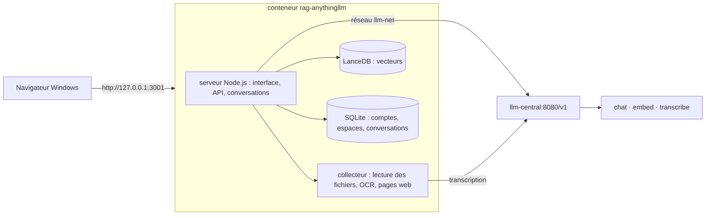

# A5. Fonctionnement interne

> **Objet** : décrire l'architecture d'AnythingLLM 1.19.0 (édition Docker) telle qu'installée ici, ses dossiers, ses ports, et les notions techniques qui expliquent son comportement (découpage, embeddings, recherche, budget de contexte, réflexion du modèle).
> **Prérequis** : avoir lu le [chapitre 01](../manuel/01-decouvrir-anythingllm.md) et le [glossaire](../../glossaire.md).
> **Version décrite** : AnythingLLM 1.19.0 (image `mintplexlabs/anythingllm:1.19.0`, commit `9b1fcab`), essais du 12 novembre 2026.
> **Statut des informations** : [Vérifié] observé sur la machine d'essai ; [Source] lu dans le code source au tag `v1.19.0` (relevé `outils/resultats/anythingllm/cadrage-serveur.md`, avec fichier et ligne) ; [Estimation] calcul expliqué ; [À tester] ni lu ni essayé.
> **Précautions** : le dossier de données contient la clé du service de modèles en clair (voir section 3) ; ne pas le partager.

## Sommaire

1. [Vue d'ensemble](#1-vue-densemble)
2. [Un conteneur, deux processus](#2-un-conteneur-deux-processus)
3. [Dossier de données](#3-dossier-de-données)
4. [Ports et réseaux](#4-ports-et-réseaux)
5. [Du document au passage](#5-du-document-au-passage)
6. [De la question à la réponse](#6-de-la-question-à-la-réponse)
7. [Budget de contexte](#7-budget-de-contexte)
8. [Réflexion du modèle `chat`](#8-réflexion-du-modèle-chat)
9. [Modèles téléchargés par l'application](#9-modèles-téléchargés-par-lapplication)
10. [Dépannage](#dépannage)
11. [Sources](#sources)

## 1. Vue d'ensemble

AnythingLLM ne contient aucun modèle de réponse ici : il envoie ses demandes au service LLM central (LiteLLM devant llama.cpp et speaches) par le réseau Docker `llm-net`. [Vérifié] (`outils/anythingllm/compose.yml`, `docker ps`)

## 2. Un conteneur, deux processus

- Le point d'entrée applique les migrations de la base SQLite (Prisma), puis lance le serveur (`server/index.js`, port 3001) et le collecteur (`collector/index.js`, port 8888 interne) ; si l'un s'arrête, le conteneur s'arrête. [Source] (`docker/docker-entrypoint.sh`)
- Le contrôle de santé appelle `/api/ping` toutes les minutes [Source] (`docker/Dockerfile`, ligne 181 ; `docker/docker-healthcheck.sh`) ; réponse `{"online":true}` [Vérifié] (`exploitation-2026-11-12.log`).
- Utilisateur `anythingllm` (UID 1000), Chromium intégré pour lire les pages web [Source] (`docker/Dockerfile`) ; le compose officiel donne la capacité `SYS_ADMIN` au conteneur pour le bac à sable de Chromium [Source] (`docker/docker-compose.yml`, lignes 16-17 ; `docker/.env.example`, lignes 536-539).
- Mémoire au repos : 330 à 480 Mio selon l'activité. [Vérifié] (`installation-2026-11-12.log`, `exploitation-2026-11-12.log`, `fin-de-mission-2026-11-12.log`)

## 3. Dossier de données

Tout est dans `donnees/anythingllm/storage/` (monté sur `/app/server/storage`). [Vérifié]

| Élément | Contenu |
|---|---|
| `.env` | réglages de l'instance, réécrits à chaque changement dans l'interface, **secrets compris** : clé du service de modèles, `SIG_KEY`, `SIG_SALT`, `JWT_SECRET` [Source] (`server/utils/helpers/updateENV.js`, lignes 1586-1715) |
| `anythingllm.db` | base SQLite : comptes, espaces, conversations, clés d'API, journaux d'événements |
| `documents/` | texte extrait de chaque document téléversé (un fichier JSON par document), rangé par dossier |
| `lancedb/` | vecteurs, un tableau par espace de travail |
| `vector-cache/` | vecteurs déjà calculés, réutilisés quand un document est ajouté à un autre espace |
| `models/` | modèles téléchargés par l'application (section 9), tables de tailles de contexte et de prix |
| `plugins/` | serveurs MCP (`anythingllm_mcp_servers.json`), compétences personnalisées, agent flows |

## 4. Ports et réseaux

| Port | Adresse | Rôle |
|---|---|---|
| 3001 | `127.0.0.1:3001` sur le poste | interface, API interne (`/api/...`) et API développeur (`/api/v1/...`), documentation Swagger (`/api/docs`) |
| 8888 | interne au conteneur | collecteur de documents, non publié |

Réseaux Docker : `llm-net` (service LLM central, externe) et `rag-local` (navigateur Playwright des captures). Chaque port publié est lié à `127.0.0.1` : `docker ps --format '{{.Names}} {{.Ports}}'` renvoie `rag-anythingllm 127.0.0.1:3001->3001/tcp`. [Vérifié] (`outils/resultats/anythingllm/installation-2026-11-12.log`)

## 5. Du document au passage

1. **Lecture** par le collecteur : PDF (texte, puis OCR Tesseract si le PDF n'a pas de texte), DOCX, PPTX, XLSX, HTML, Markdown, audio et vidéo (transcription), images (OCR), EPUB, mbox, ODT. [Source] (`collector/utils/constants.js`)
2. **OCR** : langue réglée par la variable `TARGET_OCR_LANG`, `eng` par défaut, sans réglage dans l'interface ; le modèle de langue (`eng.traineddata`, 5 Mo) est téléchargé au premier PDF scanné. [Vérifié] (`donnees/anythingllm/storage/models/tesseract/`) [Source] (`server/utils/collectorApi/index.js`, ligne 77)
3. **Découpage** en passages de 1 000 caractères au plus, chevauchement de 20 caractères (réglables dans « Diviseur de texte et découpage ») ; chaque passage reçoit un en-tête (titre, source, date). Les pages d'un PDF sont mises bout à bout avant découpage : **la page d'origine d'un passage n'est pas conservée**. [Source] (`server/utils/TextSplitter/index.js`, `collector/processSingleFile/convert/asPDF/`)
4. **Embedding** de chaque passage par l'embedder de l'instance (ici `embed`, bge-m3, 1 024 dimensions), par lots de 500 envoyés l'un après l'autre. [Source] (`server/utils/EmbeddingEngines/genericOpenAi/index.js`)
5. **Stockage** dans LanceDB, un tableau par espace de travail.

Changer d'embedder efface les vecteurs de tous les espaces : les documents doivent être intégrés à nouveau. [Source] (`server/utils/helpers/updateENV.js`, lignes 252-264)

## 6. De la question à la réponse

1. La question est transformée en vecteur par le même embedder.
2. LanceDB renvoie les `topN` passages les plus proches (4 par défaut) dont la similarité dépasse le seuil (0,25 par défaut). [Source] (`server/utils/vectorDbProviders/lance/index.js`)
3. Avec « Accuracy Optimized », 10 à 50 candidats sont d'abord retrouvés, puis reclassés par le reranker natif (`Xenova/ms-marco-MiniLM-L-6-v2`), et les `topN` meilleurs gardés. [Source] (même fichier, lignes 99-170)
4. Les documents épinglés sont ajoutés en entier ; si moins de `topN` passages sont trouvés, des passages cités aux tours précédents complètent. [Source] (`server/utils/chats/apiChatHandler.js`, lignes 321-338 et 382-404)
5. Le message système contient la consigne de l'espace, puis les passages sous la forme `[CONTEXT 0] … [END CONTEXT 0]`. [Source] (`server/utils/AiProviders/genericOpenAi/index.js`, lignes 95-105)
6. En mode **Requête**, si aucun passage n'est trouvé, la réponse de refus de l'espace est renvoyée sans appeler le modèle. [Source]
7. En mode **Agent** (le mode par défaut d'un nouvel espace, appelé `automatic` dans l'API), la question part à l'agent, qui décide lui-même d'appeler la recherche dans les documents. [Source] (`server/models/workspace.js`, lignes 220-226 ; `server/utils/chats/agents.js`)

## 7. Budget de contexte

La fenêtre déclarée (« Model context window », ici 16 384 jetons) est partagée ainsi : consigne et passages 15 %, historique 15 %, question 70 %, avec une marge fixe de 600 jetons ; rien n'est raccourci tant que l'ensemble tient. [Source] (répartition : `server/utils/AiProviders/genericOpenAi/index.js`, lignes 46-50 ; marge et compression : `server/utils/helpers/chat/index.js`, lignes 53-190)

| Part | Jetons sur 16 384 | Ce qui se passe au-delà |
|---|---|---|
| Consigne et passages | 2 457 | la consigne est ramenée à 25 % de la part, les passages à 75 %, en supprimant le milieu |
| Historique | 2 457 | seules les paires les plus récentes sont gardées |
| Question | 11 468 | la question est envoyée seule, coupée au milieu pour tenir dans 80 % de la fenêtre (13 107 jetons) |

Avec 4 passages de 1 000 caractères (environ 300 jetons chacun), la part « consigne et passages » est loin d'être pleine. [Estimation] Le comptage utilise le découpage en jetons d'OpenAI (`cl100k_base`), pas celui de Qwen : c'est une approximation. [Source] (`server/utils/helpers/tiktoken.js`)

Le plafond de la réponse (« Max Tokens », 1 024 par défaut, 8 192 ici) n'est pas retranché de la fenêtre. [Source] Le dépassement volontaire et l'erreur obtenue sont décrits dans l'[annexe A2](A2-choisir-son-materiel-et-ses-modeles.md).

## 8. Réflexion du modèle `chat`

- Le modèle `chat` (Qwen3.5-4B) réfléchit avant de répondre ; AnythingLLM lit cette réflexion (`reasoning_content`) et la place en tête de la réponse entre balises `<think>` et `</think>`. L'interface la replie ; l'API la renvoie dans `textResponse`. [Source] (`server/utils/AiProviders/genericOpenAi/index.js`, lignes 213-219 et 346-387)
- La réflexion est renvoyée telle quelle au modèle dans l'historique des tours suivants : elle consomme la part « historique ». [Source] (`server/utils/helpers/chat/responses.js`, lignes 284-315)
- Le fournisseur « Generic OpenAI » n'envoie aucun paramètre pour couper la réflexion (`chat_template_kwargs`) : elle ne se coupe que du côté du service de modèles. [Source] (`server/utils/helpers/reasoningEffort.js`)
- Plafond par défaut de 1 024 jetons [Source] (`server/utils/AiProviders/genericOpenAi/index.js`, lignes 41-43) ; la réflexion pourrait alors consommer tout le plafond [Estimation] ; avec 64 jetons, AnythingLLM affiche un message de limite atteinte [Vérifié] (`captures/15-problemes/05-reponse-coupee.txt`). D'où « Max Tokens » à 8 192.

## 9. Modèles téléchargés par l'application

| Modèle | Usage | Quand | Taille |
|---|---|---|---|
| `Xenova/all-MiniLM-L6-v2` | embedder natif | premier document intégré avec l'embedder natif | 23 Mo [Vérifié] (`fin-de-mission-2026-11-12.log`) |
| `Xenova/ms-marco-MiniLM-L-6-v2` | reranker natif | premier usage de « Accuracy Optimized » | 23 Mo [Vérifié] (`fin-de-mission-2026-11-12.log`) ; nom du modèle [Source] (`server/utils/EmbeddingRerankers/native/index.js`, lignes 20-23) |
| `eng.traineddata` (Tesseract) | OCR | premier PDF scanné | 5,2 Mo [Vérifié] (`fin-de-mission-2026-11-12.log`) |
| `fra.traineddata` (Tesseract) | OCR en français | premier PDF scanné après `TARGET_OCR_LANG=fra,eng` | 1,2 Mo [Vérifié] (`fin-de-mission-2026-11-12.log`) |
| `Xenova/whisper-small` | transcription intégrée | jamais ici (transcription confiée à `transcribe`) | environ 250 Mo [Source] (`collector/utils/WhisperProviders/localWhisper.js`) |

Origine : Hugging Face, avec repli sur `cdn.anythingllm.com` ; cache dans `storage/models/`. [Source] (`server/utils/EmbeddingEngines/native/index.js`)

## Dépannage

| Symptôme | Cause probable | Action |
|---|---|---|
| Réponse vide ou coupée net | la réflexion a consommé tout le plafond « Max Tokens » | relever « Max Tokens » (8 192 ici) dans Préférence LLM |
| Tous les espaces répondent « aucune information » après un changement d'embedder | les vecteurs ont été effacés | intégrer de nouveau les documents de chaque espace |
| Document scanné en français mal lu | OCR en anglais par défaut | écrire `TARGET_OCR_LANG=fra,eng` dans `donnees/anythingllm/options.env` (passé au conteneur par `compose.yml`), `outils/anythingllm/demarrer.sh`, puis envoyer de nouveau le document ; la même ligne dans `storage/.env` est sans effet [Vérifié] (`outils/resultats/anythingllm/ocr-fra-2026-11-12.log`) |

## Sources

- Code source AnythingLLM au tag `v1.19.0` : https://github.com/Mintplex-Labs/anything-llm/tree/v1.19.0 ; relevé détaillé : `outils/resultats/anythingllm/cadrage-serveur.md`.
- Documentation officielle : https://docs.anythingllm.com
- Relecture de l'installation : `outils/resultats/anythingllm/relecture.md`.
