# 03. Premiers pas

> Ce chapitre apprend à faire l'assistant de premier lancement, à se connecter, à se repérer dans l'écran principal, à régler la langue et à déclarer les trois modèles du service central : réponse, représentation des textes, transcription.
> **Point de départ** : page « Bienvenue » ouverte à l'adresse `http://127.0.0.1:3001`, à la fin du chapitre 02.
> **Durée** : environ 15 minutes. **Avant** : chapitre 02.

**Attention** : le mot de passe choisi à l'étape 5 ne peut pas être récupéré. Le noter dans un endroit sûr.

## Ce qu'il faut savoir

AnythingLLM ne répond pas lui-même : il envoie chaque demande à des **modèles**. Trois servent ici, tous fournis par le service LLM central du poste :

| Modèle | Nom à saisir | Rôle |
|---|---|---|
| Modèle de réponse | `chat` | rédige les réponses ; il réfléchit avant de répondre, ce qui prend quelques secondes de plus |
| Modèle d'embedding | `embed` | transforme chaque passage de document et chaque question en une suite de nombres qui représente son sens ; c'est ce qui permet de retrouver les passages utiles |
| Modèle de transcription | `transcribe` | transforme un fichier audio ou vidéo en texte |

Le service se joint, depuis AnythingLLM, à l'adresse `http://llm-central:8080/v1` (et non `127.0.0.1`, qui désignerait le conteneur d'AnythingLLM lui-même ; voir le chapitre 02) avec une clé (celle du fichier `.env`, chapitre 02, étape 3). Dans AnythingLLM, ce type de service s'appelle « Generic OpenAI » (pour les réponses et l'embedding) ou « OpenAI Compatible » (pour la transcription) : il parle la même langue que l'API d'OpenAI, sans être OpenAI.

L'assistant de premier lancement ne demande que le modèle de réponse ; les deux autres se déclarent ensuite dans les paramètres.

## Faire l'assistant de premier lancement

**Étape 1. Lancer l'assistant**
*Où* : page « Bienvenue » (chapitre 02, étape 6).
Cliquer sur « Commencer » (capture du chapitre 02, étape 6).

*Résultat* : la page « Préférence LLM » s'ouvre.

**Étape 2. Choisir le fournisseur « Generic OpenAI »**
*Où* : assistant › « Préférence LLM ».
Taper `Generic` dans le champ de recherche (pastille 1), puis cliquer sur « Generic OpenAI » (pastille 2).

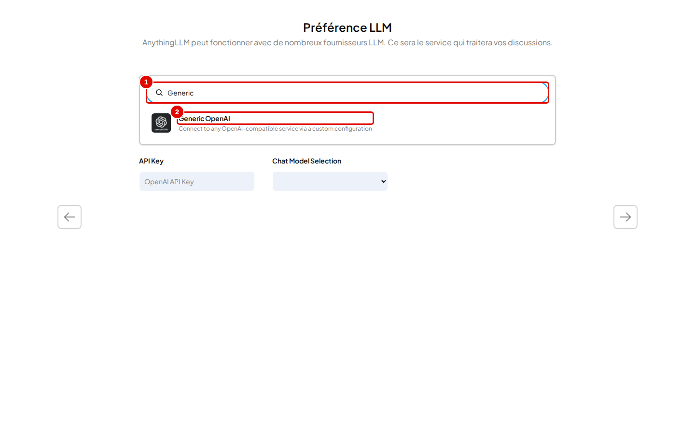
*Écran : assistant, « Préférence LLM », liste des fournisseurs filtrée.*

| N° | Élément | Rôle |
|---|---|---|
| 1 | « Search LLM providers » | filtre la liste des fournisseurs (une quarantaine) |
| 2 | « Generic OpenAI » | fournisseur pour tout service compatible avec l'API d'OpenAI |

*Résultat* : cinq champs apparaissent sous la liste.

**Étape 3. Remplir les champs du modèle de réponse**
*Où* : assistant › « Préférence LLM », sous la liste.
Remplir dans l'ordre :

- « Base URL » (pastille 1) : `http://llm-central:8080/v1` ;
- « API Key » (pastille 2) : la clé du service central (masquée sur la capture) ;
- « Selected Model » (pastille 3) : dès que l'adresse et la clé sont bonnes, le champ devient une liste des modèles du service ; choisir `chat` ;
- « Model context window » (pastille 4) : `16384`, la taille de contexte du service ;
- « Max Tokens » (pastille 5) : `8192`, longueur maximale d'une réponse, réflexion comprise.

Puis cliquer sur la flèche de droite (pastille 6).

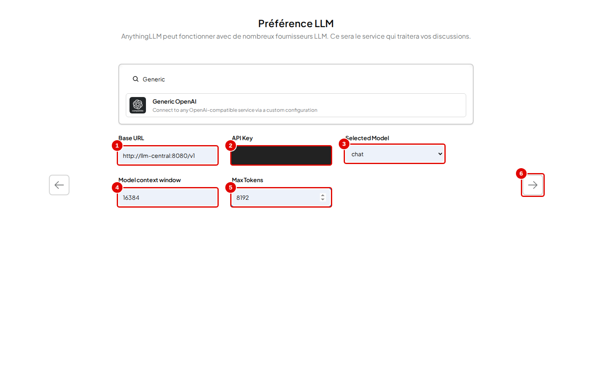
*Écran : assistant, « Préférence LLM », fournisseur Generic OpenAI choisi.*

| N° | Élément | Rôle |
|---|---|---|
| 1 | « Base URL » | adresse du service de modèles |
| 2 | « API Key » | clé du service (jamais affichée en clair) |
| 3 | « Selected Model » | modèle de réponse ; liste remplie par le service |
| 4 | « Model context window » | nombre de jetons que le modèle accepte en une fois |
| 5 | « Max Tokens » | plafond de la réponse ; 1024 par défaut, trop peu pour un modèle qui réfléchit |
| 6 | flèche de droite | enregistre et passe à l'étape suivante |

*Résultat* : la page « Configuration utilisateur » s'ouvre. Le choix du modèle est déjà enregistré.

**Étape 4. Choisir qui utilisera l'instance**
*Où* : assistant › « Configuration utilisateur ».
Cliquer sur « Juste moi » (pastille 1).

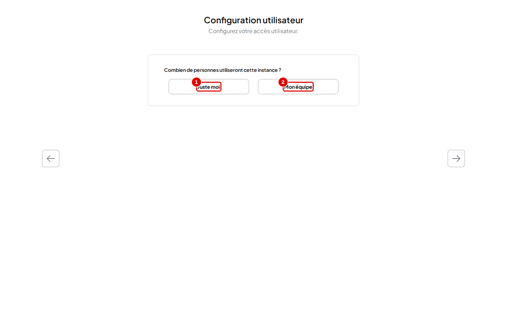
*Écran : assistant, « Configuration utilisateur ».*

| N° | Élément | Rôle |
|---|---|---|
| 1 | « Juste moi » | une seule personne, protégée par un mot de passe ; toutes les fonctions restent disponibles |
| 2 | « Mon équipe » | plusieurs comptes avec rôles ; certaines pages (tâches planifiées, robot de messagerie Telegram) disparaissent alors |

*Résultat* : la question « Définir un mot de passe » apparaît. Le passage en équipe reste possible plus tard (chapitre 13) ; l'inverse ne l'est pas.

**Étape 5. Protéger l'instance par un mot de passe**
*Où* : assistant › « Configuration utilisateur », sous « Juste moi ».
Cliquer sur « Oui » (pastille 1), taper un mot de passe d'au moins 8 caractères (pastille 2 ; lettres, chiffres et `_ - ! @ $ % ^ & * ( ) ;` seulement), puis cliquer sur la flèche de droite (pastille 3).

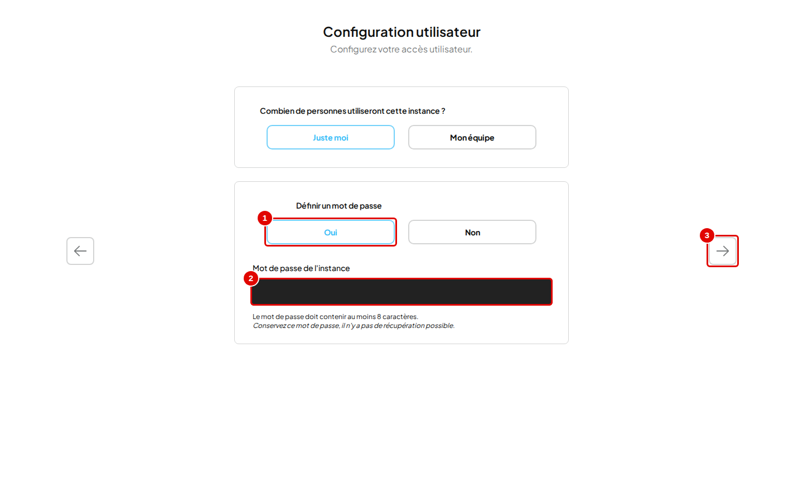
*Écran : assistant, « Configuration utilisateur », « Définir un mot de passe ».*

| N° | Élément | Rôle |
|---|---|---|
| 1 | « Oui » | active la protection par mot de passe |
| 2 | « Mot de passe de l'instance » | mot de passe demandé à chaque connexion (masqué sur la capture) |
| 3 | flèche de droite | enregistre et passe à l'étape suivante |

*Résultat* : la page « Gestion des données » s'ouvre. Sans mot de passe (« Non »), toute personne qui atteint l'adresse peut tout lire.

**Étape 6. Lire où vont les données**
*Où* : assistant › « Gestion des données ».
Lire les trois cartes, puis cliquer sur la flèche de droite (pastille 1).

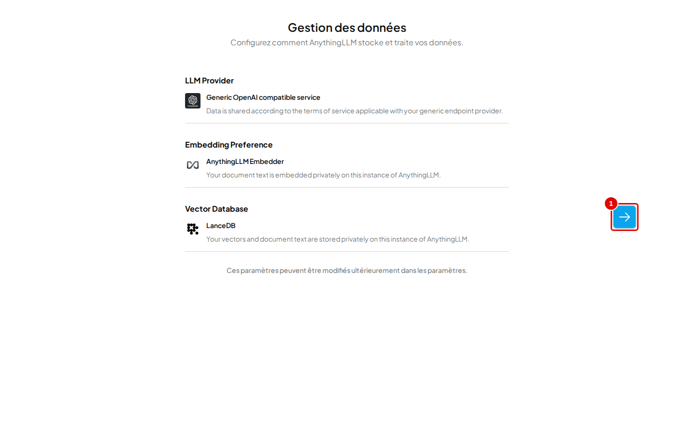
*Écran : assistant, « Gestion des données ».*

| N° | Élément | Rôle |
|---|---|---|
| 1 | flèche de droite | passe à l'enquête |

Les cartes résument : les questions partent au service « Generic OpenAI » (ici, le service du poste) ; l'embedding est calculé dans AnythingLLM (« AnythingLLM Embedder », remplacé à l'étape 14) ; les vecteurs restent dans la base LanceDB de l'instance.

*Résultat* : la page d'enquête s'ouvre.

**Étape 7. Passer l'enquête**
*Où* : assistant › enquête « Bienvenue ».
Cliquer sur « Ignorer l'enquête » (pastille 1), sans rien remplir.

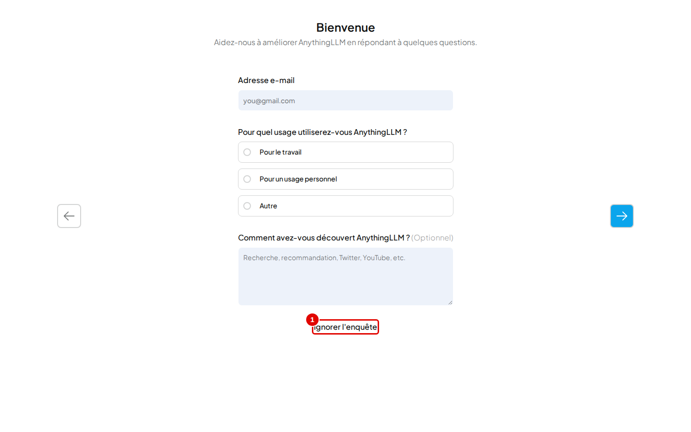
*Écran : assistant, enquête facultative.*

| N° | Élément | Rôle |
|---|---|---|
| 1 | « Ignorer l'enquête » | termine l'assistant sans rien envoyer |

*Résultat* : l'écran principal s'ouvre, avec un premier espace de travail « Mon Espace de Travail ». Remplir l'enquête enverrait les réponses à l'éditeur, en ligne.

## Se repérer dans l'écran principal

**Étape 8. Identifier les zones de l'écran**
*Où* : écran principal (logo AnythingLLM en haut à gauche).

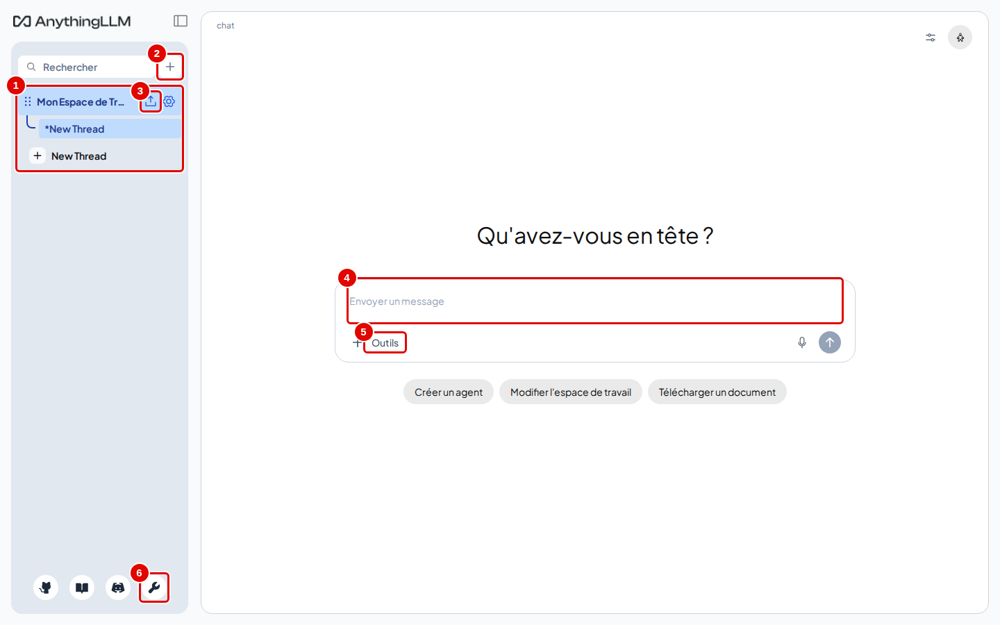
*Écran : écran principal, après l'assistant.*

| N° | Élément | Rôle |
|---|---|---|
| 1 | liste des espaces de travail | chaque espace a ses documents, ses conversations (fils) et ses réglages ; « New Thread » ouvre une nouvelle conversation |
| 2 | « + » | crée un espace de travail (chapitre 04) |
| 3 | flèche vers le haut | ouvre le gestionnaire de documents de l'espace (chapitre 05) |
| 4 | « Envoyer un message » | zone où taper une question |
| 5 | « Outils » | commandes abrégées (`/reset`…) et compétences de l'agent (chapitres 06 et 10) |
| 6 | clé | ouvre les paramètres de l'instance |

En haut de la zone de discussion, le nom du modèle utilisé (`chat`) ; en haut à droite, l'icône de réglages de la discussion (taille du texte, souvenirs, export, chapitre 06) et, à côté, l'icône de l'agent. Dans la barre latérale, la flèche (pastille 3) et la roue dentée des réglages de l'espace sont visibles sur l'espace ouvert, et apparaissent au survol sur les autres.

## Se connecter

Après l'assistant, la session est déjà ouverte : cette étape sert aux connexions suivantes (nouveau navigateur, redémarrage). Elle peut être lue maintenant et faite plus tard.

**Étape 9. Ouvrir une session**
*Où* : page « Bienvenue — Connectez-vous à votre compte AnythingLLM », affichée à chaque nouvelle ouverture du navigateur ou après un redémarrage.
Taper le mot de passe de l'instance (pastille 1), puis cliquer sur « Connexion » (pastille 2).

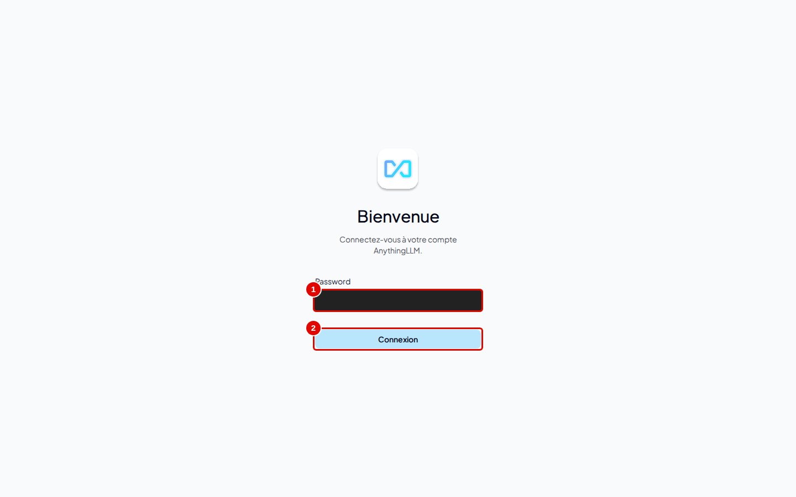
*Écran : connexion en mode « Juste moi ».*

| N° | Élément | Rôle |
|---|---|---|
| 1 | « Password » | mot de passe de l'instance (masqué sur la capture) |
| 2 | « Connexion » | ouvre la session |

*Résultat* : l'écran principal s'affiche.

## Régler la langue

**Étape 10. Choisir le français**
*Où* : clé en bas de la barre latérale › « Paramètres de l'instance » › Apparence › « Interface ».
Dans « Langue d'affichage » (pastille 2), choisir « French ».

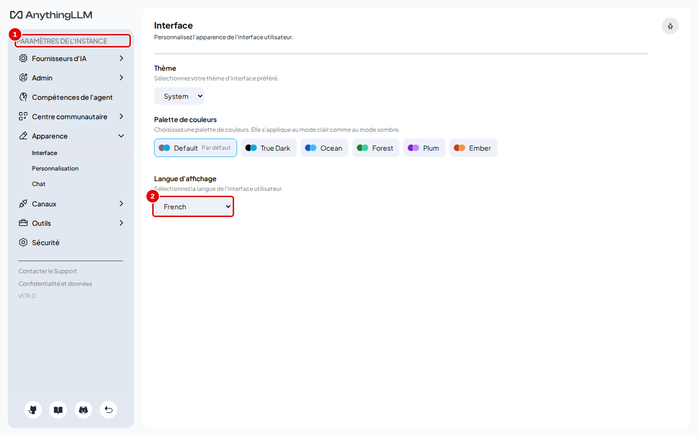
*Écran : Paramètres de l'instance, Apparence, « Interface ».*

| N° | Élément | Rôle |
|---|---|---|
| 1 | menu « Paramètres de l'instance » | tous les réglages, rangés par groupes (Fournisseurs d'IA, Admin, Apparence, Outils…) |
| 2 | « Langue d'affichage » | langue de l'interface |

*Résultat* : l'interface passe en français. La langue suit d'abord celle du navigateur ; ce réglage n'est mémorisé que dans le navigateur utilisé. Une partie des libellés reste en anglais quelle que soit la langue (« Save », « New Thread », champs des fournisseurs) : ce manuel les cite tels qu'affichés.

## Déclarer la transcription

**Étape 11. Ouvrir la page de transcription**
*Où* : Paramètres de l'instance › Fournisseurs d'IA › « Modèle de transcription ».
Cliquer sur la carte du fournisseur actuel (pastille 1), « AnythingLLM Built-In ».

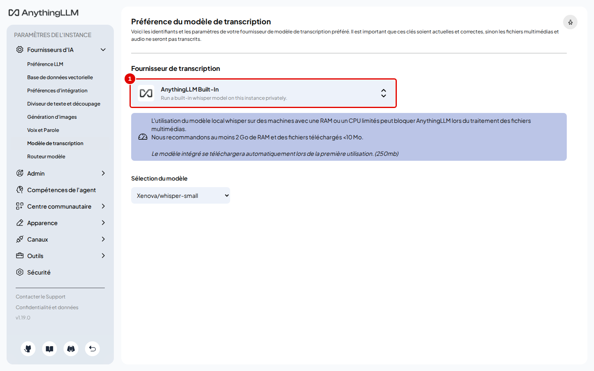
*Écran : « Préférence du modèle de transcription », fournisseur intégré.*

| N° | Élément | Rôle |
|---|---|---|
| 1 | carte du fournisseur | ouvre la liste : « OpenAI », « OpenAI Compatible », « AnythingLLM Built-In » |

*Résultat* : la liste des fournisseurs s'ouvre. Le fournisseur intégré téléchargerait un modèle de 250 Mo et transcrirait sur le processeur, plus lentement.

**Étape 12. Brancher `transcribe`**
*Où* : même page.
Choisir « OpenAI Compatible », remplir « Base URL » (pastille 1) avec `http://llm-central:8080/v1`, « API Key » (pastille 2) avec la clé, « Transcription Model » (pastille 3) avec `transcribe`, puis cliquer sur « Save changes » (pastille 4).

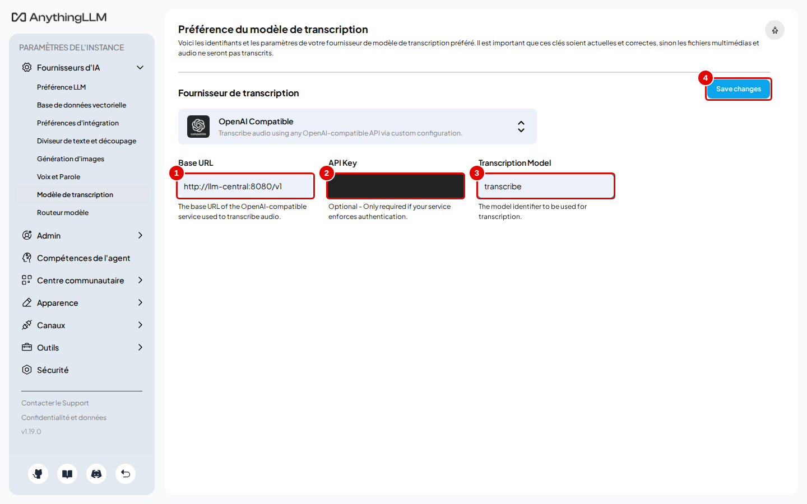
*Écran : « Préférence du modèle de transcription », fournisseur OpenAI Compatible.*

| N° | Élément | Rôle |
|---|---|---|
| 1 | « Base URL » | adresse du service |
| 2 | « API Key » | clé du service (masquée) |
| 3 | « Transcription Model » | nom du modèle de transcription |
| 4 | « Save changes » | enregistre |

*Résultat* : un message confirme l'enregistrement. Les fichiers audio et vidéo ajoutés ensuite seront transcrits par le service central.

## Déclarer le modèle d'embedding

Ce réglage se fait **avant d'ajouter des documents** : changer de modèle d'embedding efface la représentation de tous les documents déjà intégrés, dans tous les espaces.

**Étape 13. Ouvrir la page de l'embedding**
*Où* : Paramètres de l'instance › Fournisseurs d'IA › « Préférences d'intégration ».
Cliquer sur la carte du fournisseur actuel (pastille 1), « AnythingLLM Embedder ».

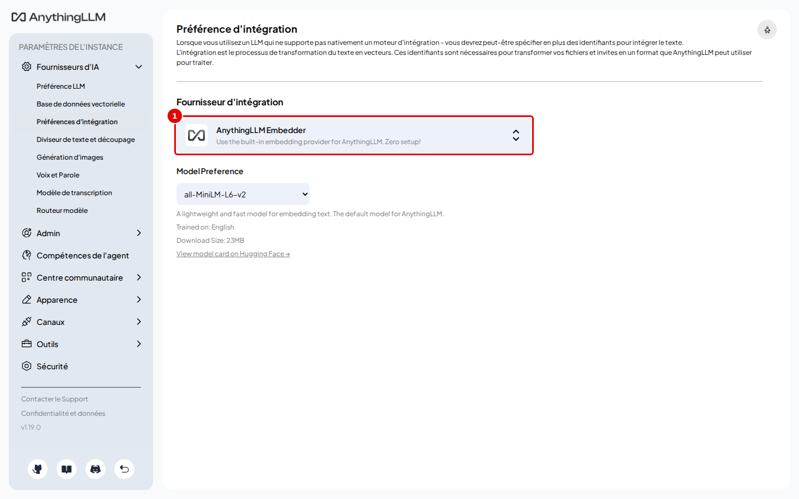
*Écran : « Préférences d'intégration », embedder intégré.*

| N° | Élément | Rôle |
|---|---|---|
| 1 | carte du fournisseur | ouvre la liste des fournisseurs d'embedding |

*Résultat* : la liste s'ouvre avec un champ de recherche. L'embedder intégré est surtout fait pour l'anglais ; sur les documents français de l'essai, `embed` trouve mieux les bons passages (annexe A1).

**Étape 14. Brancher `embed`**
*Où* : même page.
Taper `Generic` dans « Search all embedding providers », choisir « Generic OpenAI », puis remplir « Base URL » (pastille 1) avec `http://llm-central:8080/v1`, « Embedding Model » (pastille 2) avec `embed`, « Max embedding chunk length » (pastille 3) avec `1000`, « API Key » (pastille 4) avec la clé, et cliquer sur « Enregistrer les modifications » (pastille 5).

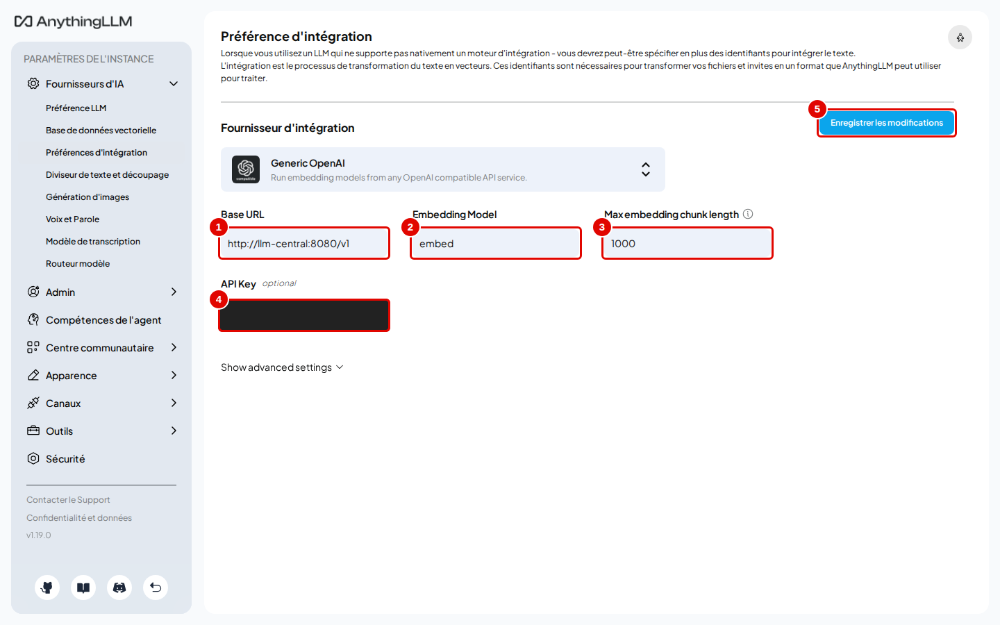
*Écran : « Préférences d'intégration », fournisseur Generic OpenAI.*

| N° | Élément | Rôle |
|---|---|---|
| 1 | « Base URL » | adresse du service |
| 2 | « Embedding Model » | nom du modèle d'embedding |
| 3 | « Max embedding chunk length » | taille maximale d'un passage, en caractères |
| 4 | « API Key » | clé du service (masquée) |
| 5 | « Enregistrer les modifications » | enregistre |

*Résultat* : sur une installation neuve, sans document intégré, l'enregistrement est immédiat et le fournisseur « Generic OpenAI » s'affiche : les modèles sont déclarés, passer au chapitre 04. Si des documents avaient déjà été intégrés, une fenêtre de confirmation s'ouvre (étape 15).

**Étape 15. Confirmer le changement (seulement si des documents existaient déjà)**
*Où* : fenêtre de confirmation, au-dessus de la page.
La fenêtre « WARNING - This action is irreversible » prévient que changer de modèle d'embedding efface la représentation de tous les documents déjà intégrés, dans tous les espaces ; les fichiers téléversés sont gardés et pourront être intégrés de nouveau. Cliquer sur « Confirm » (pastille 1). Cette fenêtre n'apparaît que si des documents ont déjà été intégrés.

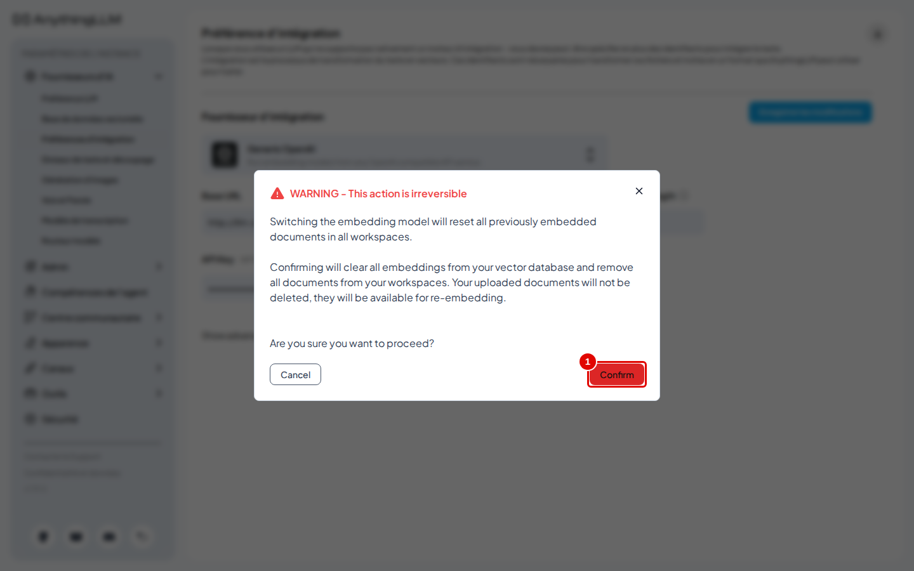
*Écran : fenêtre de confirmation du changement de modèle d'embedding.*

| N° | Élément | Rôle |
|---|---|---|
| 1 | « Confirm » | accepte la remise à zéro des représentations existantes ; « Cancel » annule |

*Résultat* : le fournisseur « Generic OpenAI » est affiché sur la page. Les trois modèles sont déclarés : l'application est prête pour une première question (chapitre 04).

## Bon à savoir

- Les champs « Base URL », « API Key », « Selected Model »… restent en anglais même avec l'interface en français.
- La clé saisie est enregistrée par AnythingLLM dans son fichier de réglages (`donnees/anythingllm/storage/.env`), en clair. Ce dossier ne doit pas être partagé.
- « Max Tokens » à 1024 (valeur proposée) suffit rarement : le modèle `chat` réfléchit avant de répondre, et sa réflexion compte dans ce plafond.
- Un modèle plus rapide sans réflexion peut être choisi plus tard, espace par espace (chapitre 07).

## En cas de problème

| Symptôme | Cause | Que faire |
|---|---|---|
| « Selected Model » reste un champ vide grisé | adresse ou clé incorrecte : la liste des modèles n'a pas pu être lue | vérifier l'adresse `http://llm-central:8080/v1` et la clé ; voir le [chapitre 15](15-en-cas-de-probleme.md) |
| La flèche de droite ne réagit pas | un champ obligatoire est vide ou le mot de passe fait moins de 8 caractères | compléter les champs |
| Mot de passe oublié | aucune récupération en mode « Juste moi » | retirer `AUTH_TOKEN` et `JWT_SECRET` de `donnees/anythingllm/storage/.env`, redémarrer, puis définir un nouveau mot de passe dans Paramètres › « Sécurité » ; voir le [chapitre 15](15-en-cas-de-probleme.md) |

---
*Version décrite : AnythingLLM 1.19.0, essais du 12 novembre 2026. Détails et preuves : [rapport d'essais](../annexes/A6-rapport-d-essais.md).*
