# 04. Première question en dix minutes

> Ce chapitre apprend le parcours le plus court : créer un espace de travail, y déposer un document, choisir le mode « Requête », poser une question et vérifier d'où vient la réponse.
> **Point de départ** : écran principal, connecté, modèles déclarés (fin du chapitre 03). Depuis les paramètres, revenir à l'écran principal par la flèche de retour en bas du menu des paramètres.
> **Durée** : environ 10 minutes. **Avant** : chapitre 03.

## Ce qu'il faut savoir

Un **espace de travail** est un dossier de discussion cloisonné : il a ses propres documents et ses propres conversations. Pour qu'un document serve aux réponses, il faut le **téléverser** (l'envoyer à AnythingLLM), puis l'**intégrer** à l'espace : AnythingLLM le découpe en passages et calcule la représentation de chacun avec le modèle `embed`.

À chaque question, AnythingLLM retrouve les 4 passages les plus proches du sens de la question et les donne au modèle `chat`, qui rédige la réponse. Sous la réponse, le bouton « Sources » montre les documents et les passages utilisés : c'est ce qui permet de vérifier la réponse.

L'exemple utilise le rapport annuel 2025 de Vélanor, entreprise fictive dont les documents servent d'exemple dans tout le manuel (dossier `corpus/documents/` du dépôt).

## Créer un espace de travail

**Étape 1. Ouvrir la création d'un espace**
*Où* : barre latérale, à droite du champ « Rechercher ».
Cliquer sur « + » (pastille 1).

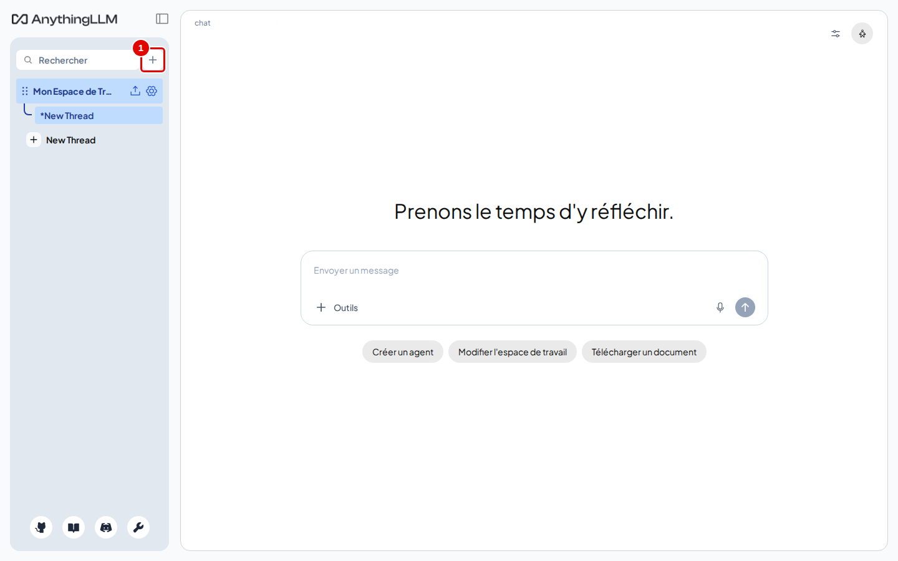
*Écran : écran principal.*

| N° | Élément | Rôle |
|---|---|---|
| 1 | « + » | ouvre la fenêtre « Nouvel Espace de Travail » |

*Résultat* : une petite fenêtre s'ouvre.

**Étape 2. Nommer l'espace**
*Où* : fenêtre « Nouvel Espace de Travail ».
Taper `Premier essai` dans « Nom des espaces de travail » (pastille 1), puis cliquer sur « Save » (pastille 2).

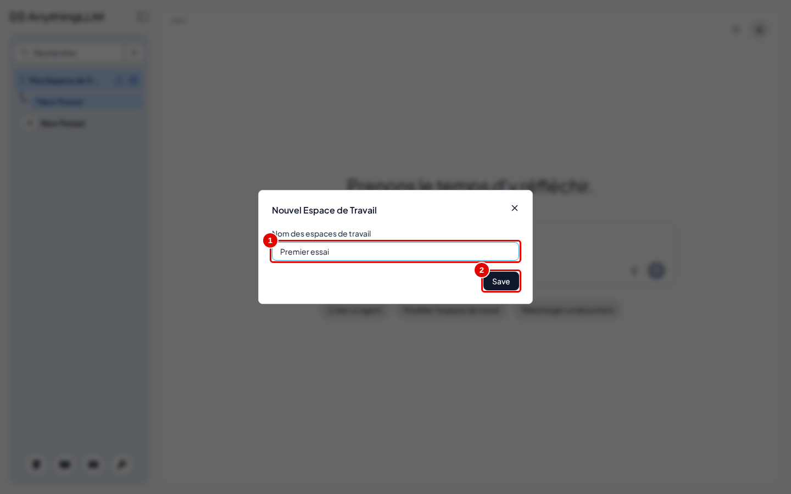
*Écran : fenêtre « Nouvel Espace de Travail ».*

| N° | Élément | Rôle |
|---|---|---|
| 1 | « Nom des espaces de travail » | nom affiché dans la barre latérale |
| 2 | « Save » | crée l'espace |

*Résultat* : l'espace « Premier essai » apparaît dans la barre latérale et s'ouvre, vide.

## Déposer un document

**Étape 3. Ouvrir la fenêtre des documents**
*Où* : barre latérale, ligne « Premier essai ».
Survoler la ligne, puis cliquer sur la flèche vers le haut (pastille 1).

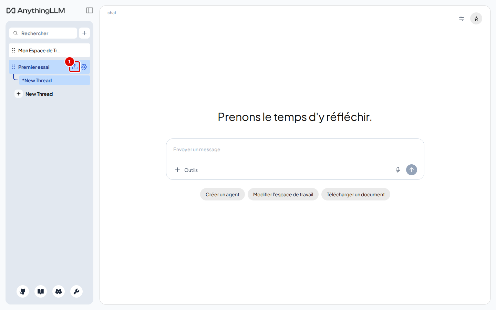
*Écran : espace « Premier essai », barre latérale.*

| N° | Élément | Rôle |
|---|---|---|
| 1 | flèche vers le haut | ouvre la fenêtre des documents de cet espace |

*Résultat* : la fenêtre des documents s'ouvre.

**Étape 4. Repérer les deux colonnes**
*Où* : fenêtre des documents, onglet « Documents ».

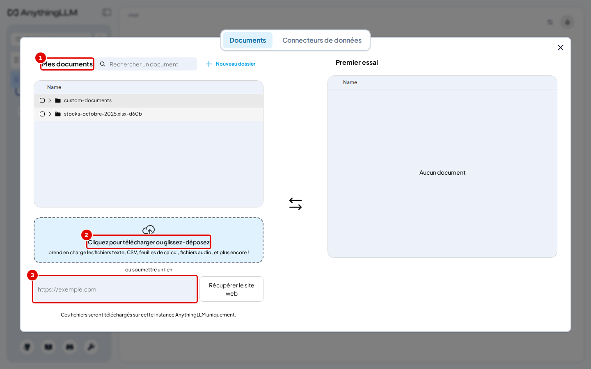
*Écran : fenêtre des documents, avant l'envoi du rapport (sur la capture, des fichiers des essais précédents sont déjà listés ; sur une installation neuve, « Mes documents » est vide).*

| N° | Élément | Rôle |
|---|---|---|
| 1 | « Mes documents » | tous les fichiers envoyés à AnythingLLM, quel que soit l'espace |
| 2 | zone d'envoi | « Cliquez pour télécharger ou glissez-déposez » : ajoute des fichiers |
| 3 | « ou soumettre un lien » | récupère une page web à partir de son adresse |

La colonne de droite, au nom de l'espace (« Premier essai »), liste les documents intégrés à cet espace : « Aucun document » pour l'instant.

**Étape 5. Envoyer le fichier**
*Où* : fenêtre des documents, zone d'envoi.
Cliquer dans la zone d'envoi : la fenêtre de choix de fichier de Windows s'ouvre. Le dépôt est dans WSL : taper `\\wsl$` dans la barre d'adresse de cette fenêtre, ouvrir la distribution (son nom, par exemple `Ubuntu` ou `Ubuntu-24.04`, est donné par `wsl -l` dans PowerShell), puis `home\<utilisateur>\AnythingLLM-Test-Bench\corpus\documents` (le chemin du dépôt s'affiche avec `pwd` dans le terminal Ubuntu), et choisir `rapport-annuel-2025.pdf` (ou le glisser depuis l'Explorateur dans la zone).

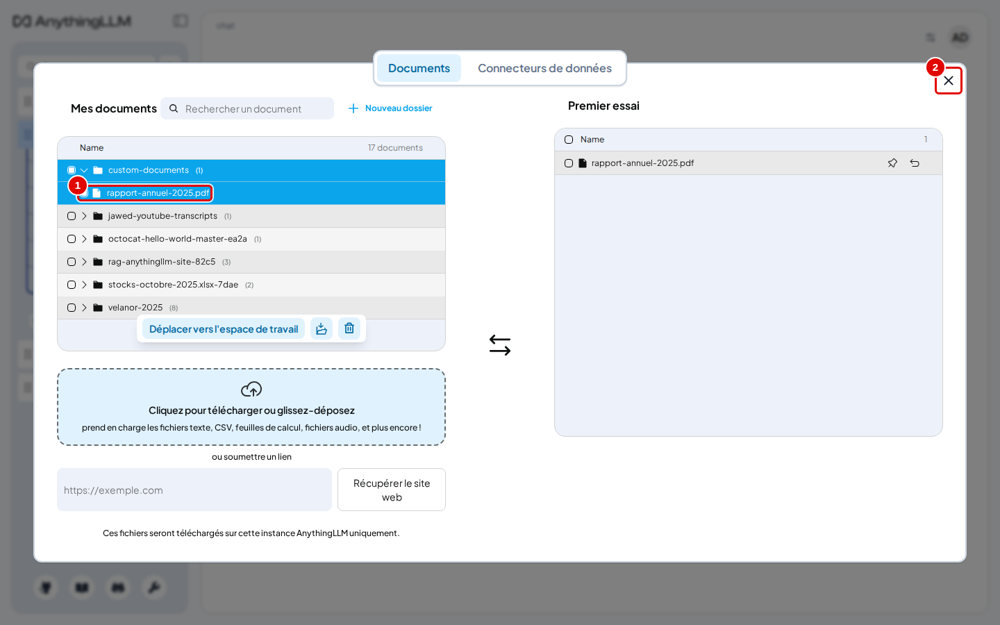
*Écran : fenêtre des documents, fichier envoyé dans « custom-documents ».*

| N° | Élément | Rôle |
|---|---|---|
| 1 | `rapport-annuel-2025.pdf` | le fichier envoyé, rangé dans le dossier `custom-documents` |
| 2 | croix | ferme la fenêtre |

*Résultat* : le fichier apparaît dans « Mes documents », avec une coche verte dans la zone d'envoi. Il n'est **pas encore** dans l'espace. Fermer la fenêtre avec la croix (pastille 2), puis la rouvrir comme à l'étape 3 : dans la version 1.19.0, un fichier qu'on vient d'envoyer ne peut pas être placé dans l'espace tant que la fenêtre n'a pas été rouverte.

**Étape 6. Placer le fichier dans l'espace**
*Où* : fenêtre des documents rouverte, « Mes documents » › dossier `custom-documents`.
Cliquer sur `custom-documents` pour l'ouvrir, cliquer sur `rapport-annuel-2025.pdf` pour le cocher (pastille 1), puis sur « Déplacer vers l'espace de travail » (pastille 2).

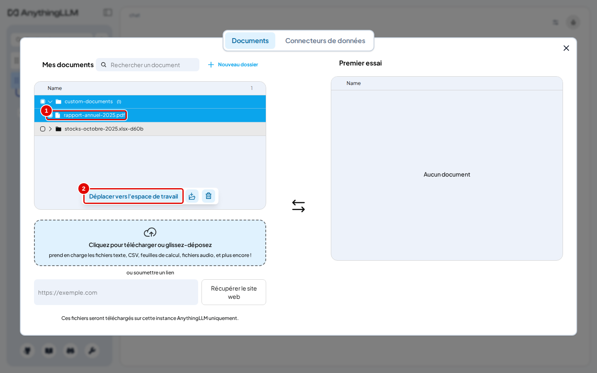
*Écran : fenêtre des documents, fichier coché.*

| N° | Élément | Rôle |
|---|---|---|
| 1 | `rapport-annuel-2025.pdf` | fichier sélectionné |
| 2 | « Déplacer vers l'espace de travail » | place la sélection dans la colonne de l'espace, en attente |

*Résultat* : le fichier passe dans la colonne de droite.

**Étape 7. Intégrer le document**
*Où* : fenêtre des documents, colonne « Premier essai ».
Cliquer sur « Sauvegarder et intégrer » (pastille 2).

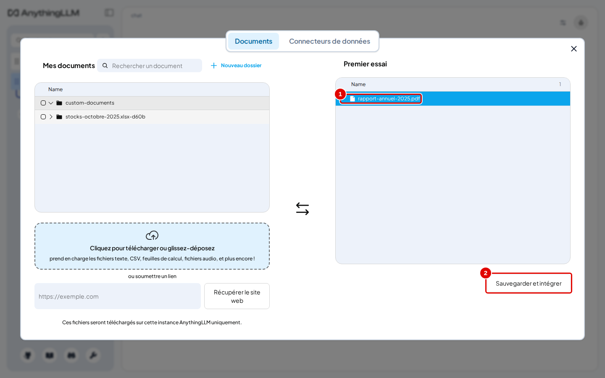
*Écran : fenêtre des documents, document en attente dans l'espace.*

| N° | Élément | Rôle |
|---|---|---|
| 1 | document en attente | fichier placé dans l'espace mais pas encore intégré |
| 2 | « Sauvegarder et intégrer » | découpe le document et calcule ses représentations |

*Résultat* : une barre de progression s'affiche quelques secondes.

**Étape 8. Vérifier l'intégration**
*Où* : fenêtre des documents, colonne « Premier essai ».

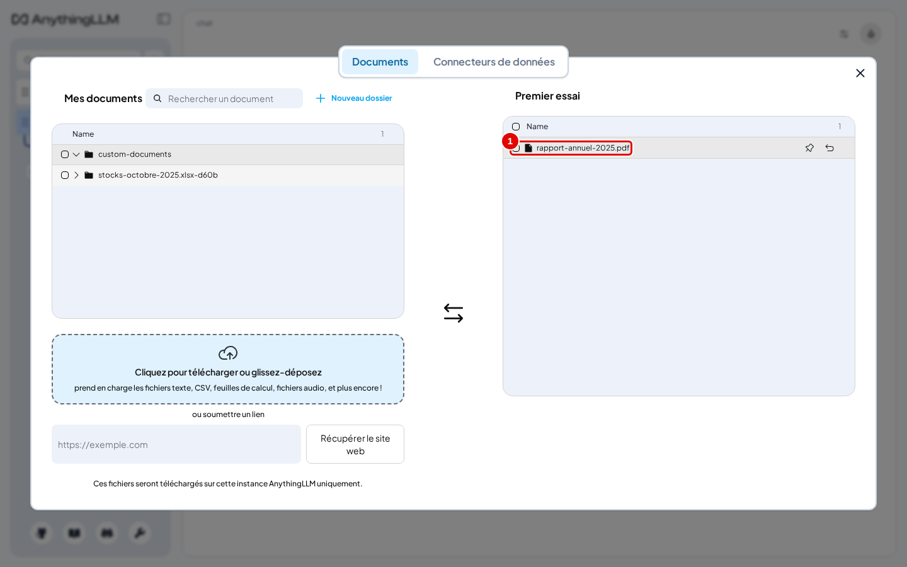
*Écran : fenêtre des documents, document intégré.*

| N° | Élément | Rôle |
|---|---|---|
| 1 | `rapport-annuel-2025.pdf` | document intégré, utilisable pour les réponses |

*Résultat* : le bouton « Sauvegarder et intégrer » a disparu ; le document est dans l'espace. Fermer la fenêtre avec la croix.

## Choisir le mode « Requête »

Un nouvel espace est en mode « Agent » : chaque question passe par un agent qui choisit lui-même ses outils. Dans les essais, ce mode a affiché une réponse vide dans l'interface (voir le [chapitre 15](15-en-cas-de-probleme.md)). Le mode « Requête » est le plus sûr pour interroger des documents : la réponse ne vient que des documents, et si rien n'est trouvé, l'espace le dit au lieu d'inventer.

**Étape 9. Ouvrir les réglages de l'espace**
*Où* : barre latérale, ligne « Premier essai ».
Survoler la ligne, puis cliquer sur la roue dentée (pastille 1).

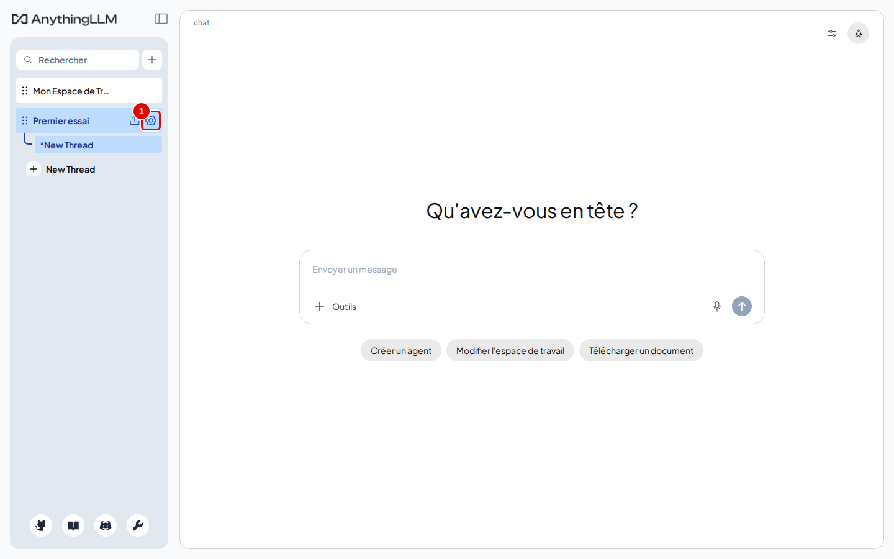
*Écran : espace « Premier essai », barre latérale.*

| N° | Élément | Rôle |
|---|---|---|
| 1 | roue dentée | ouvre les réglages de l'espace (chapitre 07) |

*Résultat* : la page des réglages s'ouvre sur « Paramètres généraux ».

**Étape 10. Choisir « Requête »**
*Où* : réglages de l'espace › onglet « Paramètres du chat » (pastille 1).
Cliquer sur « Requête » (pastille 4).

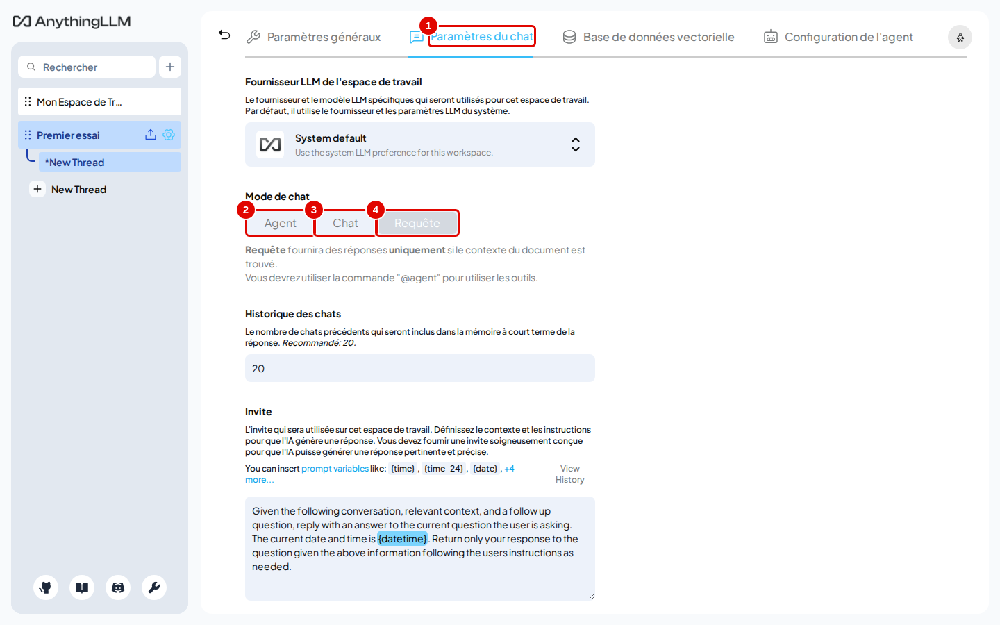
*Écran : réglages de l'espace, « Paramètres du chat », « Mode de chat ».*

| N° | Élément | Rôle |
|---|---|---|
| 1 | « Paramètres du chat » | onglet des réglages de la conversation |
| 2 | « Agent » | l'agent choisit ses outils (mode par défaut) |
| 3 | « Chat » | réponse avec les documents et les connaissances générales du modèle |
| 4 | « Requête » | réponse uniquement à partir des documents |

*Résultat* : « Requête » est surligné et le texte sous les boutons indique « Requête fournira des réponses uniquement si le contexte du document est trouvé. » Le choix est enregistré immédiatement, sans bouton. Revenir à la discussion en cliquant sur « Premier essai » dans la barre latérale.

## Poser la question et vérifier la source

**Étape 11. Poser la question**
*Où* : espace « Premier essai », zone de saisie en bas.
Taper `Quel est le chiffre d'affaires 2025 de Vélanor ?` (pastille 1), puis cliquer sur la flèche d'envoi (pastille 2) ou appuyer sur Entrée.

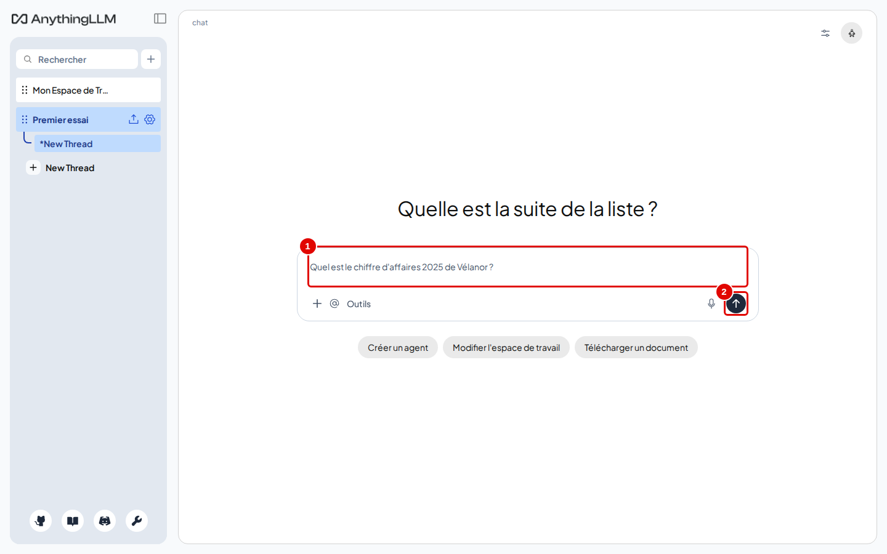
*Écran : espace « Premier essai », zone de saisie.*

| N° | Élément | Rôle |
|---|---|---|
| 1 | « Envoyer un message » | zone de saisie de la question |
| 2 | flèche d'envoi | envoie la question |

*Résultat* : la question s'affiche, puis « Thinking... » pendant que le modèle réfléchit.

**Étape 12. Lire la réponse**
*Où* : espace « Premier essai », zone de discussion.

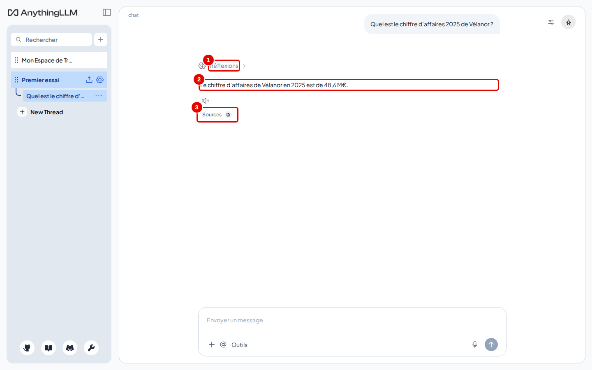
*Écran : espace « Premier essai », réponse affichée.*

| N° | Élément | Rôle |
|---|---|---|
| 1 | « Réflexions » | raisonnement du modèle, replié ; juste après la question, ce libellé s'affiche « Thought for … » ; il devient « Réflexions » quand la page est rechargée ; un clic le déplie |
| 2 | réponse | « Le chiffre d'affaires de Vélanor en 2025 est de 48,6 M€. » |
| 3 | « Sources » | ouvre la liste des documents utilisés |

*Résultat* : la réponse arrive en une quinzaine de secondes, réflexion comprise. Sous la réponse, une ligne discrète indique le modèle, la durée et la vitesse.

**Étape 13. Ouvrir les sources**
*Où* : sous la réponse.
Cliquer sur « Sources ».

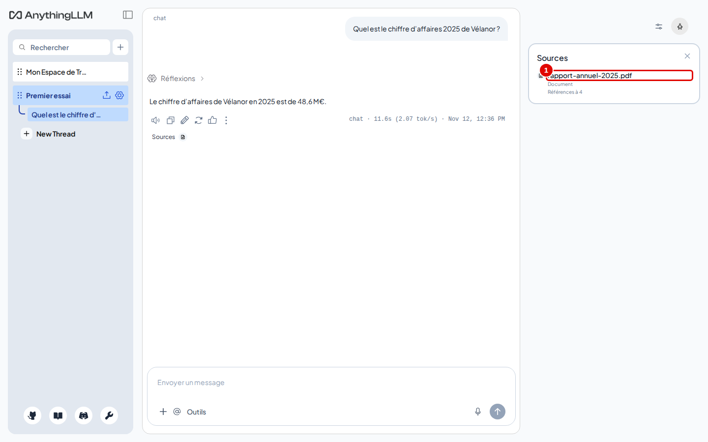
*Écran : espace « Premier essai », panneau « Sources » à droite.*

| N° | Élément | Rôle |
|---|---|---|
| 1 | `rapport-annuel-2025.pdf` | document cité, avec le nombre de passages utilisés |

*Résultat* : un panneau s'ouvre à droite. Cliquer sur le nom du document.

**Étape 14. Lire les passages cités**
*Où* : fenêtre du document cité.

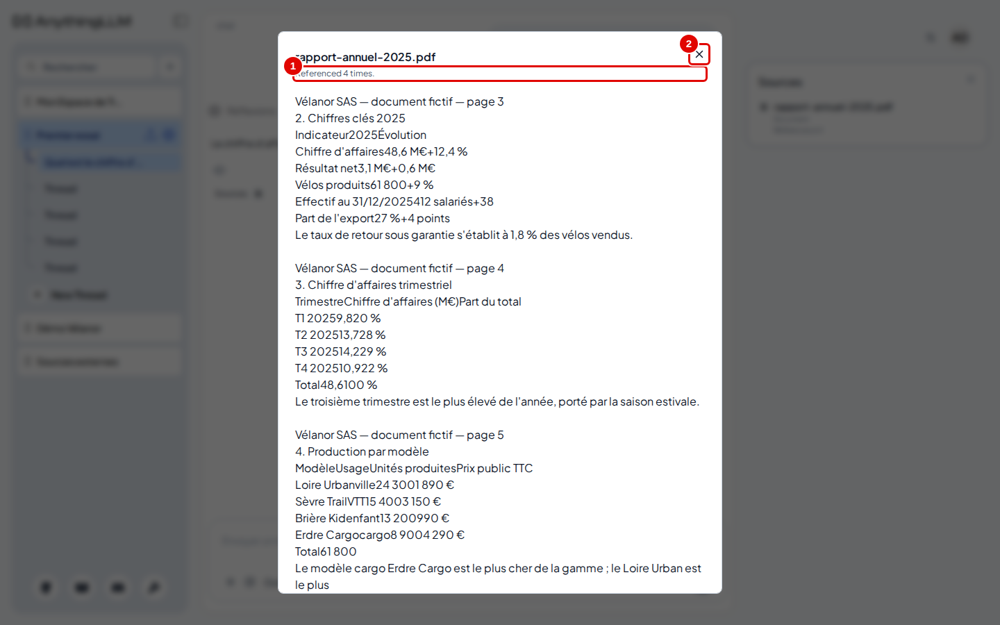
*Écran : fenêtre des passages cités du rapport annuel.*

| N° | Élément | Rôle |
|---|---|---|
| 1 | « Referenced 4 times. » | nombre de passages de ce document donnés au modèle |
| 2 | croix | ferme la fenêtre |

*Résultat* : le chiffre de la réponse se retrouve dans le premier passage (ligne « Chiffre d'affaires 48,6 M€ » du tableau de la page 3). En faisant défiler la fenêtre, chaque passage se termine par un pourcentage suivi de « match » : sa proximité de sens avec la question (de 60 à 65 % pour les passages de cette réponse). Le numéro de page n'est connu que parce qu'il est écrit dans le texte du document : AnythingLLM ne l'indique pas lui-même.

## Bon à savoir

- Un même fichier de « Mes documents » peut être placé dans plusieurs espaces sans être envoyé deux fois.
- La réflexion du modèle fait gagner en justesse mais ajoute quelques secondes : la durée affichée sous la réponse la comprend.
- Pour tout un dossier de documents, voir le chapitre 05.

## En cas de problème

| Symptôme | Cause | Que faire |
|---|---|---|
| « Déplacer vers l'espace de travail » ne fait rien | fichier envoyé dans la fenêtre encore ouverte (version 1.19.0) | fermer la fenêtre et la rouvrir, puis recommencer |
| Réponse vide sous « Thought for … » (libellé « Réflexions » après rechargement de la page) | mode « Agent » | passer en mode « Requête » ou « Chat » (étape 10) |
| « There is no relevant information in this workspace to answer your query. » | aucun passage assez proche n'a été trouvé, ou le document n'est pas intégré | vérifier l'étape 8 ; reformuler la question ; voir le [chapitre 07](07-regler-un-espace-de-travail.md) |

---
*Version décrite : AnythingLLM 1.19.0, essais du 12 novembre 2026. Détails et preuves : [rapport d'essais](../annexes/A6-rapport-d-essais.md).*
