# 05. Ajouter et organiser ses documents

> Ce chapitre apprend à envoyer plusieurs fichiers d'un coup, à les ranger dans des dossiers, à les placer dans un espace de travail, à épingler un document important, à retirer un document d'un espace et à supprimer un fichier.
> **Point de départ** : écran principal, connecté (chapitre 03). Avant l'étape 1, créer l'espace « Démo Vélanor » comme au chapitre 04, étapes 1 et 2.
> **Durée** : environ 15 minutes. **Avant** : chapitre 04.

**Attention** : supprimer un fichier de « Mes documents » le retire aussi de tous les espaces où il est intégré.

## Ce qu'il faut savoir

AnythingLLM sépare deux choses :

- **« Mes documents »** (colonne de gauche de la fenêtre des documents) : la bibliothèque de tous les fichiers envoyés à l'instance, rangés en dossiers. Un fichier y est lu et transformé en texte une seule fois ;
- **l'espace de travail** (colonne de droite) : les documents qui servent aux réponses de cet espace. Un même fichier peut être placé dans plusieurs espaces.

Formats lus : PDF (les PDF scannés passent par une lecture optique), Word, PowerPoint, Excel (une feuille devient un document), OpenDocument, texte, Markdown, HTML, CSV, EPUB, fichiers audio et vidéo (transcrits par `transcribe`), images.

Un document **épinglé** est donné en entier au modèle à chaque question, en plus des passages retrouvés. C'est utile pour un document court et toujours pertinent (une procédure, un règlement) ; sur un long document, les réponses ralentissent.

L'exemple constitue l'espace « Démo Vélanor » avec les 9 fichiers du dossier `corpus/documents` du dépôt.

## Créer un dossier

**Étape 1. Ouvrir la fenêtre des documents**
*Où* : barre latérale, ligne « Démo Vélanor » › flèche vers le haut (comme au chapitre 04, étape 3).

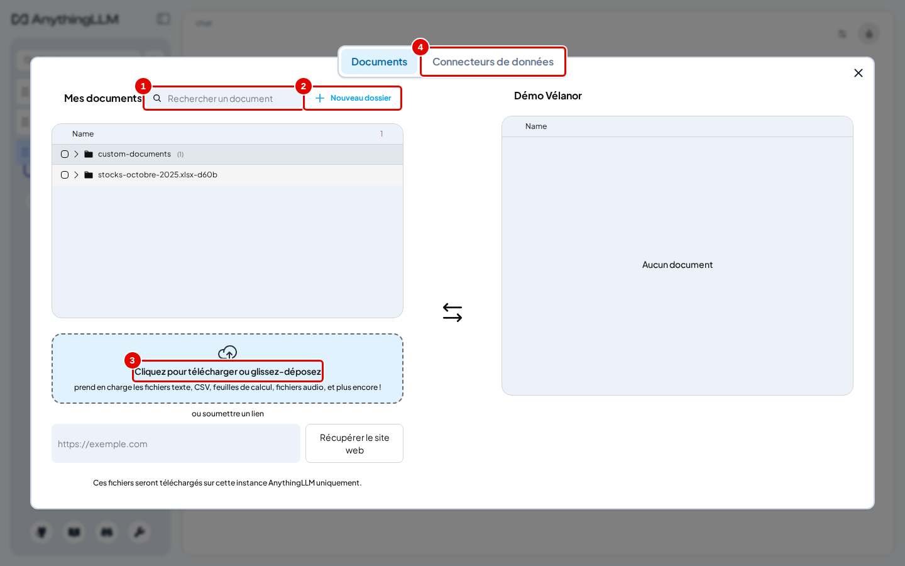
*Écran : fenêtre des documents, onglet « Documents ».*

| N° | Élément | Rôle |
|---|---|---|
| 1 | « Rechercher un document » | filtre « Mes documents » par nom |
| 2 | « Nouveau dossier » | crée un dossier de rangement |
| 3 | zone d'envoi | ajoute des fichiers (clic ou glisser-déposer) |
| 4 | « Connecteurs de données » | importe depuis un site, GitHub, YouTube… (chapitre 09) |

*Résultat* : la fenêtre est ouverte sur l'onglet « Documents ».

**Étape 2. Nommer le dossier**
*Où* : fenêtre des documents › « Nouveau dossier ».
Cliquer sur « Nouveau dossier », taper `velanor-2025` (pastille 1), puis cliquer sur « Create Folder » (pastille 2).

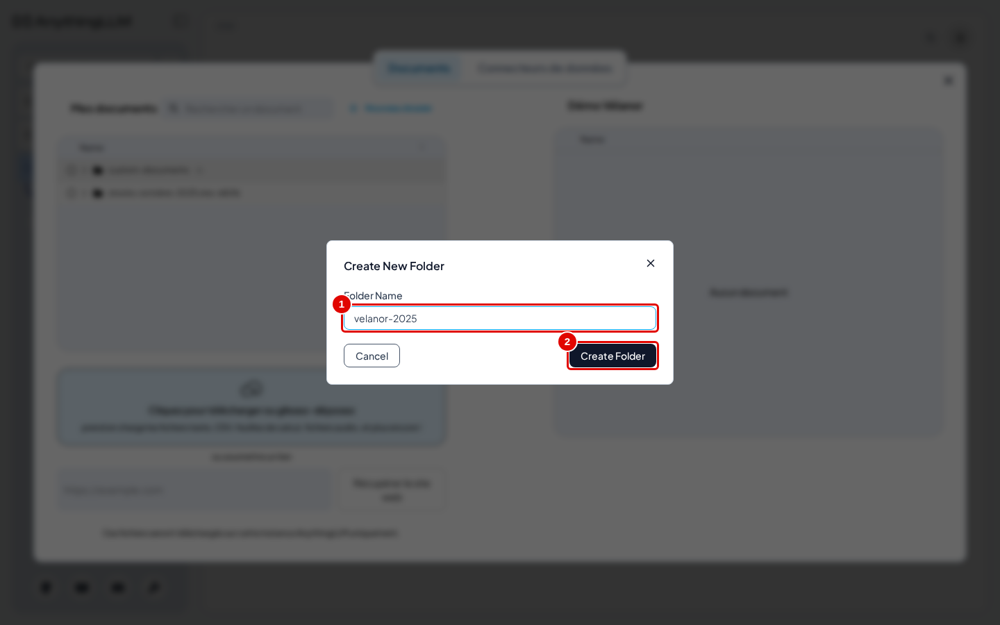
*Écran : fenêtre « Nouveau dossier ».*

| N° | Élément | Rôle |
|---|---|---|
| 1 | nom du dossier | nom affiché dans « Mes documents » |
| 2 | « Create Folder » | crée le dossier |

*Résultat* : le dossier `velanor-2025` apparaît dans « Mes documents », vide.

## Envoyer plusieurs fichiers

**Étape 3. Envoyer les fichiers**
*Où* : fenêtre des documents, zone d'envoi.
Cliquer dans la zone d'envoi, aller dans `corpus\documents` du dépôt (comme au chapitre 04, étape 5) et sélectionner les 9 fichiers d'un coup (Ctrl+A dans la fenêtre de choix de Windows), ou les glisser ensemble dans la zone. Les essais ont aussi envoyé une note de test fictive, `note-de-test.txt` (dossier `outils/anythingllm/essais/` du dépôt), qui sert aux étapes 11 et 12.

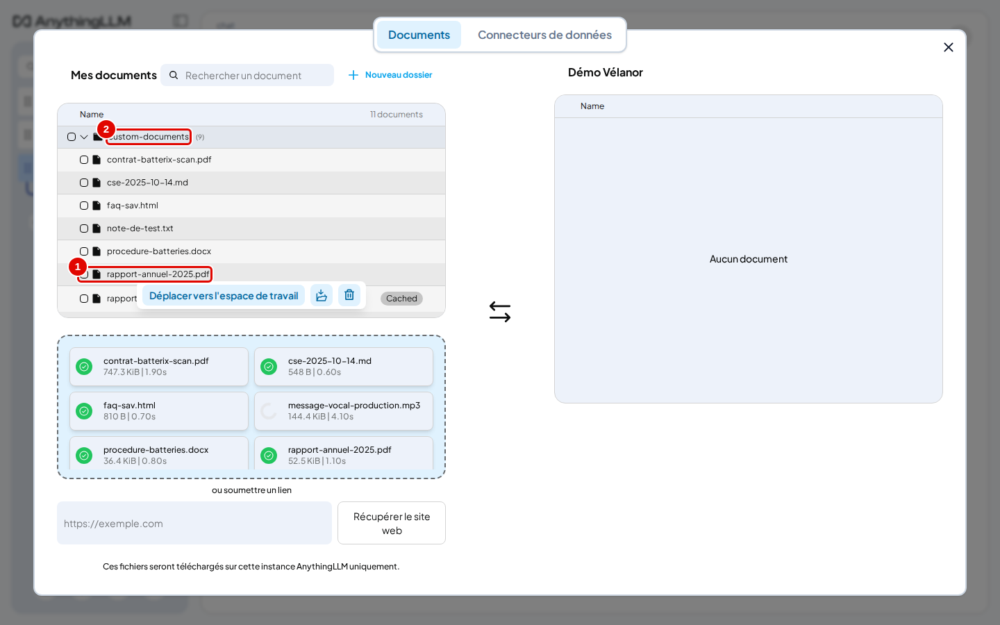
*Écran : fenêtre des documents, fichiers envoyés dans « custom-documents ».*

| N° | Élément | Rôle |
|---|---|---|
| 1 | fichier envoyé | chaque fichier lu apparaît dans le dossier par défaut |
| 2 | `custom-documents` | dossier où arrivent les fichiers envoyés |

*Résultat* : après quelques secondes (la transcription du fichier audio et la lecture du PDF scanné sont les plus longues), les fichiers sont dans `custom-documents`. Le classeur Excel arrive dans son propre dossier (`stocks-octobre-2025.xlsx-…`), une feuille par document. Fermer puis rouvrir la fenêtre avant l'étape suivante (voir le chapitre 04, étape 5).

## Ranger les fichiers dans un dossier

**Étape 4. Déplacer les fichiers dans le dossier**
*Où* : fenêtre des documents rouverte, dossier `custom-documents` ouvert.
Cocher les 8 fichiers du corpus (tous sauf `note-de-test.txt`, et sauf un éventuel second `rapport-annuel-2025.pdf` déjà placé dans « Premier essai » au chapitre 04, marqué « Cached »), puis cliquer sur l'icône de dossier à droite de « Déplacer vers l'espace de travail » (pastille 2) et choisir `velanor-2025` dans la liste (pastille 3).

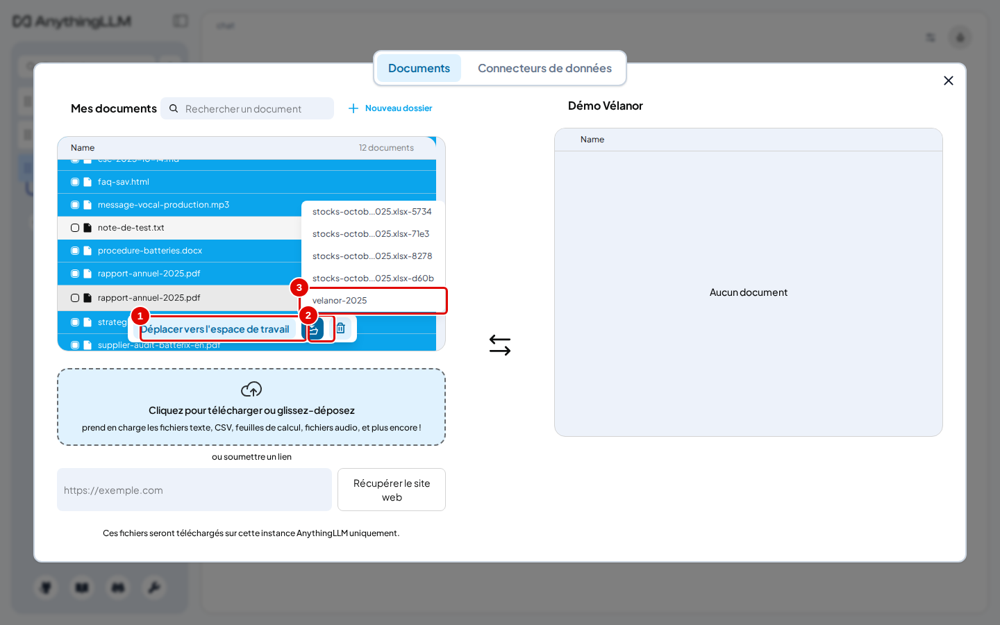
*Écran : fenêtre des documents, fichiers cochés et liste des dossiers (la liste montre aussi des dossiers laissés par des essais précédents).*

| N° | Élément | Rôle |
|---|---|---|
| 1 | « Déplacer vers l'espace de travail » | (étape 5) place la sélection dans l'espace |
| 2 | icône de dossier | ouvre la liste des dossiers de destination |
| 3 | `velanor-2025` | dossier choisi |

*Résultat* : le message « 8 documents déplacés avec succès. » s'affiche ; le dossier `velanor-2025` contient les fichiers. La corbeille, à droite, supprime la sélection (étape 12).

## Placer un dossier entier dans l'espace

**Étape 5. Cocher les dossiers**
*Où* : fenêtre des documents, « Mes documents ».
Cocher la case à gauche de `velanor-2025` (pastille 1) et celle du dossier du classeur (pastille 2), puis cliquer sur « Déplacer vers l'espace de travail » (pastille 3).

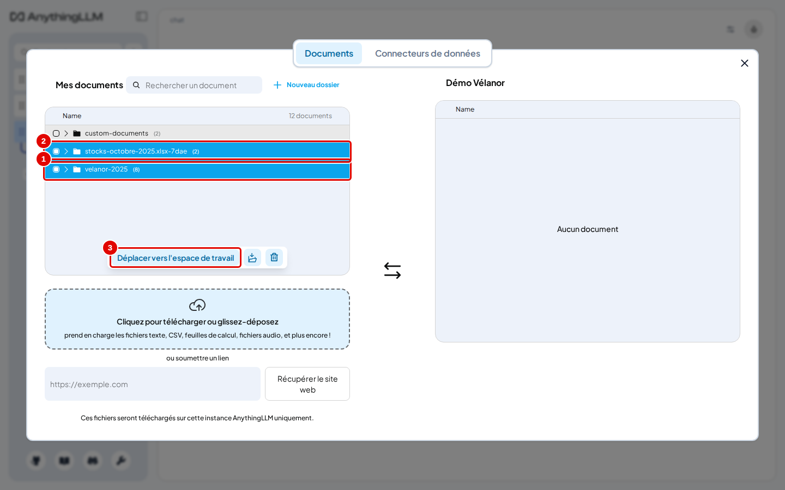
*Écran : fenêtre des documents, deux dossiers cochés.*

| N° | Élément | Rôle |
|---|---|---|
| 1 | `velanor-2025` coché | sélectionne tous ses fichiers |
| 2 | dossier du classeur coché | sélectionne les feuilles du classeur |
| 3 | « Déplacer vers l'espace de travail » | place la sélection dans l'espace, en attente |

*Résultat* : les documents passent dans la colonne « Démo Vélanor ». Cliquer sur une ligne de dossier (et non sur sa case) l'ouvre ou le ferme sans le sélectionner.

**Étape 6. Lancer l'intégration**
*Où* : fenêtre des documents, colonne « Démo Vélanor ».
Cliquer sur « Sauvegarder et intégrer » (pastille 2).

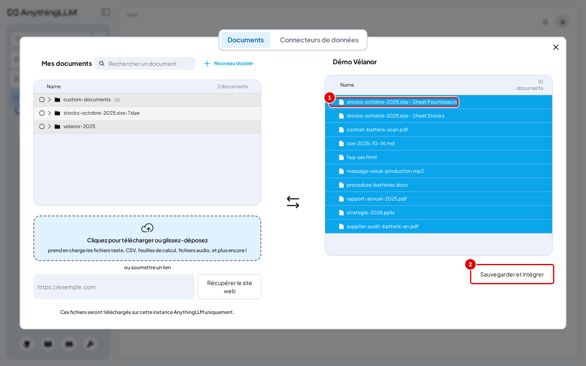
*Écran : fenêtre des documents, documents en attente d'intégration.*

| N° | Élément | Rôle |
|---|---|---|
| 1 | documents en attente | placés dans l'espace, pas encore intégrés |
| 2 | « Sauvegarder et intégrer » | lance le découpage et le calcul des représentations |

*Résultat* : une barre de progression s'affiche.

**Étape 7. Vérifier le contenu de l'espace**
*Où* : fenêtre des documents, colonne « Démo Vélanor ».

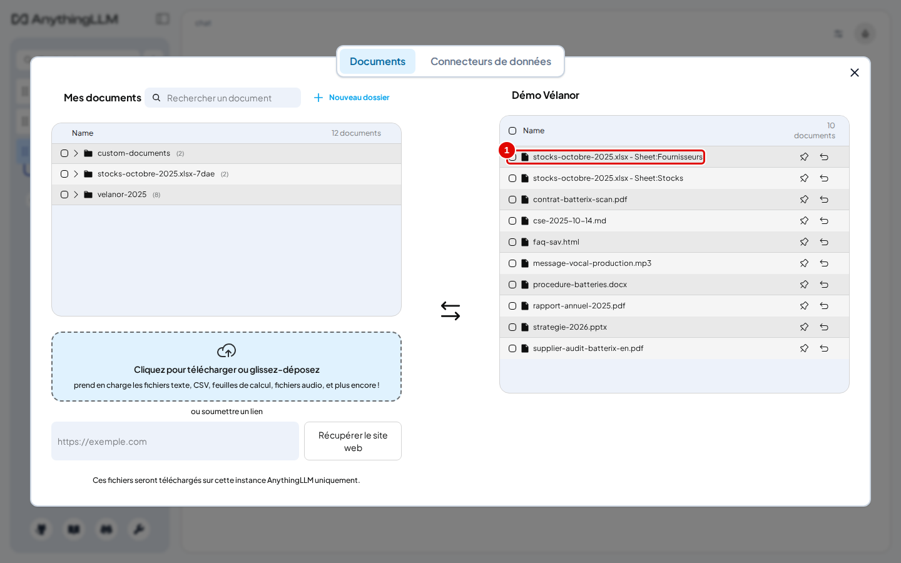
*Écran : fenêtre des documents, intégration terminée.*

| N° | Élément | Rôle |
|---|---|---|
| 1 | première ligne de l'espace | une feuille du classeur, intégrée comme un document à part |

*Résultat* : l'en-tête indique « 10 documents » (8 fichiers et 2 feuilles du classeur). Les 9 fichiers du corpus s'intègrent en quelques secondes avec `embed`. Chaque ligne porte deux icônes : l'épingle et la flèche de retrait.

## Épingler un document

**Étape 8. Cliquer sur l'épingle**
*Où* : fenêtre des documents, colonne « Démo Vélanor », ligne `procedure-batteries.docx`.
Cliquer sur l'épingle (pastille 2).

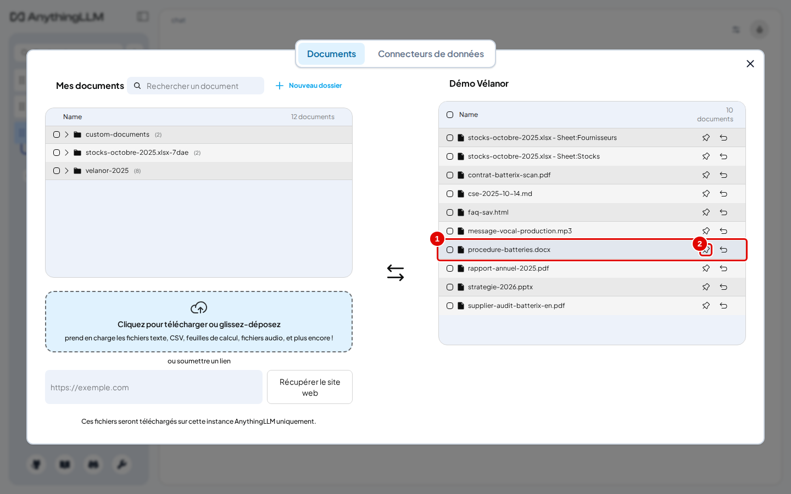
*Écran : fenêtre des documents, ligne de la procédure.*

| N° | Élément | Rôle |
|---|---|---|
| 1 | `procedure-batteries.docx` | document à épingler |
| 2 | épingle (« Pin to workspace ») | épingle ou désépingle le document |

*Résultat* : la première fois, une fenêtre explique l'épinglage.

**Étape 9. Lire l'explication**
*Où* : fenêtre « Qu'est-ce que l'épinglage de documents ? ».
Lire, puis cliquer sur « J'ai compris » (pastille 1).

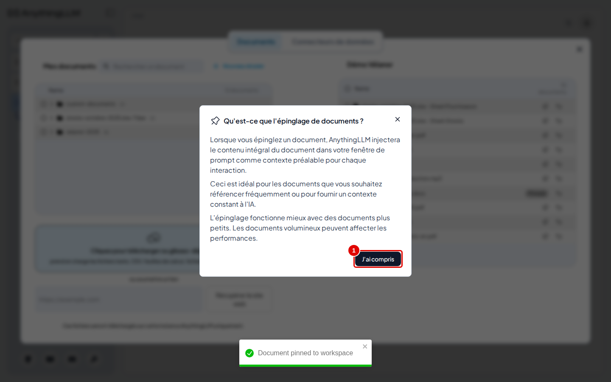
*Écran : fenêtre d'explication de l'épinglage.*

| N° | Élément | Rôle |
|---|---|---|
| 1 | « J'ai compris » | ferme l'explication ; elle ne s'affiche qu'une fois |

*Résultat* : la fenêtre se ferme ; le message « Document pinned to workspace » s'affiche.

**Étape 10. Vérifier l'épinglage**
*Où* : fenêtre des documents, colonne « Démo Vélanor ».

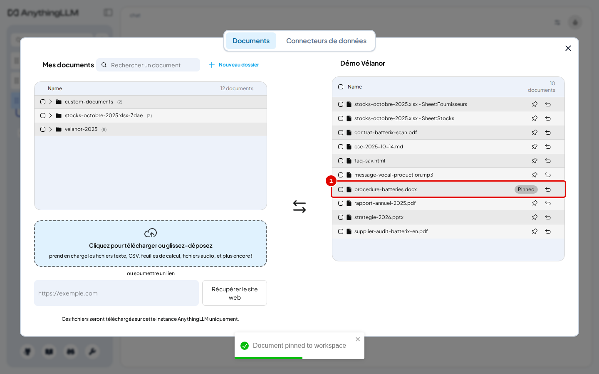
*Écran : fenêtre des documents, procédure épinglée.*

| N° | Élément | Rôle |
|---|---|---|
| 1 | ligne épinglée | le badge « Pinned » remplace l'épingle ; la ligne passe en tête à la réouverture de la fenêtre |

*Résultat* : la procédure sera lue en entier à chaque question de cet espace. Cliquer de nouveau sur le badge la désépingle.

## Retirer un document d'un espace

**Étape 11. Retirer le document**
*Où* : fenêtre des documents, colonne de l'espace, ligne du document. Pour l'exemple, `note-de-test.txt` (envoyée à l'étape 3) a d'abord été placée dans l'espace comme aux étapes 5 et 6.
Cliquer sur la flèche de retrait (pastille 2).

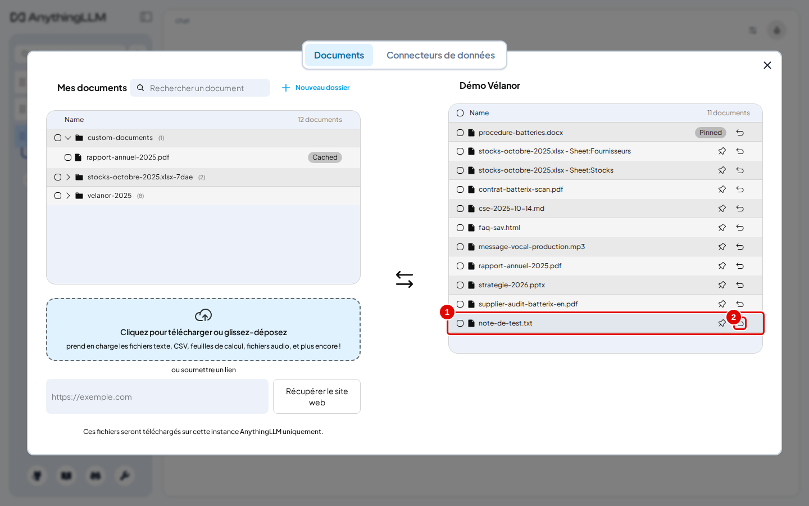
*Écran : fenêtre des documents, ligne de la note de test.*

| N° | Élément | Rôle |
|---|---|---|
| 1 | `note-de-test.txt` | document à retirer |
| 2 | flèche de retrait (« Remove document from workspace ») | retire le document de cet espace seulement |

*Résultat* : la ligne disparaît de l'espace ; le fichier reste dans « Mes documents » et dans les autres espaces.

## Supprimer un fichier

**Étape 12. Supprimer le fichier**
*Où* : fenêtre des documents, « Mes documents ».
Cocher le fichier (pastille 1), cliquer sur la corbeille (pastille 2), puis confirmer dans la fenêtre du navigateur.

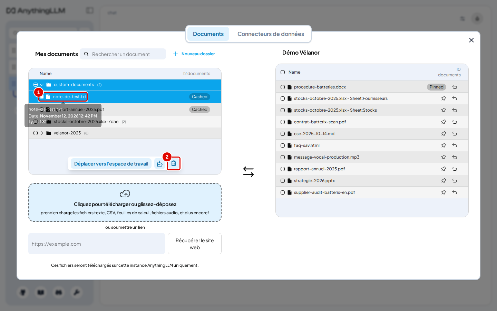
*Écran : fenêtre des documents, fichier coché et corbeille.*

| N° | Élément | Rôle |
|---|---|---|
| 1 | `note-de-test.txt` coché | fichier à supprimer |
| 2 | corbeille | supprime définitivement la sélection |

*Résultat* : le fichier disparaît de « Mes documents » et de tous les espaces.

## Retrouver un fichier

**Étape 13. Rechercher par nom**
*Où* : fenêtre des documents, champ « Rechercher un document ».
Taper une partie du nom, par exemple `stocks` (pastille 1).

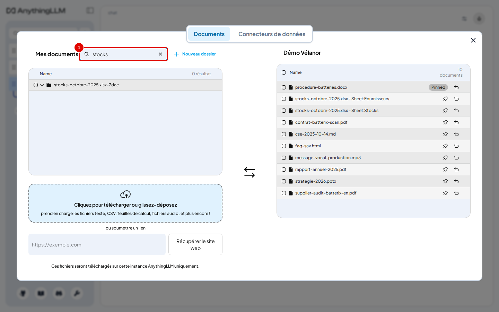
*Écran : fenêtre des documents, recherche en cours.*

| N° | Élément | Rôle |
|---|---|---|
| 1 | « Rechercher un document » | filtre « Mes documents » sur le nom des fichiers |

*Résultat* : seuls les fichiers dont le nom contient le texte restent affichés ; la recherche porte sur les noms de fichiers, pas sur leur contenu.

## Bon à savoir

- Le badge « Cached » (visible à l'étape 12 sur la capture) signale un fichier dont les représentations sont déjà calculées : le placer dans un autre espace est immédiat.
- Un PDF scanné est lu par reconnaissance de caractères, en anglais par défaut : sur un scan en français, des mots peuvent être mal lus (annexe A5).
- Un fichier audio est transcrit à l'envoi par `transcribe` ; le texte obtenu sert ensuite comme celui d'un document.
- Épingler plusieurs gros documents remplit vite la place disponible pour le modèle et ralentit les réponses.

## En cas de problème

| Symptôme | Cause | Que faire |
|---|---|---|
| « Déplacer vers l'espace de travail » ne fait rien | fichiers envoyés dans la fenêtre encore ouverte | fermer et rouvrir la fenêtre |
| Le classeur Excel n'apparaît pas dans `custom-documents` | chaque classeur a son propre dossier | ouvrir le dossier `nom-du-classeur.xlsx-…` |
| Un fichier reste en erreur à l'envoi | format non pris en charge ou fichier protégé | voir le [chapitre 15](15-en-cas-de-probleme.md) |

---
*Version décrite : AnythingLLM 1.19.0, essais du 12 novembre 2026. Détails et preuves : [rapport d'essais](../annexes/A6-rapport-d-essais.md).*
