# 06. Poser des questions et lire les sources

> Ce chapitre apprend à poser des questions dans un espace, à lire la réflexion du modèle et les sources, à reprendre une réponse, à reconnaître une question sans réponse, à organiser ses conversations en fils, à créer une commande abrégée et à exporter une conversation.
> **Point de départ** : espace « Démo Vélanor » ouvert, en mode « Requête » (chapitre 04, étapes 9 et 10, appliquées à cet espace).
> **Durée** : environ 15 minutes. **Avant** : chapitres 04 et 05.

## Ce qu'il faut savoir

Le mode de l'espace décide de la façon de répondre :

| Mode | Ce qui se passe | Quand l'utiliser |
|---|---|---|
| « Requête » | réponse tirée des seuls passages retrouvés ; sans passage, la réponse de refus de l'espace s'affiche | questions précises sur les documents |
| « Chat » | réponse à partir des passages et des connaissances générales du modèle, avec l'historique de la conversation | discussion plus libre autour des documents |
| « Agent » | le modèle choisit lui-même ses outils (recherche dans les documents, site web, serveurs MCP) | tâches en plusieurs étapes (chapitre 10) |

Chaque conversation d'un espace est un **fil** (« Thread ») : il garde son propre historique. À l'ouverture de l'espace, un fil vide « *New Thread » est prêt ; il prend le nom de sa première question. « New Thread » en crée un autre, utile pour séparer des sujets.

Les captures de ce chapitre et des suivants montrent dans la barre latérale des espaces et des fils créés pendant les essais (« Banc-bge-m3 », « Thread »…) : les ignorer.

Le modèle `chat` **réfléchit** avant de répondre : la réflexion s'affiche repliée au-dessus de la réponse.

## Poser une question

**Étape 1. Envoyer une question**
*Où* : espace « Démo Vélanor », zone de saisie.
Taper `Combien de vélos Vélanor a-t-elle produits en 2025, et dans quelle usine ?` puis Entrée. Pendant la réflexion, « Thinking... » s'affiche et la flèche d'envoi devient un carré qui arrête la génération.

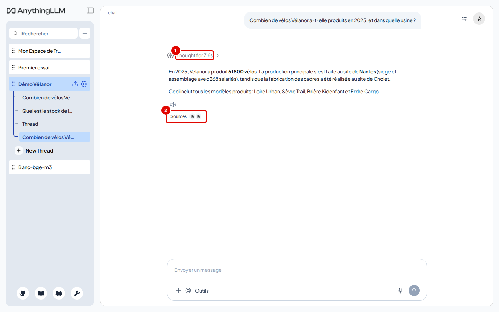
*Écran : espace « Démo Vélanor », réponse à la question sur la production.*

| N° | Élément | Rôle |
|---|---|---|
| 1 | « Thought for … » | réflexion du modèle, repliée, avec sa durée |
| 2 | « Sources » | documents utilisés pour la réponse |

*Résultat* : la réponse arrive en quelques secondes : « Vélanor a produit 61 800 vélos en 2025 », avec la répartition par site. Sous la réponse, une ligne indique le modèle, la durée et la vitesse (par exemple « chat · 6.4s »).

**Étape 2. Lire la réflexion**
*Où* : au-dessus de la réponse.
Cliquer sur « Thought for … » (après rechargement de la page, ce libellé devient « Réflexions »).

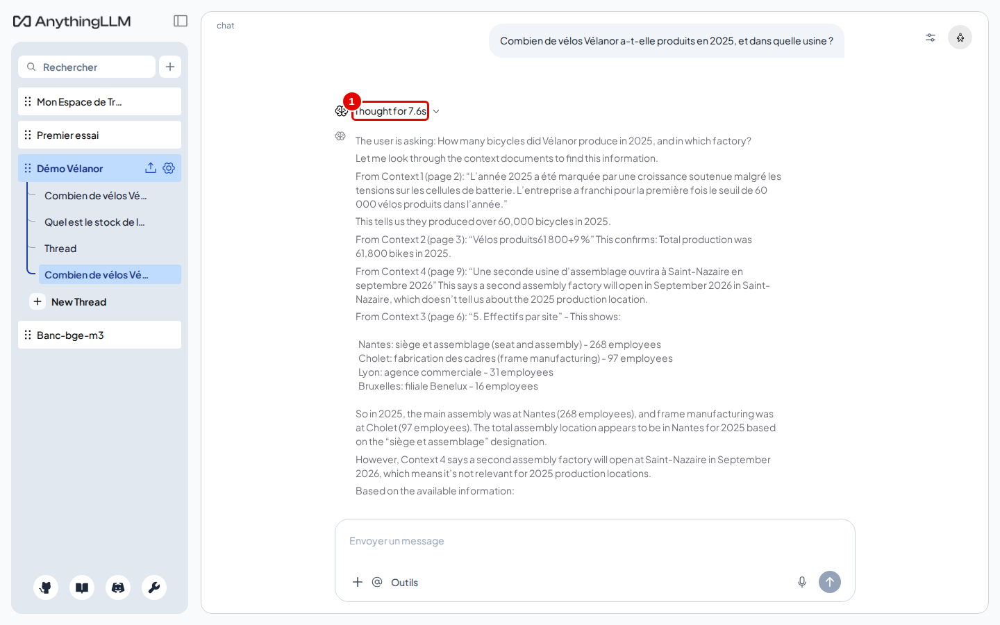
*Écran : espace « Démo Vélanor », réflexion dépliée.*

| N° | Élément | Rôle |
|---|---|---|
| 1 | réflexion dépliée | raisonnement du modèle avant sa réponse, en anglais le plus souvent |

*Résultat* : le raisonnement s'affiche. Il aide à comprendre une réponse surprenante ; un nouveau clic le replie.

**Étape 3. Ouvrir les sources**
*Où* : sous la réponse.
Cliquer sur « Sources ».

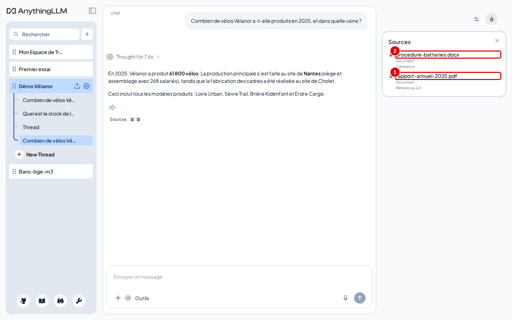
*Écran : espace « Démo Vélanor », panneau « Sources ».*

| N° | Élément | Rôle |
|---|---|---|
| 1 | `rapport-annuel-2025.pdf` | document dont viennent des passages retrouvés |
| 2 | `procedure-batteries.docx` | document épinglé (chapitre 05), lu à chaque question |

*Résultat* : un clic sur un document ouvre ses passages, comme au chapitre 04, étape 14.

## Reprendre une réponse

**Étape 4. Utiliser les actions de la réponse**
*Où* : survoler la réponse.

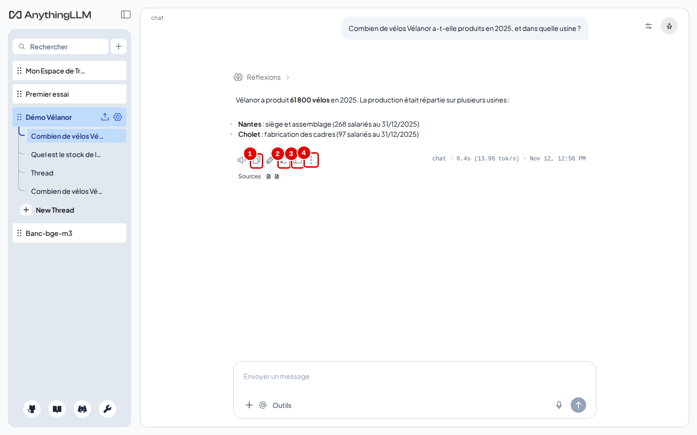
*Écran : espace « Démo Vélanor », actions sous la réponse.*

| N° | Élément | Rôle |
|---|---|---|
| 1 | « Copier » | copie la réponse dans le presse-papiers ; le crayon à sa droite modifie la réponse |
| 2 | « Régénérer » | redemande une réponse à la même question |
| 3 | « Bonne réponse » | marque la réponse comme bonne (pouce) |
| 4 | « Plus d'actions » | ouvre d'autres actions |

*Résultat* : l'icône de haut-parleur, à gauche, lit la réponse à voix haute (voix du navigateur, chapitre 08).

**Étape 5. Dupliquer ou supprimer**
*Où* : « Plus d'actions ».

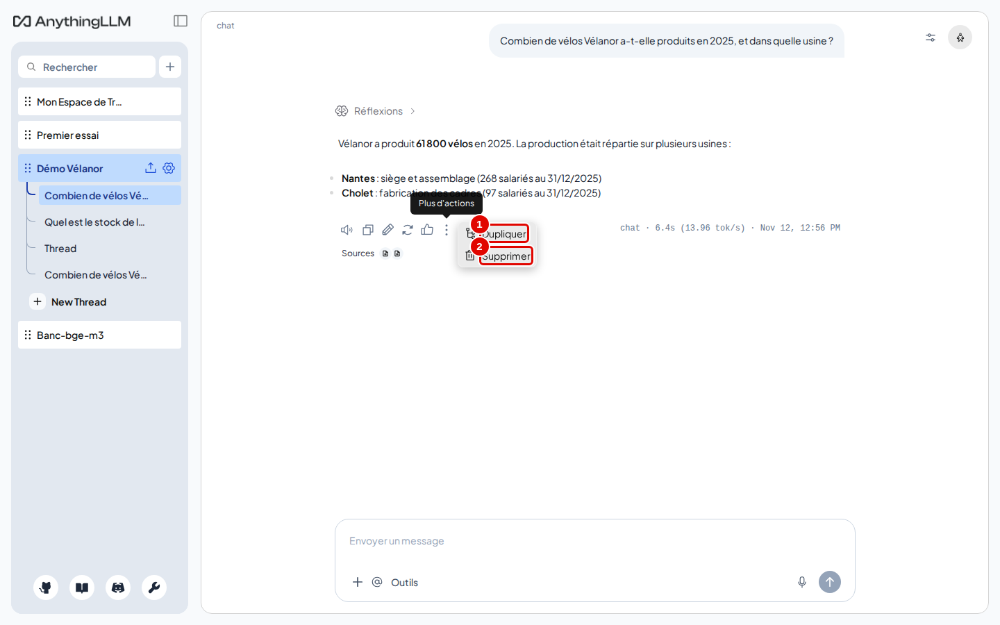
*Écran : menu « Plus d'actions ».*

| N° | Élément | Rôle |
|---|---|---|
| 1 | « Dupliquer » | crée un nouveau fil qui reprend la conversation jusqu'à ce message |
| 2 | « Supprimer » | supprime l'échange |

*Résultat* : « Dupliquer » permet d'essayer une autre suite sans perdre la conversation d'origine.

## Reconnaître une question sans réponse

**Étape 6. Poser une question hors des documents**
*Où* : espace « Démo Vélanor », mode « Requête ».
Taper `Quel est le cours de l'action Vélanor en bourse ?` puis Entrée.

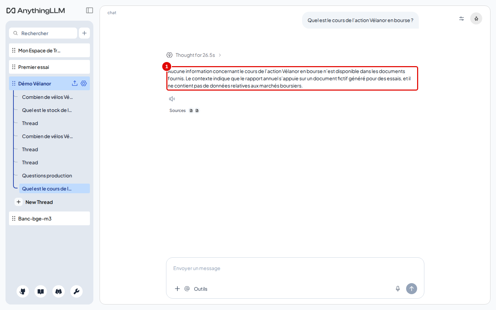
*Écran : espace « Démo Vélanor », question sans réponse dans les documents.*

| N° | Élément | Rôle |
|---|---|---|
| 1 | question posée | aucun document ne parle de la bourse |

*Résultat* : la réponse indique qu'aucune information sur le cours de l'action n'est disponible dans les documents. Quand des passages vaguement proches existent, le modèle répond lui-même qu'il ne sait pas ; quand aucun passage ne dépasse le seuil, c'est la réponse de refus réglée au chapitre 07 qui s'affiche.

**Étape 7. Comparer avec le mode « Chat »**
*Où* : réglages de l'espace › « Paramètres du chat » › « Chat », puis même question.

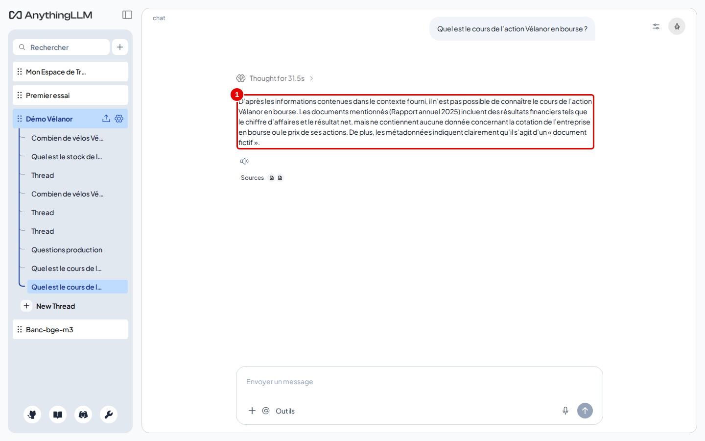
*Écran : espace « Démo Vélanor », même question en mode « Chat ».*

| N° | Élément | Rôle |
|---|---|---|
| 1 | même question | posée en mode « Chat » |

*Résultat* : ici aussi le modèle dit ne pas connaître le cours de l'action. En mode « Chat », il peut toutefois compléter avec ses connaissances générales, sans source. **Remettre ensuite l'espace en mode « Requête »** (même onglet, bouton « Requête ») : les chapitres suivants le supposent.

## Organiser ses conversations en fils

**Étape 8. Créer un fil**
*Où* : barre latérale, sous l'espace ouvert.
Cliquer sur « New Thread » (pastille 2).

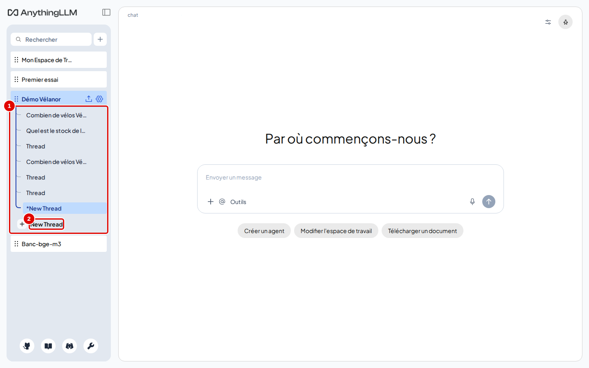
*Écran : barre latérale, fils de « Démo Vélanor ».*

| N° | Élément | Rôle |
|---|---|---|
| 1 | fils de l'espace | une ligne par conversation, nommée d'après sa première question |
| 2 | « New Thread » | crée une conversation vide |

*Résultat* : un nouveau fil s'ouvre, sans historique.

**Étape 9. Renommer ou supprimer un fil**
*Où* : barre latérale, survol d'un fil › trois points (« Thread options »).

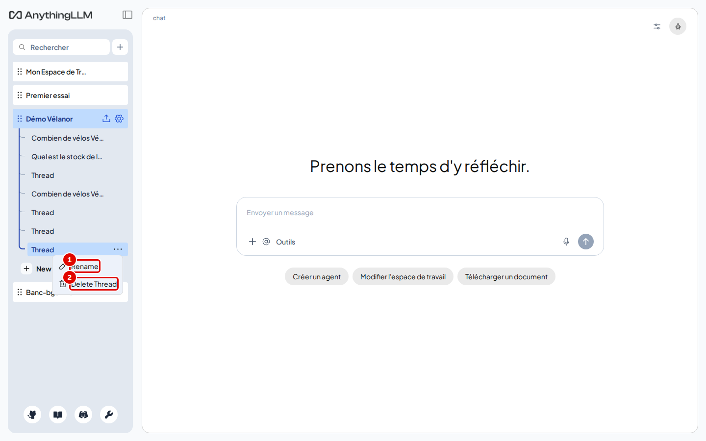
*Écran : menu d'un fil.*

| N° | Élément | Rôle |
|---|---|---|
| 1 | « Rename » | renomme le fil (une fenêtre du navigateur demande le nouveau nom) |
| 2 | « Delete Thread » | supprime le fil et ses messages |

Pour renommer : cliquer sur « Rename », taper le nouveau nom dans la fenêtre du navigateur, puis OK.

*Résultat* : le fil renommé (ici « Questions production ») apparaît sous son nouveau nom. Ctrl+clic sur plusieurs fils permet de les supprimer ensemble.

## Créer une commande abrégée

**Étape 10. Ouvrir les outils**
*Où* : zone de saisie › « Outils » (ou taper `/`).

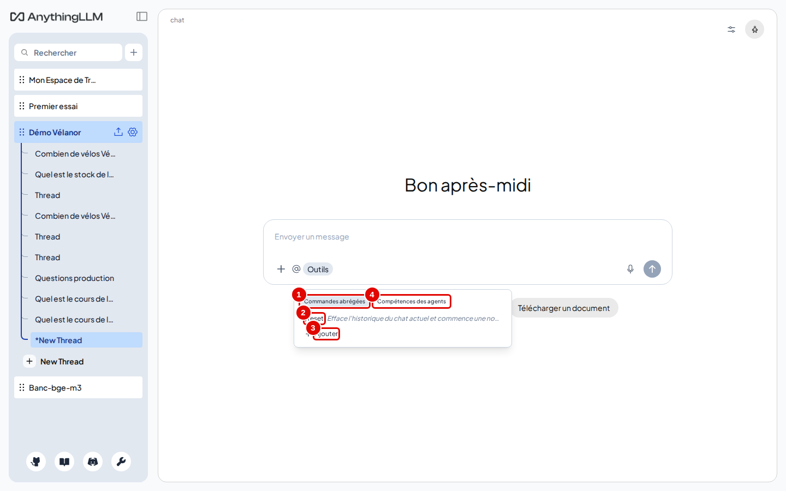
*Écran : menu « Outils », onglet « Commandes abrégées ».*

| N° | Élément | Rôle |
|---|---|---|
| 1 | « Commandes abrégées » | consignes enregistrées, appelées par `/nom` |
| 2 | `/reset` | efface l'historique du fil et repart de zéro |
| 3 | « Ajouter » | crée une commande |
| 4 | « Compétences des agents » | outils de l'agent (chapitre 10) |

*Résultat* : la liste des commandes s'affiche.

**Étape 11. Enregistrer une commande**
*Où* : fenêtre « Ajouter une nouvelle commande preset ».
Remplir la commande `resume`, la consigne `Résume en trois points les documents de cet espace.` et une description, puis « Sauvegarder ».

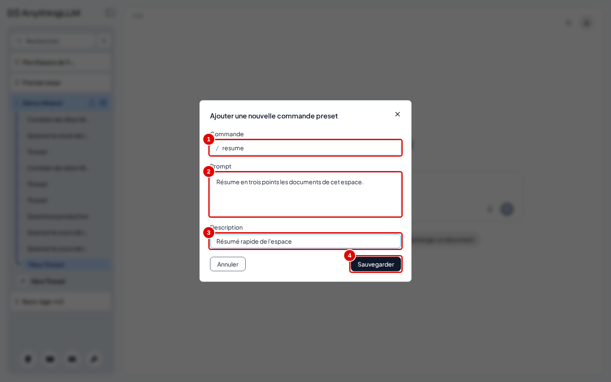
*Écran : fenêtre « Ajouter une nouvelle commande preset ».*

| N° | Élément | Rôle |
|---|---|---|
| 1 | commande | nom à taper après `/` |
| 2 | prompt | texte envoyé à la place de la commande |
| 3 | description | aide affichée dans la liste |
| 4 | « Sauvegarder » | enregistre la commande |

*Résultat* : taper `/resume` dans la zone de saisie envoie la consigne enregistrée.

## Exporter une conversation

**Étape 12. Ouvrir le menu de la discussion**
*Où* : en haut à droite de la zone de discussion, icône de réglages (pastille 1).

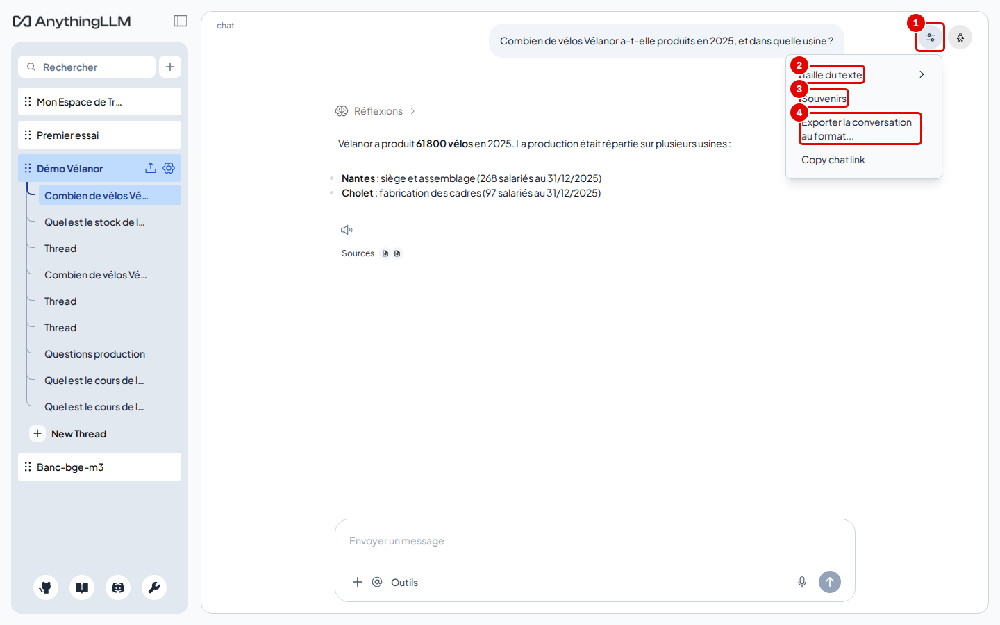
*Écran : menu des réglages de la discussion.*

| N° | Élément | Rôle |
|---|---|---|
| 1 | icône de réglages | ouvre le menu de la discussion |
| 2 | « Taille du texte » | Petit, Normal, Grand |
| 3 | « Souvenirs » | panneau des souvenirs (chapitre 11) |
| 4 | « Exporter la conversation au format... » | télécharge le fil ouvert |

*Résultat* : le survol de « Exporter la conversation au format... » ouvre la liste des formats.

**Étape 13. Choisir le format**
*Où* : sous-menu d'export.

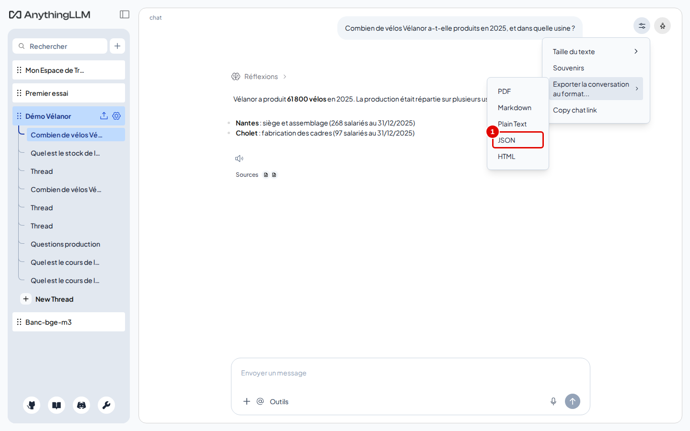
*Écran : formats d'export d'une conversation.*

| N° | Élément | Rôle |
|---|---|---|
| 1 | formats proposés | PDF, Markdown, Plain Text, JSON, HTML |

*Résultat* : cliquer sur un format, par exemple PDF pour le lire ou Markdown pour le retravailler ; le fichier est téléchargé par le navigateur. Dans le premier menu, « Copy chat link » copie un lien vers le fil. La réflexion du modèle est retirée de l'export.

## Bon à savoir

- L'historique (20 messages par défaut) est relu à chaque question : une très longue conversation ralentit les réponses ; `/reset` ou un nouveau fil repart de zéro.
- La réflexion du modèle est renvoyée avec l'historique : elle prend de la place dans la mémoire de la conversation.
- Dans un espace en mode « Agent », la réponse s'est affichée vide dans les essais alors que l'agent avait bien travaillé : préférer « Requête » ou « Chat », et lancer l'agent à la demande avec `@agent` (chapitre 10).

## En cas de problème

| Symptôme | Cause | Que faire |
|---|---|---|
| « Thinking... » dure plus d'une minute | question de calcul ou longue réflexion | patienter, ou arrêter avec le carré et reformuler |
| Réponse vide | mode « Agent » | passer en « Requête » ou « Chat » |
| Le refus s'affiche en anglais | réponse de refus non traduite | chapitre 07, étape 3 |

---
*Version décrite : AnythingLLM 1.19.0, essais du 12 novembre 2026. Détails et preuves : [rapport d'essais](../annexes/A6-rapport-d-essais.md).*
