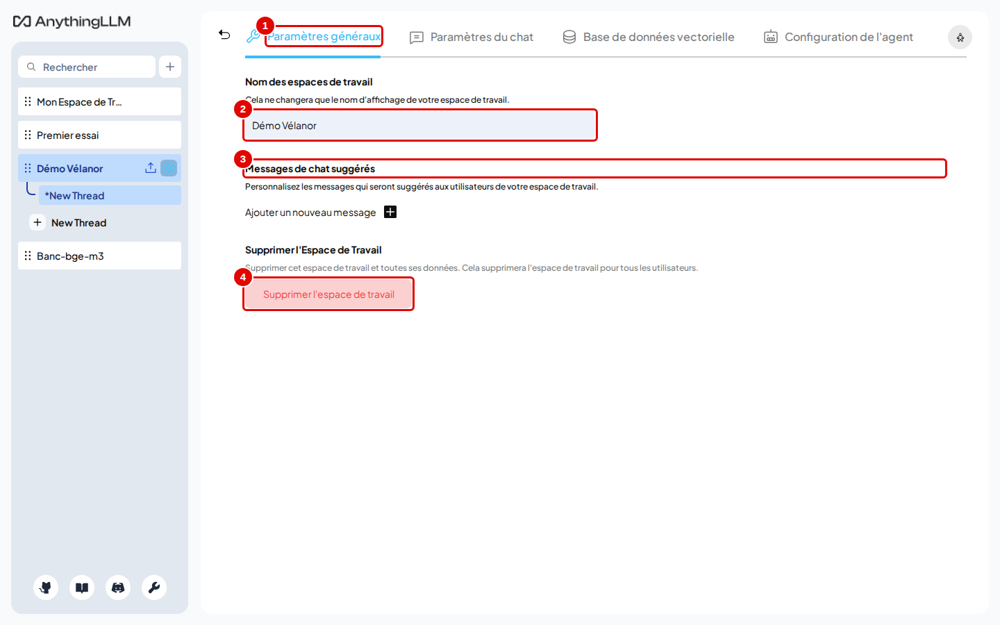
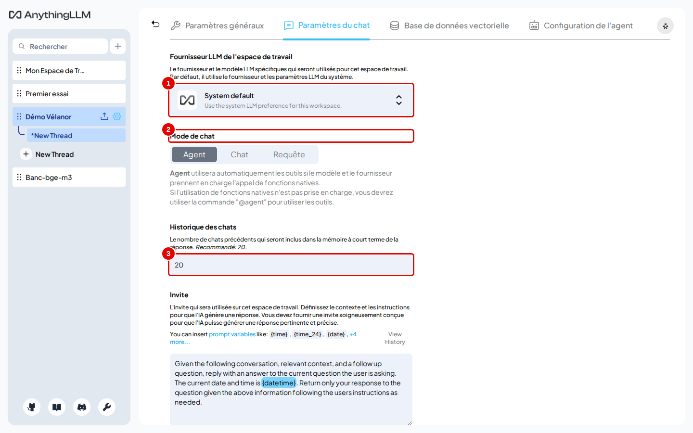
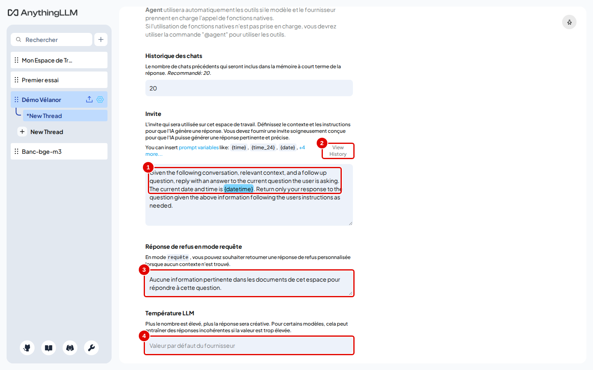
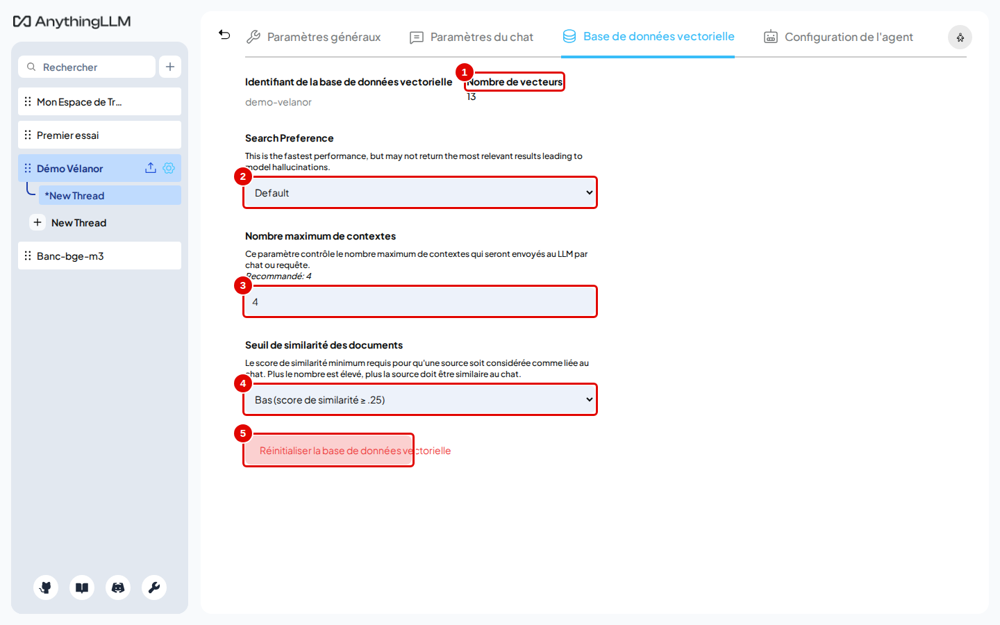
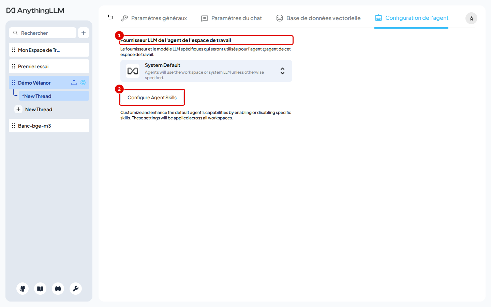

# 07. Régler un espace de travail

> Ce chapitre apprend à régler un espace de travail : son nom, les questions suggérées, le mode, la consigne donnée au modèle, la réponse de refus, la température, le nombre de passages lus, le seuil de similarité et le tri de précision.
> **Point de départ** : réglages de l'espace « Démo Vélanor » (barre latérale › survol de la ligne › roue dentée, comme au chapitre 04, étape 9).
> **Durée** : environ 10 minutes. **Avant** : chapitres 04 et 05.

**Attention** : deux actions sont définitives. « Supprimer l'espace de travail » efface l'espace et ses conversations. « Réinitialiser la base de données vectorielle » efface les passages de l'espace, qu'il faut intégrer de nouveau. Dans les deux cas, les fichiers restent dans « Mes documents ».

## Ce qu'il faut savoir

Chaque espace a ses propres réglages ; ils ne touchent pas les autres espaces. Ils se rangent en quatre onglets : « Paramètres généraux », « Paramètres du chat », « Base de données vectorielle » et « Configuration de l'agent » (plus « Membres » quand l'instance a plusieurs comptes, chapitre 13).

**Il n'y a pas de bouton « Enregistrer »** : un champ texte est enregistré quand on clique ailleurs, une liste ou un bouton dès qu'on le change. Une coche « Enregistré » s'affiche deux secondes à côté du titre du réglage.

Les réglages qui changent le plus la qualité des réponses sont dans l'onglet « Base de données vectorielle » : le nombre de passages donnés au modèle et le tri de précision. Les réglages conseillés sont donnés dans « Bon à savoir ».

## Paramètres généraux

**Étape 1. Lire les paramètres généraux**
*Où* : réglages de l'espace › « Paramètres généraux » (onglet ouvert par défaut).

*Écran : réglages de l'espace « Démo Vélanor », onglet « Paramètres généraux ».*

| N° | Élément | Rôle |
|---|---|---|
| 1 | « Paramètres généraux » | onglet actif |
| 2 | « Nom des espaces de travail » | renomme l'espace (l'adresse de l'espace ne change pas) |
| 3 | « Messages de chat suggérés » | jusqu'à 4 questions proposées en boutons sur l'écran vide de l'espace |
| 4 | « Supprimer l'espace de travail » | supprime l'espace et ses conversations, après confirmation |

*Résultat* : modifier le nom puis cliquer ailleurs l'enregistre.

## Paramètres du chat

**Étape 2. Choisir le modèle, le mode et l'historique**
*Où* : réglages de l'espace › « Paramètres du chat ».

*Écran : onglet « Paramètres du chat », haut de la page.*

| N° | Élément | Rôle |
|---|---|---|
| 1 | « Fournisseur LLM de l'espace de travail » | « System default » utilise le modèle de l'instance ; un autre fournisseur ou modèle peut être choisi pour cet espace seulement |
| 2 | « Mode de chat » | « Agent », « Chat » ou « Requête » (chapitre 04, étape 10) |
| 3 | « Historique des chats » | nombre de messages précédents relus à chaque question (20 par défaut) |

*Résultat* : chaque changement est enregistré aussitôt. Un historique plus court accélère les réponses dans une longue conversation ; `0` fait traiter chaque question isolément.

**Étape 3. Régler la consigne, le refus et la température**
*Où* : même onglet, faire défiler vers le bas.
Dans « Réponse de refus en mode requête » (pastille 3), remplacer le texte anglais par `Aucune information pertinente dans les documents de cet espace pour répondre à cette question.`, puis cliquer ailleurs.

*Écran : onglet « Paramètres du chat », bas de la page.*

| N° | Élément | Rôle |
|---|---|---|
| 1 | « Invite » | consigne donnée au modèle avant chaque question ; des variables comme `{date}` sont remplacées à l'envoi |
| 2 | « View History » | anciennes versions de la consigne, pour revenir en arrière |
| 3 | « Réponse de refus en mode requête » | texte renvoyé tel quel, sans appeler le modèle, quand aucun passage n'est trouvé |
| 4 | « Température LLM » | vide = valeur du modèle ; plus la valeur est haute, plus les réponses varient |

*Résultat* : en mode « Requête », une question sans réponse dans les documents renvoie désormais le texte en français. La consigne par défaut est en anglais ; elle peut être réécrite en français, par exemple pour demander des réponses courtes qui citent le document.

## Base de données vectorielle

**Étape 4. Régler la recherche des passages**
*Où* : réglages de l'espace › « Base de données vectorielle ».

*Écran : onglet « Base de données vectorielle ».*

| N° | Élément | Rôle |
|---|---|---|
| 1 | « Nombre de vecteurs » | nombre de passages enregistrés pour cet espace |
| 2 | « Search Preference » | « Default » ou « Accuracy Optimized » (tri de précision par un petit modèle intégré) |
| 3 | « Nombre maximum de contextes » | nombre de passages donnés au modèle à chaque question (4 par défaut) |
| 4 | « Seuil de similarité des documents » | « Aucune restriction », « Bas (score de similarité ≥ .25) » (défaut), « Moyen (≥ .50) », « Élevé (≥ .75) » |
| 5 | « Réinitialiser la base de données vectorielle » | efface les passages de l'espace ; les documents devront être intégrés de nouveau |

Pour l'espace « Démo Vélanor », choisir « Accuracy Optimized » dans « Search Preference » (pastille 2) et taper `8` dans « Nombre maximum de contextes » (pastille 3), puis cliquer ailleurs.

*Résultat* : les changements s'appliquent dès la question suivante, sans nouvelle intégration.

## Configuration de l'agent

**Étape 5. Choisir le modèle de l'agent**
*Où* : réglages de l'espace › « Configuration de l'agent ».

*Écran : onglet « Configuration de l'agent ».*

| N° | Élément | Rôle |
|---|---|---|
| 1 | « Fournisseur LLM de l'agent de l'espace de travail » | modèle utilisé par l'agent de cet espace ; « System Default » reprend celui de l'instance |
| 2 | « Configure Agent Skills » | ouvre la liste des compétences de l'agent (chapitre 10) |

Pour ce manuel, laisser « System Default » : l'agent utilise alors `chat`, comme le reste de l'instance.

*Résultat* : un autre choix ne change que le modèle de l'agent de cet espace.

## Bon à savoir

Effet mesuré sur les 34 questions avec réponse du banc d'essai (détail en annexe A1) :

- passer de l'embedder intégré à `embed` est le réglage qui compte le plus : 33 bonnes réponses sur 34 au lieu de 25 ;
- le tri de précision (« Accuracy Optimized ») ou 8 passages au lieu de 4 donnent 34 sur 34 et refusent correctement les 4 questions sans réponse ; 2 passages seulement font perdre deux réponses ;
- les bons passages observés dans les essais avaient une similarité de 60 à 65 % (chapitre 04, étape 14) : un seuil « Élevé » (75 %) les aurait écartés ; garder « Bas ».

Pour un espace destiné à des questions précises sur des documents, les réglages conseillés sont : mode « Requête », réponse de refus en français, seuil « Bas », 4 à 8 passages.

## En cas de problème

| Symptôme | Cause | Que faire |
|---|---|---|
| La coche « Enregistré » n'apparaît pas | le champ n'a pas perdu le focus | cliquer en dehors du champ |
| Réponse de refus alors que l'information existe | seuil trop haut ou trop peu de passages | seuil « Bas », 6 à 8 passages ; voir le [chapitre 15](15-en-cas-de-probleme.md) |
| « Accuracy Optimized » absent | la base vectorielle n'est pas LanceDB | ce réglage n'existe qu'avec LanceDB (base par défaut) |

---
*Version décrite : AnythingLLM 1.19.0, essais du 12 novembre 2026. Détails et preuves : [rapport d'essais](../annexes/A6-rapport-d-essais.md).*
