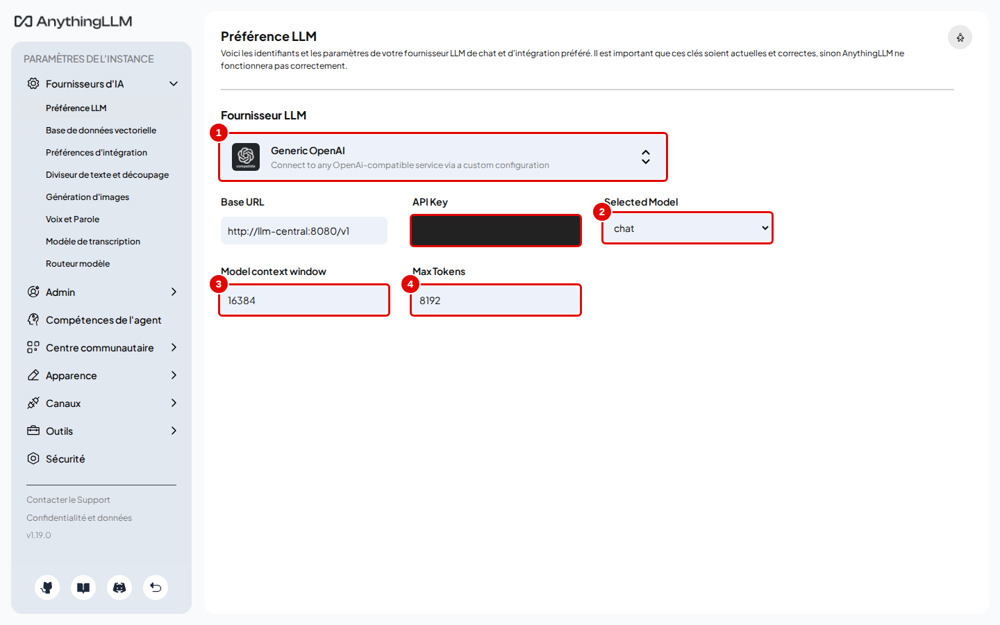
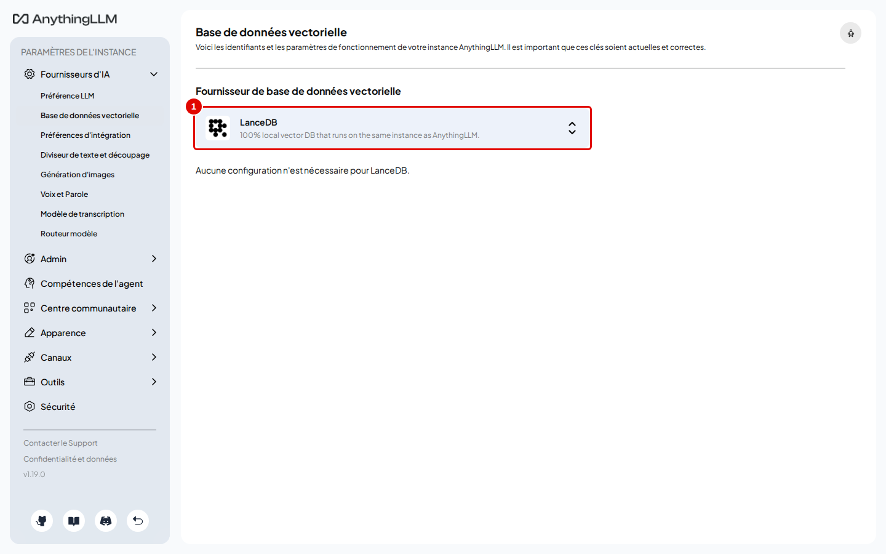
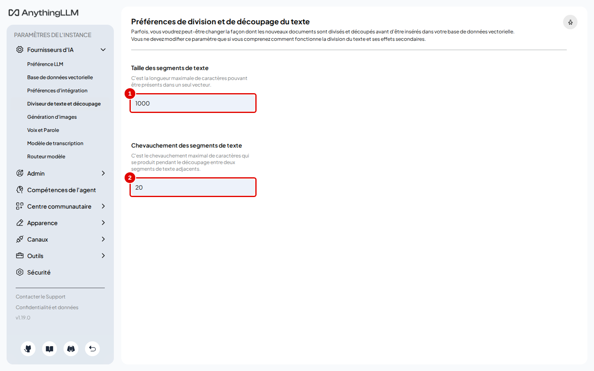
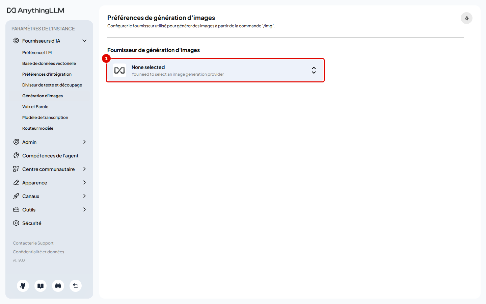
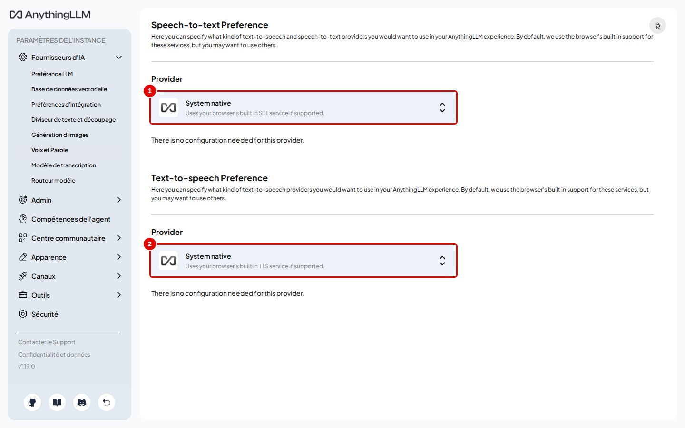
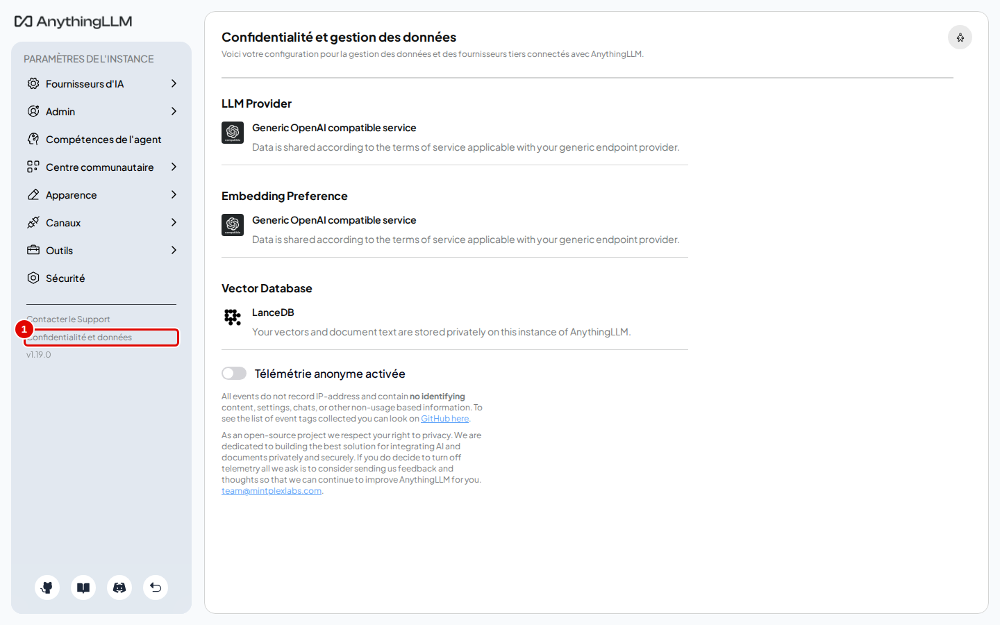
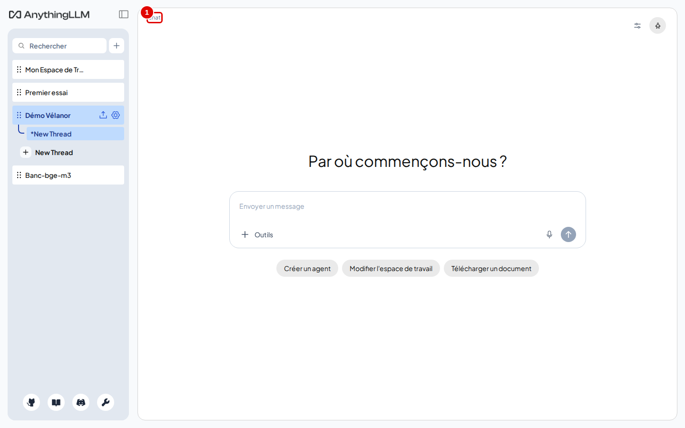
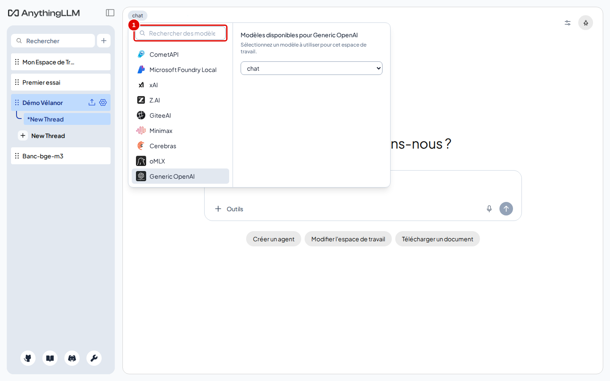

# 08. Choisir les modèles et la lecture des documents

> Ce chapitre fait le tour des réglages de l'instance qui concernent les modèles et la lecture des documents : modèle de réponse, base vectorielle, découpage des textes, génération d'images, voix, confidentialité, et choix d'un autre modèle pour un seul espace.
> **Point de départ** : écran principal, clé en bas de la barre latérale › « Paramètres de l'instance ».
> **Durée** : environ 10 minutes. **Avant** : chapitre 03.

**Attention** : changer le modèle d'embedding impose d'intégrer de nouveau tous les documents (changer le découpage, lui, ne vaut que pour les documents intégrés ensuite, étape 3) : le changement retire les documents de tous les espaces (ils restent dans « Mes documents ») ; les replacer et les intégrer comme au chapitre 05, étapes 5 et 6.

## Ce qu'il faut savoir

Les réglages de l'instance valent pour tous les espaces. Ils sont rangés dans le menu « Paramètres de l'instance », groupe « Fournisseurs d'IA » : « Préférence LLM », « Base de données vectorielle », « Préférences d'intégration », « Diviseur de texte et découpage », « Génération d'images », « Voix et Parole », « Modèle de transcription », « Routeur modèle ». Le chapitre 03 a déjà déclaré le modèle de réponse, l'embedding et la transcription ; le routeur de modèles est au chapitre 11.

Sur ces pages, le bouton d'enregistrement (« Enregistrer les modifications » ou « Save changes ») n'apparaît qu'après une modification.

## Modèle de réponse

**Étape 1. Revoir la préférence LLM**
*Où* : Paramètres de l'instance › Fournisseurs d'IA › « Préférence LLM ».

*Écran : « Préférence LLM », fournisseur Generic OpenAI.*

| N° | Élément | Rôle |
|---|---|---|
| 1 | carte du fournisseur | « Generic OpenAI » ; un clic ouvre la liste des fournisseurs (une quarantaine, dont des services en ligne payants) |
| 2 | « Selected Model » | modèle de réponse ; liste lue sur le service (`chat`, `gemma-4-e4b`…) |
| 3 | « Model context window » | taille de contexte du modèle (16384) |
| 4 | « Max Tokens » | plafond de la réponse, réflexion comprise (8192) |

*Résultat* : un changement de modèle ici s'applique à tous les espaces réglés sur « System default ». Ne choisir que les noms stables du service (`chat`) ; les autres noms de la liste (`qwen3.5-4b`…) peuvent changer.

## Base vectorielle

**Étape 2. Voir la base vectorielle**
*Où* : Paramètres de l'instance › Fournisseurs d'IA › « Base de données vectorielle ».

*Écran : « Base de données vectorielle ».*

| N° | Élément | Rôle |
|---|---|---|
| 1 | carte « LanceDB » | base intégrée, rangée dans le dossier de données de l'application |

*Résultat* : rien à changer. Les autres bases (PGVector, Chroma, Qdrant, Milvus, Weaviate, Pinecone…) demandent un serveur séparé ; changer de base fait perdre les passages déjà intégrés. Le tri de précision « Accuracy Optimized » n'existe qu'avec LanceDB.

## Découpage des textes

**Étape 3. Voir le découpage**
*Où* : Paramètres de l'instance › Fournisseurs d'IA › « Diviseur de texte et découpage ».

*Écran : « Préférences de division et de découpage du texte ».*

| N° | Élément | Rôle |
|---|---|---|
| 1 | « Taille des segments de texte » | longueur maximale d'un passage, en caractères ; ne peut pas dépasser la limite déclarée pour l'embedding (1 000 ici, rappelée sous le champ) |
| 2 | « Chevauchement des segments de texte » | nombre de caractères repris d'un passage au suivant (20 par défaut) |

*Résultat* : un changement ne vaut que pour les documents intégrés ensuite. Pour des passages plus longs, relever d'abord « Max embedding chunk length » dans « Préférences d'intégration » (chapitre 03, étape 14).

## Génération d'images

**Étape 4. Voir la génération d'images**
*Où* : Paramètres de l'instance › Fournisseurs d'IA › « Génération d'images ».

*Écran : « Préférences de génération d'images ».*

| N° | Élément | Rôle |
|---|---|---|
| 1 | carte du fournisseur | « None selected » : aucun générateur d'images |

*Résultat* : la commande `/img` du chat reste inactive. Le service de modèles du poste ne génère pas d'images ; les fournisseurs proposés (OpenAI, Gemini, OpenRouter…) sont en ligne et payants, ou demandent un autre serveur (Ollama, LocalAI).

## Voix

**Étape 5. Voir la dictée et la lecture à voix haute**
*Où* : Paramètres de l'instance › Fournisseurs d'IA › « Voix et Parole ».

*Écran : « Voix et Parole » (page en anglais).*

| N° | Élément | Rôle |
|---|---|---|
| 1 | « Speech-to-text Preference » | dictée de la question au micro ; « System native » utilise la reconnaissance vocale du navigateur |
| 2 | « Text-to-speech Preference » | lecture des réponses à voix haute ; « System native » utilise la voix du navigateur, « PiperTTS » une voix calculée dans le navigateur |

*Résultat* : avec « System native », rien n'est installé : le micro de la zone de saisie et le haut-parleur sous chaque réponse utilisent le navigateur. Ne pas confondre avec la transcription des fichiers audio envoyés, réglée au chapitre 03.

## Confidentialité

**Étape 6. Vérifier ce qui sort du poste**
*Où* : Paramètres de l'instance › lien « Confidentialité et données » en bas du menu.

*Écran : « Confidentialité et gestion des données ».*

| N° | Élément | Rôle |
|---|---|---|
| 1 | « Confidentialité et données » | résume où vont les questions, les textes et les vecteurs |

*Résultat* : les trois cartes indiquent le service de modèles du poste pour les réponses et l'embedding, et LanceDB pour les vecteurs. L'interrupteur « Télémétrie anonyme activée » est sur arrêt : l'installation l'a coupé avant le premier démarrage (chapitre 02). Le couper ici, après coup, enverrait d'abord un dernier événement à l'éditeur.

## Choisir un autre modèle pour un espace

**Étape 7. Ouvrir le sélecteur de modèle**
*Où* : espace « Démo Vélanor », en haut à gauche de la zone de discussion.
Cliquer sur le nom du modèle (pastille 1).

*Écran : espace « Démo Vélanor », zone de discussion vide.*

| N° | Élément | Rôle |
|---|---|---|
| 1 | nom du modèle (`chat`) | ouvre le sélecteur de modèle de l'espace (raccourci Ctrl+Maj+L) |

*Résultat* : le sélecteur s'ouvre.

**Étape 8. Choisir le modèle**
*Où* : sélecteur de modèle.
Pour voir les choix sans rien changer : le fournisseur à gauche (ici « Generic OpenAI »), le modèle dans la liste de droite (`chat`). Pour garder les résultats des chapitres suivants, laisser `chat` et fermer le sélecteur avec Échap ; changer de modèle se fait en choisissant un autre nom dans la liste de droite.

*Écran : sélecteur de modèle de l'espace.*

| N° | Élément | Rôle |
|---|---|---|
| 1 | « Rechercher des modèles » | filtre les fournisseurs |

*Résultat* : l'espace utilise le modèle choisi ; les autres espaces gardent le leur. Sur le poste d'essai, `gemma-4-e4b` est proposé par le service : il se charge à la demande, ce qui prend quelques secondes à la première question. Contrairement à `chat`, ce nom n'est pas garanti stable : le vérifier dans la liste avant de s'en servir. Le même choix se fait dans les réglages de l'espace, onglet « Paramètres du chat » (chapitre 07).

## Bon à savoir

- Le service de modèles est partagé : un modèle chargé à la demande prend de la mémoire de la carte graphique (environ 5 Go pour `gemma-4-e4b`).
- Les pages « Voix et Parole » et les champs des fournisseurs restent en anglais.

## En cas de problème

| Symptôme | Cause | Que faire |
|---|---|---|
| La liste « Selected Model » est vide | service injoignable ou clé refusée | vérifier l'adresse et la clé ; voir le [chapitre 15](15-en-cas-de-probleme.md) |
| La taille des passages refuse une valeur | elle dépasse la limite de l'embedding | relever « Max embedding chunk length » d'abord |

---
*Version décrite : AnythingLLM 1.19.0, essais du 12 novembre 2026. Détails et preuves : [rapport d'essais](../annexes/A6-rapport-d-essais.md).*
