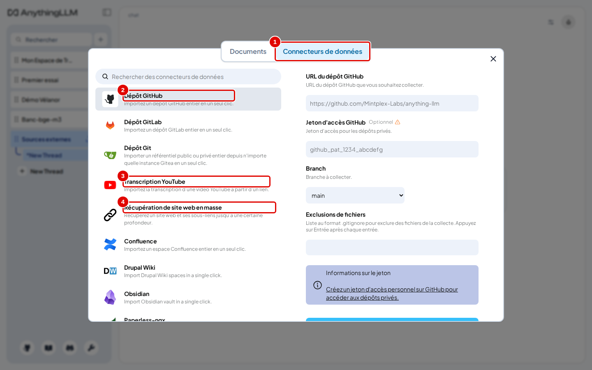
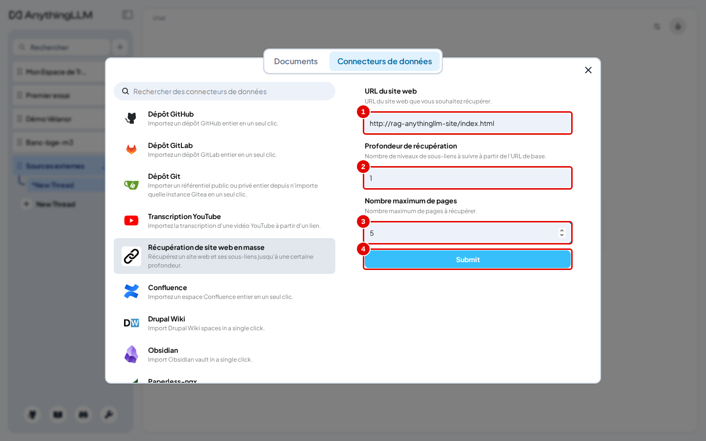
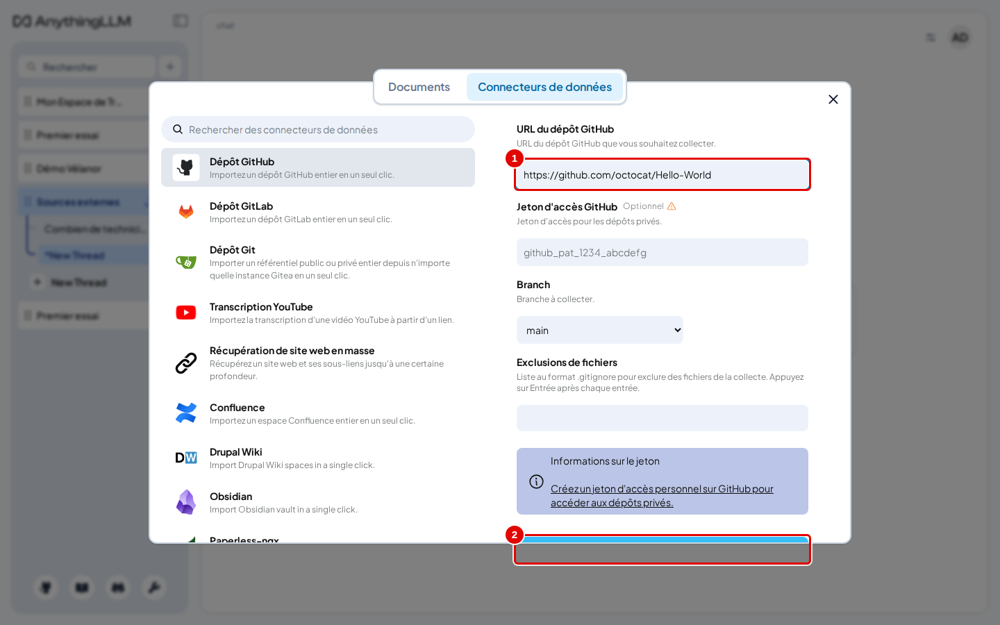
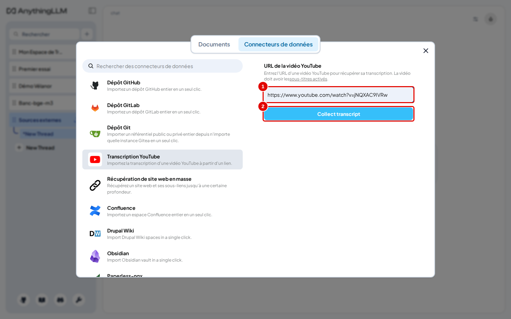
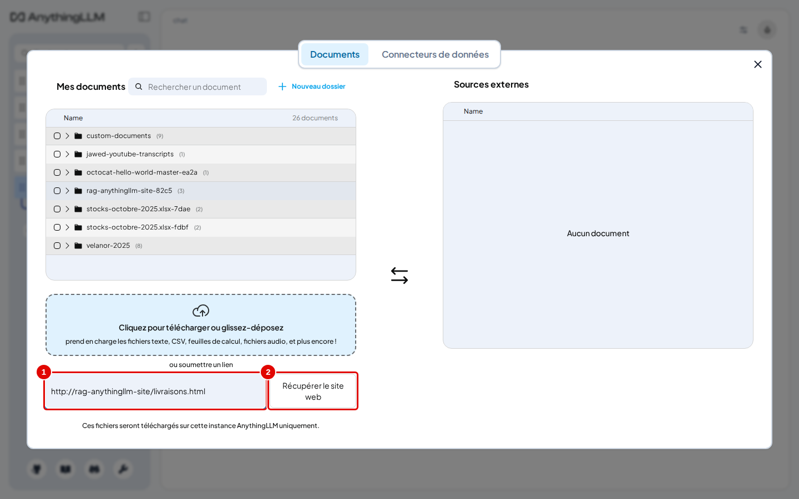
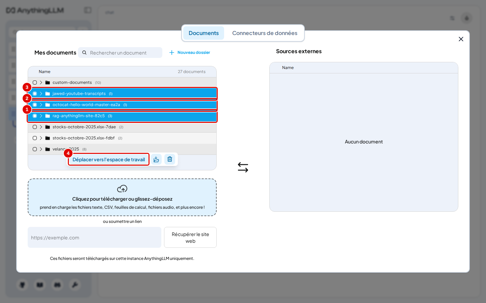
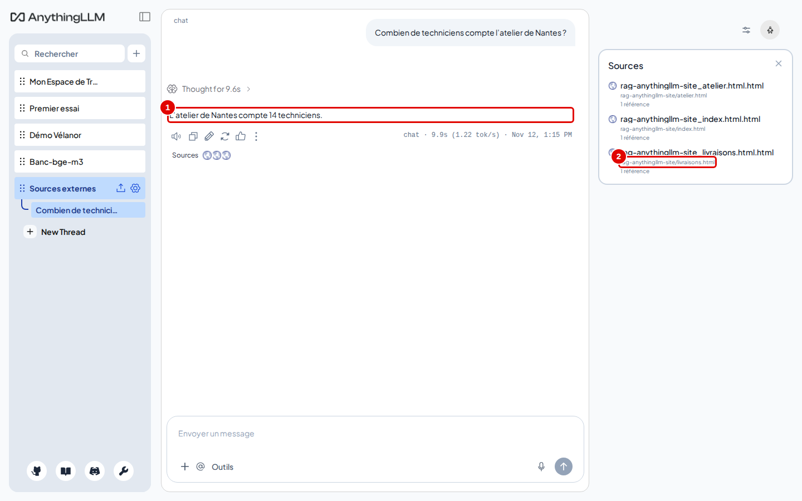

# 09. Sources externes

> Ce chapitre apprend à importer des documents qui ne sont pas des fichiers : les pages d'un site web, un dépôt GitHub public, la transcription d'une vidéo YouTube, une page web isolée ; puis à les intégrer à un espace et à les interroger.
> **Point de départ** : un espace « Sources externes » créé comme au chapitre 04 (étapes 1 et 2), fenêtre des documents ouverte (flèche vers le haut de l'espace).
> **Durée** : environ 15 minutes. **Avant** : chapitre 05.

**Attention** : ces imports demandent l'accès à Internet (sauf pour un site du réseau local) et envoient l'adresse demandée au site concerné. Les documents importés restent ensuite sur le poste.

## Ce qu'il faut savoir

L'onglet « Connecteurs de données » de la fenêtre des documents propose des **connecteurs** : chacun va chercher un contenu à une adresse et le range dans « Mes documents », dans un dossier à son nom. Ensuite, tout se passe comme pour un fichier : placer le dossier dans l'espace, intégrer, interroger (chapitre 05).

| Connecteur | Ce qu'il importe | Compte nécessaire |
|---|---|---|
| « Dépôt GitHub », « Dépôt GitLab », « Dépôt Git » (Gitea) | les fichiers d'un dépôt de code | non pour un dépôt public ; un jeton d'accès pour un dépôt privé |
| « Transcription YouTube » | les sous-titres d'une vidéo | non ; la vidéo doit avoir des sous-titres |
| « Récupération de site web en masse » | une page et les pages liées, jusqu'à une profondeur donnée | non |
| Confluence, Drupal Wiki, Obsidian, Paperless-ngx | un espace documentaire, un coffre de notes, une gestion électronique de documents | oui, celui du service |

Pour l'exemple, un petit site fictif de trois pages tourne sur le poste, à l'adresse `http://rag-anythingllm-site/` du réseau Docker (étape 0).

## Démarrer le site de test

**Étape 0. Lancer le site fictif**
*Où* : terminal Ubuntu, dossier du dépôt.

```bash
outils/anythingllm/essais/site.sh start
```

*Résultat* : `site de test : http://rag-anythingllm-site/ (réseau rag-local)`. Ce site n'est visible que d'AnythingLLM (même réseau Docker), pas du navigateur Windows ; `outils/anythingllm/essais/site.sh stop` l'arrête. Pour un vrai site, utiliser directement son adresse.

## Voir les connecteurs

**Étape 1. Ouvrir l'onglet des connecteurs**
*Où* : fenêtre des documents de l'espace « Sources externes » › onglet « Connecteurs de données » (pastille 1).


*Écran : fenêtre des documents, onglet « Connecteurs de données ».*

| N° | Élément | Rôle |
|---|---|---|
| 1 | « Connecteurs de données » | onglet des imports |
| 2 | « Dépôt GitHub » | import d'un dépôt GitHub |
| 3 | « Transcription YouTube » | import des sous-titres d'une vidéo |
| 4 | « Récupération de site web en masse » | import d'un site, page par page |

*Résultat* : un clic sur un connecteur affiche son formulaire à droite.

## Importer un site web

**Étape 2. Récupérer le site**
*Où* : « Récupération de site web en masse ».
Remplir « URL du site web » (pastille 1) avec `http://rag-anythingllm-site/index.html`, « Profondeur de récupération » (pastille 2) avec `1`, « Nombre maximum de pages » (pastille 3) avec `5`, puis cliquer sur « Submit » (pastille 4).


*Écran : formulaire « Récupération de site web en masse ».*

| N° | Élément | Rôle |
|---|---|---|
| 1 | « URL du site web » | page de départ |
| 2 | « Profondeur de récupération » | nombre de niveaux de liens suivis à partir de cette page |
| 3 | « Nombre maximum de pages » | plafond de pages récupérées |
| 4 | « Submit » | lance la récupération |

*Résultat* : le message « Successfully scraped 3 pages! » s'affiche ; les trois pages sont dans le dossier `rag-anythingllm-site-…`.

## Importer un dépôt GitHub public

**Étape 3. Collecter le dépôt**
*Où* : « Dépôt GitHub ».
Remplir « URL du dépôt GitHub » (pastille 1) avec `https://github.com/octocat/Hello-World` et laisser « Jeton d'accès GitHub » vide. La liste « Branch » se remplit avec les branches du dépôt ; choisir `master`, la branche principale de ce dépôt (la capture, prise avant le chargement de la liste, affiche encore `main`). Faire défiler le formulaire jusqu'en bas et cliquer sur « Submit » (pastille 2, caché sous le bord de la capture).


*Écran : formulaire « Dépôt GitHub ».*

| N° | Élément | Rôle |
|---|---|---|
| 1 | « URL du dépôt GitHub » | adresse du dépôt public |
| 2 | « Submit » | lance la collecte |

*Résultat* : après saisie de l'adresse, la liste « Branch » propose les branches du dépôt ; après envoi, le message « 1 file collected from octocat/Hello-World:master » s'affiche. « Exclusions de fichiers » écarte des fichiers au format `.gitignore`.

## Importer une vidéo YouTube

**Étape 4. Récupérer la transcription**
*Où* : « Transcription YouTube ».
Coller l'adresse d'une vidéo sous-titrée dans « URL de la vidéo YouTube » (pastille 1), ici `https://www.youtube.com/watch?v=jNQXAC9IVRw`, puis cliquer sur « Collect transcript » (pastille 2).


*Écran : formulaire « Transcription YouTube ».*

| N° | Élément | Rôle |
|---|---|---|
| 1 | « URL de la vidéo YouTube » | adresse de la vidéo |
| 2 | « Collect transcript » | récupère les sous-titres |

*Résultat* : le message « Me at the zoo by jawed transcription completed. » s'affiche ; seuls les sous-titres sont importés, pas l'image ni le son.

## Importer une seule page

**Étape 5. Soumettre un lien**
*Où* : onglet « Documents », sous la zone d'envoi.
Coller l'adresse dans « ou soumettre un lien » (pastille 1), ici `http://rag-anythingllm-site/livraisons.html`, puis cliquer sur « Récupérer le site web » (pastille 2).


*Écran : fenêtre des documents, champ de lien.*

| N° | Élément | Rôle |
|---|---|---|
| 1 | « ou soumettre un lien » | adresse d'une page web |
| 2 | « Récupérer le site web » | récupère cette seule page |

*Résultat* : la page arrive dans `custom-documents` sous un nom tiré de son adresse.

## Intégrer et interroger les sources

**Étape 6. Placer les dossiers dans l'espace**
*Où* : onglet « Documents », « Mes documents ».
Fermer puis rouvrir la fenêtre (chapitre 04, étape 5). Cocher les dossiers du site, du dépôt et de la vidéo (pastilles 1 à 3) ; la page `livraisons.html` importée seule à l'étape 5 est dans `custom-documents` et peut être cochée aussi. Cliquer sur « Déplacer vers l'espace de travail » (pastille 4), puis sur « Sauvegarder et intégrer ».


*Écran : fenêtre des documents, dossiers des sources importées cochés.*

| N° | Élément | Rôle |
|---|---|---|
| 1 | `rag-anythingllm-site-…` | les trois pages du site |
| 2 | `octocat-hello-world-master-…` | le fichier du dépôt |
| 3 | `jawed-youtube-transcripts` | la transcription |
| 4 | « Déplacer vers l'espace de travail » | place la sélection dans l'espace |

*Résultat* : la colonne de l'espace liste les documents importés et le bouton « Sauvegarder et intégrer » disparaît : l'intégration est terminée (comme au chapitre 05, étape 7). Pendant l'intégration, chaque ligne peut afficher un état ; « Complete » signifie que le document est prêt.

**Étape 7. Poser une question sur le site**
*Où* : espace « Sources externes ». Cet espace vient d'être créé : il est en mode « Agent ». Le passer d'abord en mode « Requête » (roue dentée › « Paramètres du chat » › « Requête », chapitre 04, étapes 9 et 10), puis revenir à la discussion.
Demander `Combien de techniciens compte l'atelier de Nantes ?` puis ouvrir « Sources ».


*Écran : espace « Sources externes », réponse et sources.*

| N° | Élément | Rôle |
|---|---|---|
| 1 | réponse | « L'atelier de Nantes compte 14 techniciens. » |
| 2 | source | page du site, avec son adresse d'origine |

*Résultat* : pour une source web, le panneau « Sources » affiche l'adresse de la page ; un clic ouvre les passages utilisés.

## Bon à savoir

- Un document importé du web peut être tenu à jour automatiquement avec la fonction expérimentale « Live Document Sync » (chapitre 12, étape 14).
- Le connecteur de site web utilise un navigateur intégré au conteneur, qui demande une permission particulière du conteneur (`SYS_ADMIN`, réglée par l'installation ; annexe A5).

## En cas de problème

| Symptôme | Cause | Que faire |
|---|---|---|
| Un site renvoie 0 page | adresse injoignable depuis le conteneur, ou site qui bloque les robots | vérifier l'adresse ; `127.0.0.1` désigne le conteneur lui-même, pas le poste |
| « La vidéo doit avoir les sous-titres activés » | vidéo sans sous-titres | choisir une vidéo sous-titrée, ou télécharger l'audio et l'envoyer comme fichier (transcrit par `transcribe`) |
| Dépôt GitHub refusé | dépôt privé | renseigner un jeton d'accès GitHub (« Jeton d'accès pour les dépôts privés ») |

---
*Version décrite : AnythingLLM 1.19.0, essais du 12 novembre 2026. Détails et preuves : [rapport d'essais](../annexes/A6-rapport-d-essais.md).*
