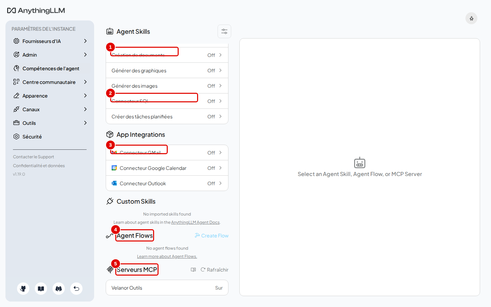
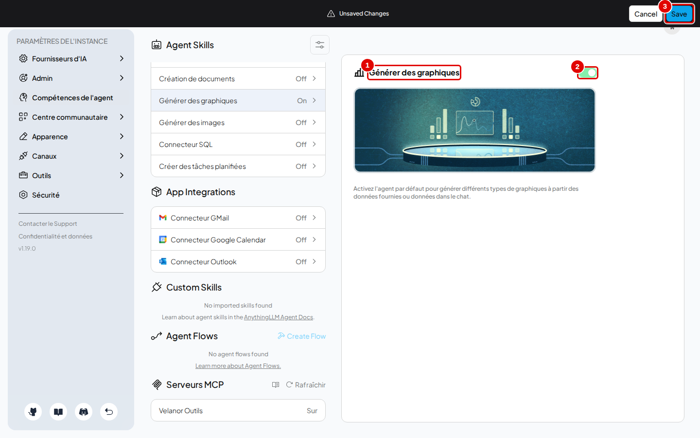
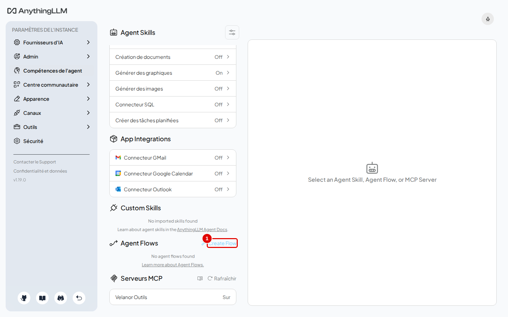
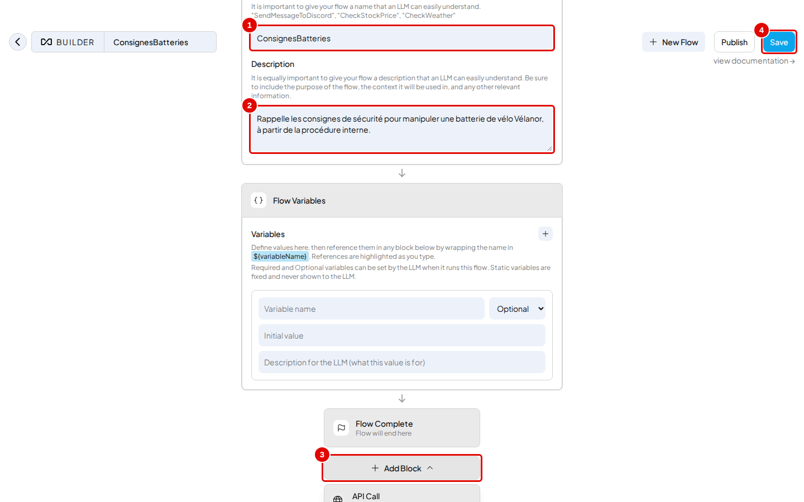
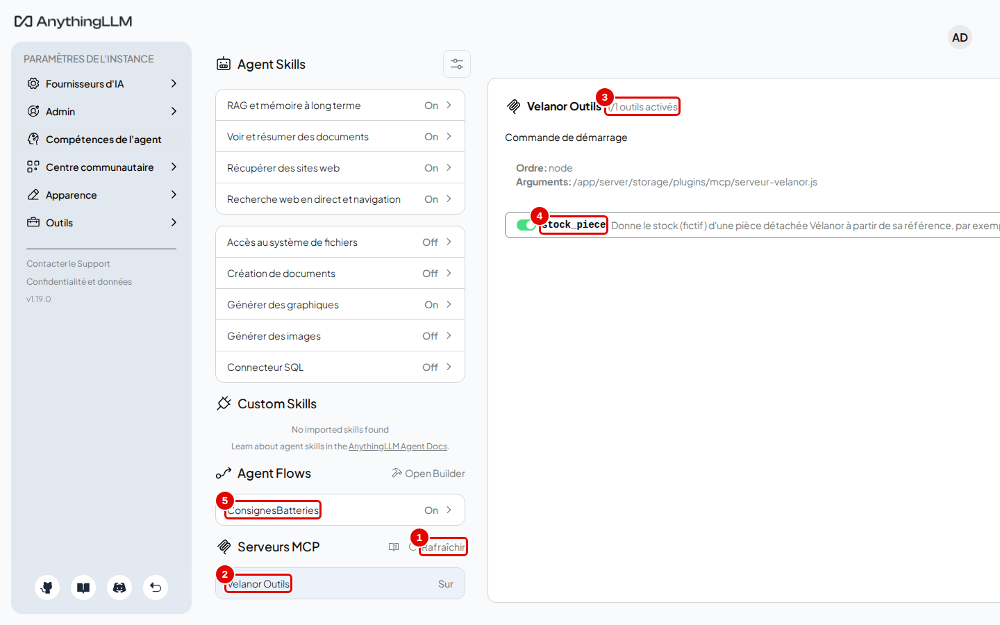
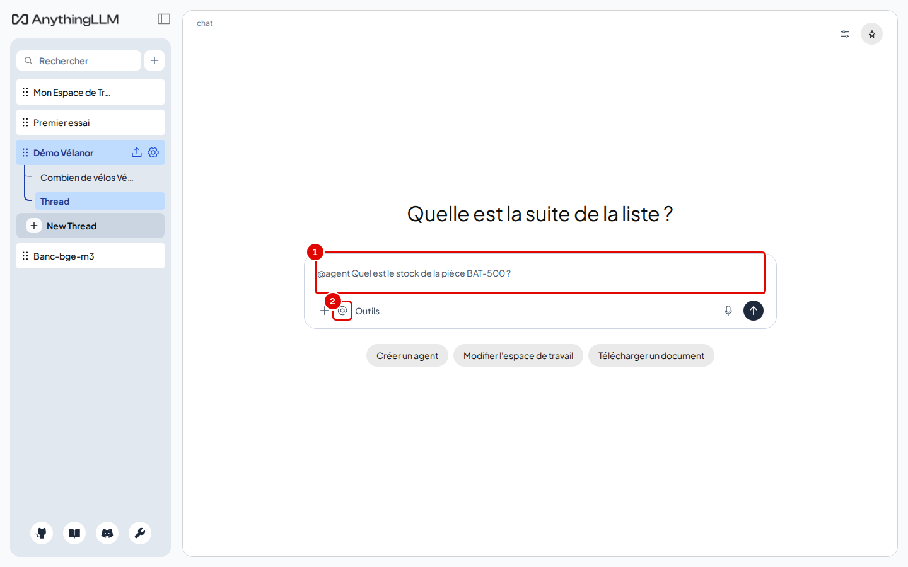
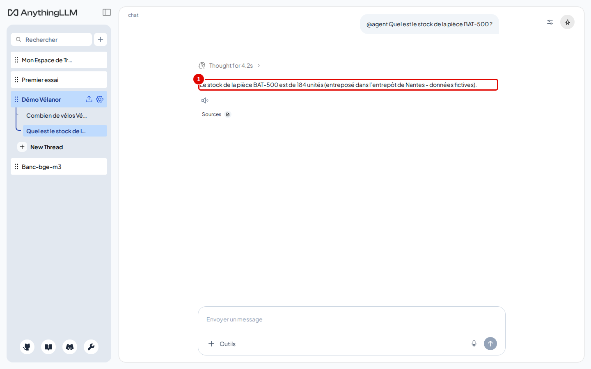

# 10. Agents et outils

> Ce chapitre apprend à choisir les compétences de l'agent, à créer un enchaînement sans code (agent flow), à brancher un serveur MCP et à lancer l'agent dans une conversation.
> **Point de départ** : Paramètres de l'instance › « Compétences de l'agent ».
> **Durée** : environ 20 minutes. **Avant** : chapitres 06 et 07.

**Attention** : certaines compétences agissent hors de l'application (« Recherche web en direct et navigation » interroge un moteur de recherche en ligne, « Accès au système de fichiers » lit et écrit des fichiers dans le conteneur). N'activer que celles dont l'usage est compris.

## Ce qu'il faut savoir

Un **agent** est le modèle `chat` à qui l'on donne des **outils** : il décide lui-même de les utiliser, voit le résultat, puis répond. Les outils viennent de trois sources :

- les **compétences intégrées** (« Agent Skills ») : chercher dans les documents de l'espace, résumer un document, lire un site web, rechercher sur le web, créer des fichiers, des graphiques, interroger une base SQL, créer une tâche planifiée ;
- les **agent flows** : des enchaînements d'étapes construits à la souris dans un éditeur, sans code ;
- les **serveurs MCP** : de petits programmes externes qui ajoutent des outils selon un protocole standard (Model Context Protocol).

L'agent se lance dans une conversation en commençant le message par `@agent`, ou pour toutes les questions avec le mode « Agent » de l'espace.

L'exemple branche un serveur MCP écrit pour ce manuel, `velanor-outils` : il donne le stock fictif d'une pièce détachée à partir de sa référence. Son code, une quarantaine de lignes sans dépendance, est dans `outils/anythingllm/mcp/serveur-velanor.js` du dépôt.

## Choisir les compétences

**Étape 1. Ouvrir les compétences**
*Où* : Paramètres de l'instance › « Compétences de l'agent ».


*Écran : « Compétences de l'agent », liste de gauche.*

| N° | Élément | Rôle |
|---|---|---|
| 1 | « RAG et mémoire à long terme » | recherche dans les documents de l'espace (« On » par défaut) |
| 2 | « Recherche web en direct et navigation » | recherche sur Internet (« On » par défaut) |
| 3 | « Générer des graphiques » | dessine un graphique à partir de données (« Off » par défaut) |
| 4 | « Agent Flows » | enchaînements sans code (étape 3) |
| 5 | « Serveurs MCP » | serveurs d'outils externes (étape 5) |

*Résultat* : chaque ligne indique « On » ou « Off ». La capture a été prise à la fin du chapitre : elle montre déjà « Générer des graphiques » activé (étape 2), le flow `ConsignesBatteries` (étapes 3 et 4) et le serveur « Velanor Outils » (étape 5). Par défaut, quatre compétences sont actives : RAG et mémoire, voir et résumer des documents, récupérer des sites web, recherche web.

**Étape 2. Activer une compétence**
*Où* : cliquer sur « Générer des graphiques ».
Basculer l'interrupteur (pastille 2), puis cliquer sur « Save » (pastille 3).


*Écran : détail de la compétence « Générer des graphiques ».*

| N° | Élément | Rôle |
|---|---|---|
| 1 | compétence choisie | sa description s'affiche à droite |
| 2 | interrupteur | active ou désactive la compétence |
| 3 | « Save » | enregistre ; « Cancel » annule |

*Résultat* : la ligne passe à « On ». L'agent pourra produire un graphique quand une question le demande.

## Créer un agent flow

**Étape 3. Ouvrir l'éditeur**
*Où* : « Compétences de l'agent » › section « Agent Flows ».
Cliquer sur « Create Flow » (pastille 1).


*Écran : « Compétences de l'agent », section « Agent Flows ».*

| N° | Élément | Rôle |
|---|---|---|
| 1 | « Create Flow » | ouvre l'éditeur d'enchaînements |

*Résultat* : l'éditeur (« BUILDER ») s'ouvre sur un flow vide.

**Étape 4. Décrire et enregistrer le flow**
*Où* : éditeur d'agent flow.
Remplir « Flow Name » avec `ConsignesBatteries` (pastille 1) et « Description » (pastille 2) avec une phrase qui dit au modèle quand l'utiliser, puis cliquer sur « Save » (pastille 4). Dans les essais, le flow a été enregistré sans bloc, pour montrer l'éditeur : un flow vide ne fait rien quand l'agent l'appelle. Pour qu'il serve, « Add Block » (pastille 3) ajoute les étapes (instruction au modèle, appel d'une adresse web, lecture d'une page…) ; ces blocs n'ont pas été essayés dans ce manuel.


*Écran : éditeur d'agent flow (en anglais).*

| N° | Élément | Rôle |
|---|---|---|
| 1 | « Flow Name » | nom de l'outil, tel que le modèle le verra |
| 2 | « Description » | quand et pourquoi l'utiliser ; c'est ce que lit le modèle pour décider |
| 3 | « Add Block » | ajoute une étape (appel d'API, lecture de site web, instruction au modèle…) |
| 4 | « Save » | enregistre le flow ; « Publish » le partage sur le Centre communautaire en ligne |

*Résultat* : le flow est enregistré ; en revenant sur « Compétences de l'agent » (clé en bas de la barre latérale de l'écran principal, ou adresse `http://127.0.0.1:3001/settings/agents`), il apparaît dans la section « Agent Flows » (`ConsignesBatteries`, « On », visible sur la capture de l'étape 1) ; l'agent peut l'appeler comme une compétence. Les « Flow Variables » permettent de demander au modèle des valeurs (par exemple une référence de pièce) à injecter dans les étapes.

## Brancher un serveur MCP

Les serveurs MCP se déclarent dans le fichier `anythingllm_mcp_servers.json` du dossier de données (`donnees/anythingllm/storage/plugins/`) ; l'interface les affiche et permet de les activer.

**Étape 5a. Déclarer le serveur d'exemple**
*Où* : terminal Ubuntu, dossier du dépôt. Le script copie le serveur d'exemple et le déclare :

```bash
outils/anythingllm/mcp/installer-mcp.sh
```

Le script affiche aussi trois réponses d'essai du serveur (initialisation, liste des outils, appel de `stock_piece` avec `BAT-500`).

**Étape 5. Vérifier le serveur dans l'interface**
*Où* : « Compétences de l'agent » › section « Serveurs MCP ».
Cliquer sur « Rafraîchir » (pastille 1), puis sur « Velanor Outils » (pastille 2).


*Écran : « Compétences de l'agent », détail du serveur MCP.*

| N° | Élément | Rôle |
|---|---|---|
| 1 | « Rafraîchir » | relit le fichier de déclaration et redémarre les serveurs |
| 2 | « Velanor Outils » | serveur déclaré, « Sur » quand il tourne |
| 3 | « 1/1 outils activés » | outils du serveur proposés à l'agent |
| 4 | `stock_piece` | outil du serveur, avec sa description |
| 5 | `ConsignesBatteries` | flow créé aux étapes 3 et 4, listé dans « Agent Flows » |

*Résultat* : le détail montre la commande de démarrage (`node` et le chemin du script) et la liste des outils. Un serveur MCP tourne dans le conteneur d'AnythingLLM : il n'a accès qu'à ce que le conteneur voit.

## Lancer l'agent

**Étape 6. Poser une question à l'agent**
*Où* : espace « Démo Vélanor », nouveau fil, zone de saisie.
Taper `@agent Quel est le stock de la pièce BAT-500 ?` (pastille 1) puis Entrée. Le bouton « @ » (pastille 2) insère `@agent` au début du message.


*Écran : espace « Démo Vélanor », message adressé à l'agent.*

| N° | Élément | Rôle |
|---|---|---|
| 1 | `@agent` suivi de la question | lance l'agent pour ce message |
| 2 | « @ » | insère `@agent` |

*Résultat* : l'agent démarre et cherche l'outil adapté.

**Étape 7. Lire la réponse de l'agent**
*Où* : zone de discussion.


*Écran : espace « Démo Vélanor », réponse de l'agent.*

| N° | Élément | Rôle |
|---|---|---|
| 1 | réponse | « Le stock de la pièce BAT-500 est de 184 unités » : le chiffre vient de l'outil `stock_piece` du serveur MCP |

*Résultat* : la réponse arrive en quelques secondes. L'information n'existe dans aucun document : elle ne peut venir que du serveur MCP.

## Choisir le modèle de l'agent

Le modèle utilisé par l'agent se règle par espace : réglages de l'espace › « Configuration de l'agent » (chapitre 07, étape 5). Un modèle plus capable d'appeler des outils peut y être choisi sans changer celui des réponses ordinaires.

## Bon à savoir

- Plus il y a d'outils actifs, plus le modèle hésite : au-delà de 15 outils, AnythingLLM présélectionne les plus pertinents avec un petit modèle intégré.
- La compétence « Créer des tâches planifiées » permet à l'agent de programmer lui-même une tâche (chapitre 11).
- Un serveur MCP trouvé sur Internet est un programme qui tourne avec les droits du conteneur : relire son code avant de le déclarer.

## En cas de problème

| Symptôme | Cause | Que faire |
|---|---|---|
| Le serveur MCP n'apparaît pas | fichier de déclaration mal formé ou non relu | vérifier le JSON, puis « Rafraîchir » |
| L'agent n'utilise pas l'outil | description trop vague | décrire précisément l'outil (nom, quand l'utiliser, exemple) |
| Réponse vide en mode « Agent » | comportement observé dans l'interface | utiliser `@agent` dans un espace en mode « Chat » ou « Requête » ; voir le [chapitre 15](15-en-cas-de-probleme.md) |

---
*Version décrite : AnythingLLM 1.19.0, essais du 12 novembre 2026. Détails et preuves : [rapport d'essais](../annexes/A6-rapport-d-essais.md).*
