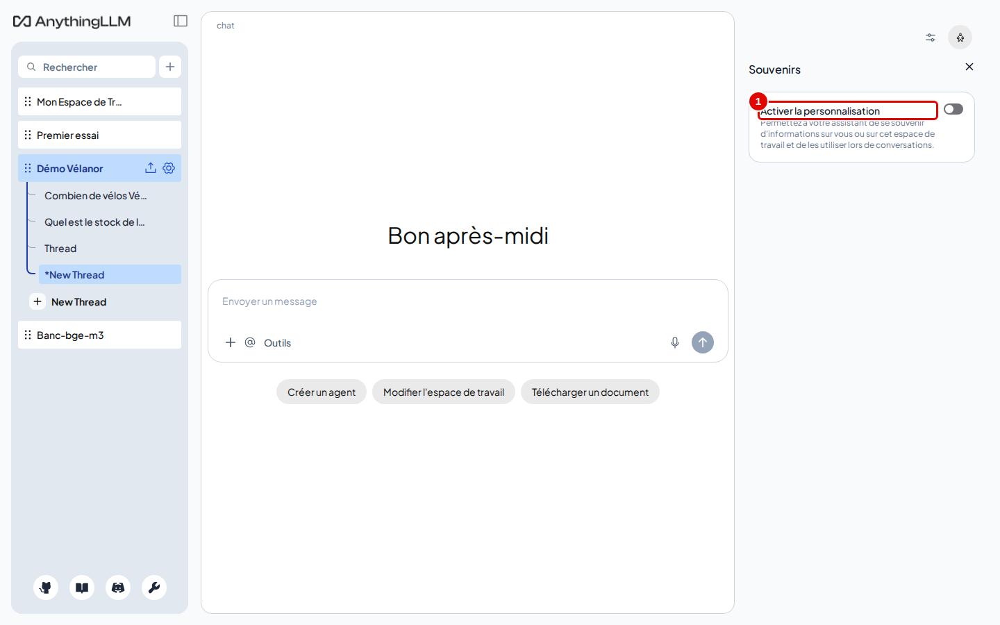
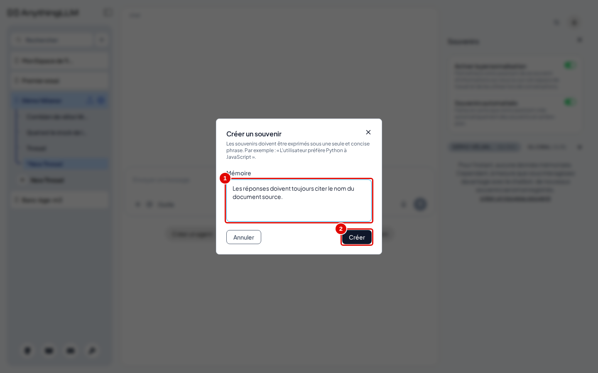
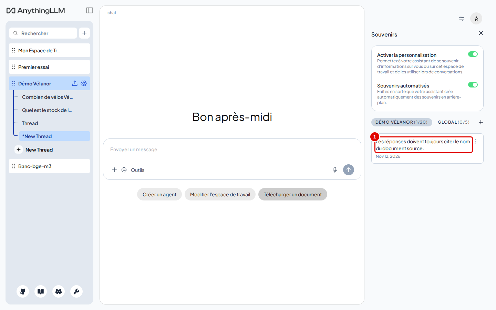
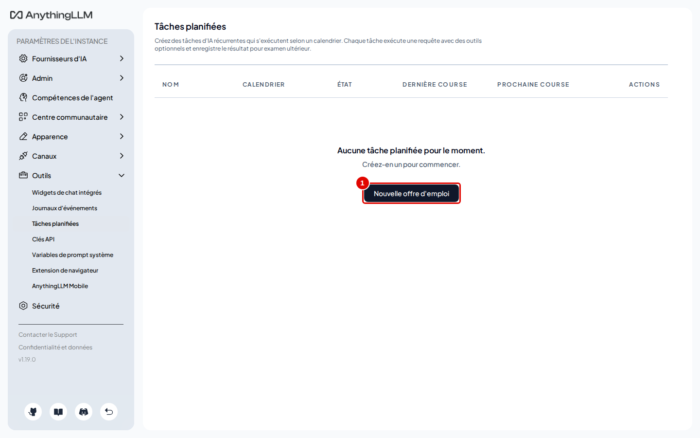
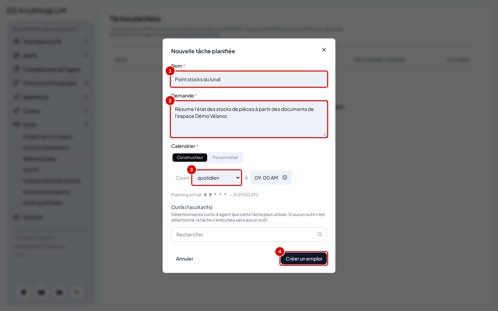
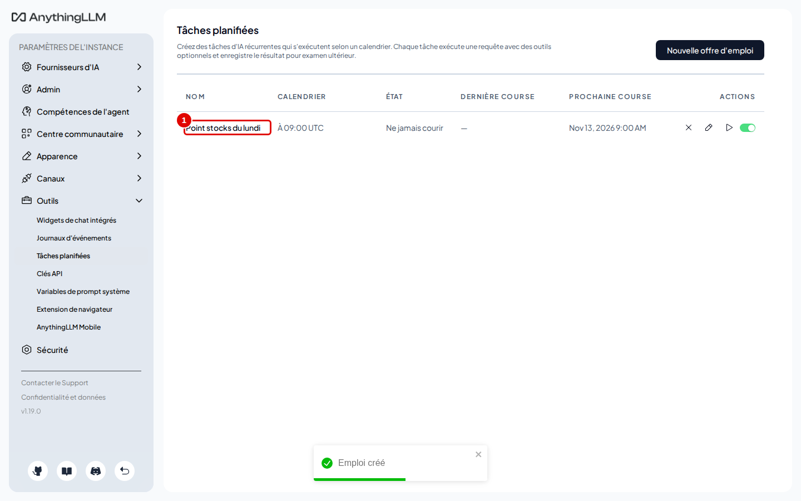
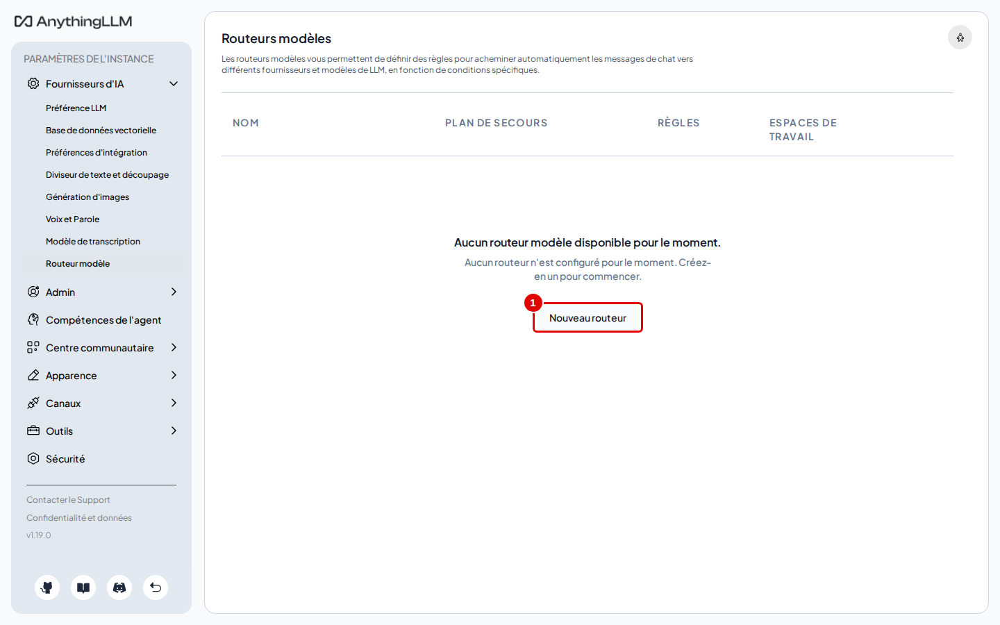
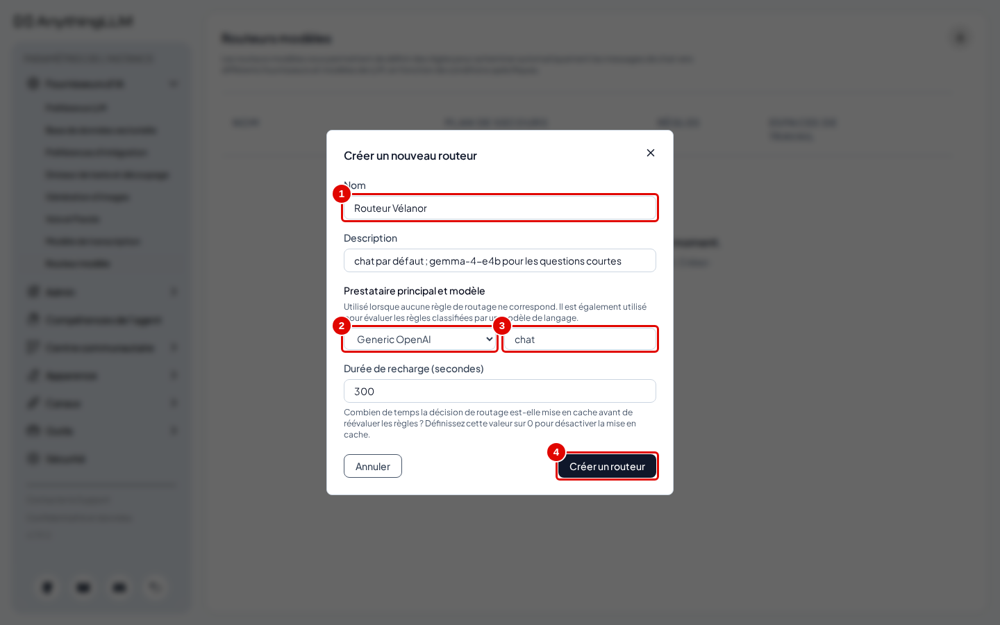
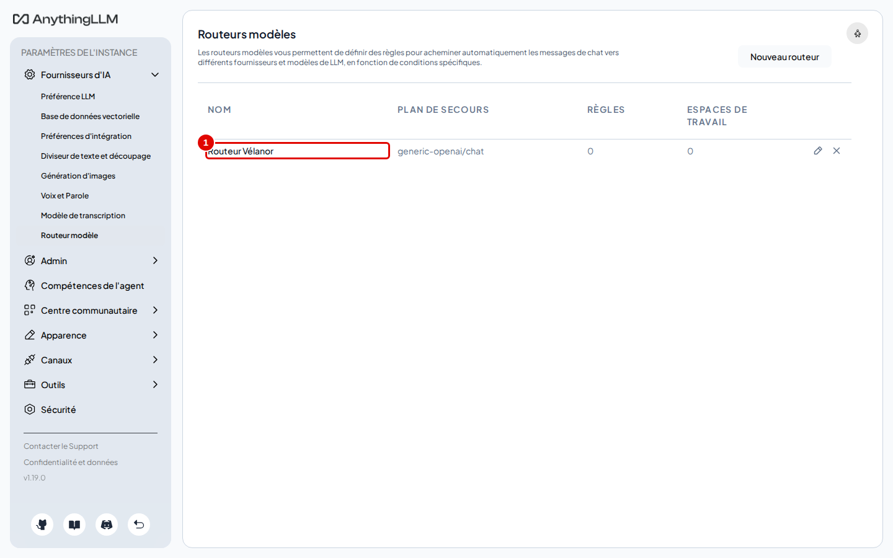

# 11. Mémoires, tâches planifiées et routage de modèles

> Ce chapitre apprend à faire retenir des informations d'une conversation à l'autre (souvenirs), à programmer une tâche qui s'exécute seule à heure fixe, et à créer un routeur qui répartit les questions entre plusieurs modèles.
> **Point de départ** : espace « Démo Vélanor » ouvert, connecté en mode « Juste moi » (chapitre 03).
> **Durée** : environ 15 minutes. **Avant** : chapitres 06 et 10.

**Attention** : les tâches planifiées n'existent qu'en mode « Juste moi » : après le passage en multi-utilisateur (chapitre 13), leur page disparaît.

## Ce qu'il faut savoir

- Un **souvenir** est une phrase que l'application rappelle au modèle dans les conversations suivantes (« les réponses doivent citer le document source », « le service qualité s'appelle… »). Les souvenirs sont propres à un espace ou globaux. La fonction est coupée par défaut ; une fois activée, l'application peut aussi créer des souvenirs automatiquement en analysant les conversations, ce qui fait travailler le modèle en arrière-plan.
- Une **tâche planifiée** envoie une consigne au modèle à intervalle régulier (toutes les heures, chaque jour, chaque semaine…) et garde le résultat pour le consulter ensuite.
- Un **routeur de modèles** choisit, pour chaque message, le modèle à utiliser selon des règles ; un modèle « de secours » répond quand aucune règle ne s'applique. Il se choisit ensuite comme fournisseur d'un espace.

## Faire retenir un souvenir

**Étape 1. Ouvrir le panneau des souvenirs**
*Où* : espace « Démo Vélanor » › icône de réglages en haut à droite de la discussion › « Souvenirs ».
Basculer « Activer la personnalisation » (pastille 1).

*Écran : panneau « Souvenirs ».*

| N° | Élément | Rôle |
|---|---|---|
| 1 | « Activer la personnalisation » | autorise l'assistant à garder et utiliser des souvenirs |

*Résultat* : l'interrupteur « Souvenirs automatisés » apparaît (création automatique en arrière-plan), ainsi que la liste des souvenirs de l'espace, vide (« 0/20 »).

**Étape 2. Écrire un souvenir**
*Où* : panneau « Souvenirs » › lien « créer un nouveau souvenir ».
Taper `Les réponses doivent toujours citer le nom du document source.` (pastille 1), puis cliquer sur « Créer » (pastille 2).

*Écran : fenêtre « Créer un souvenir ».*

| N° | Élément | Rôle |
|---|---|---|
| 1 | « Mémoire » | texte du souvenir |
| 2 | « Créer » | enregistre le souvenir |

*Résultat* : la fenêtre se ferme.

**Étape 3. Vérifier le souvenir**
*Où* : panneau « Souvenirs ».

*Écran : panneau « Souvenirs », un souvenir enregistré.*

| N° | Élément | Rôle |
|---|---|---|
| 1 | souvenir enregistré | rappelé au modèle dans les conversations de l'espace |

*Résultat* : le souvenir est listé. Son menu permet de le modifier, de le rendre global (« Passer à l'échelle mondiale ») ou de le supprimer. Dans les essais, « Activer la personnalisation » a ensuite été recoupé (même interrupteur) pour que les mesures de qualité ne soient pas faussées ; les chapitres suivants fonctionnent dans les deux cas.

## Programmer une tâche

**Étape 4. Ouvrir les tâches planifiées**
*Où* : Paramètres de l'instance › Outils › « Tâches planifiées ».
Cliquer sur « Nouvelle offre d'emploi » (pastille 1) : c'est la traduction approximative de « New Job » (nouvelle tâche).

*Écran : « Tâches planifiées », liste vide.*

| N° | Élément | Rôle |
|---|---|---|
| 1 | « Nouvelle offre d'emploi » | ouvre le formulaire d'une nouvelle tâche |

*Résultat* : le formulaire de création s'ouvre.

**Étape 5. Décrire la tâche**
*Où* : formulaire de nouvelle tâche.
Remplir le nom `Point stocks du lundi` (pastille 1), le champ « Demande » (pastille 2) avec `Résume l'état des stocks de pièces à partir des documents de l'espace Démo Vélanor.`, choisir la fréquence (pastille 3 : « chaque minute », « par heure », « quotidien », « hebdomadaire », « mensuel » ; ici « hebdomadaire » conviendrait au nom, l'essai a gardé « quotidien »), puis cliquer sur « Créer un emploi » (pastille 4).

*Écran : formulaire de nouvelle tâche planifiée.*

| N° | Élément | Rôle |
|---|---|---|
| 1 | nom | nom affiché dans la liste |
| 2 | « Demande » | consigne envoyée au modèle à chaque exécution |
| 3 | calendrier | fréquence d'exécution |
| 4 | « Créer un emploi » | enregistre la tâche |

*Résultat* : le message « Emploi créé » s'affiche. La tâche ne se rattache à aucun espace : la consigne est envoyée au modèle avec les compétences cochées dans « Outils (facultatifs) » ; sans outil (par exemple « RAG et mémoire à long terme »), le modèle répond sans lire les documents. L'exécution n'a pas été observée pendant les essais.

**Étape 6. Suivre la tâche**
*Où* : « Tâches planifiées ».

*Écran : « Tâches planifiées », une tâche programmée.*

| N° | Élément | Rôle |
|---|---|---|
| 1 | tâche créée | ligne avec son calendrier (« À 09:00 UTC »), son état et sa prochaine exécution |

*Résultat* : la colonne « Prochaine course » indique la prochaine exécution ; les résultats des exécutions se consultent depuis la ligne de la tâche. Les heures sont en temps universel (UTC, l'heure de référence internationale) : 09:00 UTC correspond à 10:00 à Paris en hiver.

## Créer un routeur de modèles

**Étape 7. Ouvrir les routeurs**
*Où* : Paramètres de l'instance › Fournisseurs d'IA › « Routeur modèle ».
Cliquer sur « Nouveau routeur » (pastille 1).

*Écran : « Routeurs modèles », liste vide.*

| N° | Élément | Rôle |
|---|---|---|
| 1 | « Nouveau routeur » | ouvre la fenêtre « Créer un nouveau routeur » |

*Résultat* : la fenêtre de création s'ouvre.

**Étape 8. Définir le modèle de secours**
*Où* : fenêtre « Créer un nouveau routeur ».
Remplir « Nom » (pastille 1) avec `Routeur Vélanor` et, facultatif, « Description » ; choisir « Generic OpenAI » comme prestataire principal (pastille 2), taper `chat` comme modèle (pastille 3), puis cliquer sur « Créer un routeur » (pastille 4).

*Écran : fenêtre « Créer un nouveau routeur ».*

| N° | Élément | Rôle |
|---|---|---|
| 1 | « Nom » | nom du routeur |
| 2 | « Prestataire principal et modèle » | fournisseur utilisé quand aucune règle ne s'applique ; il sert aussi à évaluer les règles rédigées en langage courant |
| 3 | modèle | nom du modèle de secours (`chat`) |
| 4 | « Créer un routeur » | enregistre le routeur |

*Résultat* : le routeur apparaît dans la liste.

**Étape 9. Vérifier le routeur**
*Où* : « Routeurs modèles ».

*Écran : « Routeurs modèles », un routeur créé.*

| N° | Élément | Rôle |
|---|---|---|
| 1 | « Routeur Vélanor » | routeur, avec son plan de secours `generic-openai/chat`, 0 règle et 0 espace |

*Résultat* : le routeur est créé, sans règle : la création des règles (par sujet ou par longueur de question) n'est pas décrite dans ce manuel, et sans règle toutes les questions vont au modèle de secours. Il se choisit ensuite comme fournisseur d'un espace : réglages de l'espace › « Paramètres du chat » › « Fournisseur LLM de l'espace de travail » (chapitre 07, étape 2), où « Model Router » figure dans la liste. Sur ce poste, le service propose aussi `gemma-4-e4b` : une règle peut, par exemple, envoyer les questions courtes à ce modèle.

## Bon à savoir

- Une tâche réglée sur « chaque minute » fait travailler le modèle en continu : à réserver aux essais.
- Les souvenirs automatiques font appel au modèle après les conversations : sur un poste sans carte graphique, cela ralentit les réponses suivantes.

## En cas de problème

| Symptôme | Cause | Que faire |
|---|---|---|
| La page « Tâches planifiées » renvoie à l'accueil | instance en multi-utilisateur | fonction propre au mode « Juste moi » |
| Le modèle du routeur n'est pas proposé en liste | le champ est libre pour Generic OpenAI | taper le nom exact (`chat`) |

---
*Version décrite : AnythingLLM 1.19.0, essais du 12 novembre 2026. Détails et preuves : [rapport d'essais](../annexes/A6-rapport-d-essais.md).*
