# 12. Personnaliser et administrer

> Ce chapitre fait le tour des pages d'apparence et d'administration : thème, nom et logo, options du chat, liste des espaces, historique de toutes les conversations, consigne par défaut, journal des événements, clés d'API, variables de consigne, extension de navigateur, application mobile, Telegram, fonctions expérimentales et documentation de l'API.
> **Point de départ** : Paramètres de l'instance (clé en bas de la barre latérale).
> **Durée** : environ 15 minutes. **Avant** : chapitre 03.

**Attention** : une clé d'API donne accès à tous les espaces et documents de l'instance. La copier dans un endroit sûr et la supprimer dès qu'elle ne sert plus.

## Ce qu'il faut savoir

Ces pages ne changent pas la qualité des réponses : elles servent à adapter l'apparence, à surveiller l'usage et à ouvrir l'instance à d'autres programmes. Une partie d'entre elles reste en anglais.

## Apparence

**Étape 1. Thème, couleurs et langue**
*Où* : Paramètres de l'instance › Apparence › « Interface ».

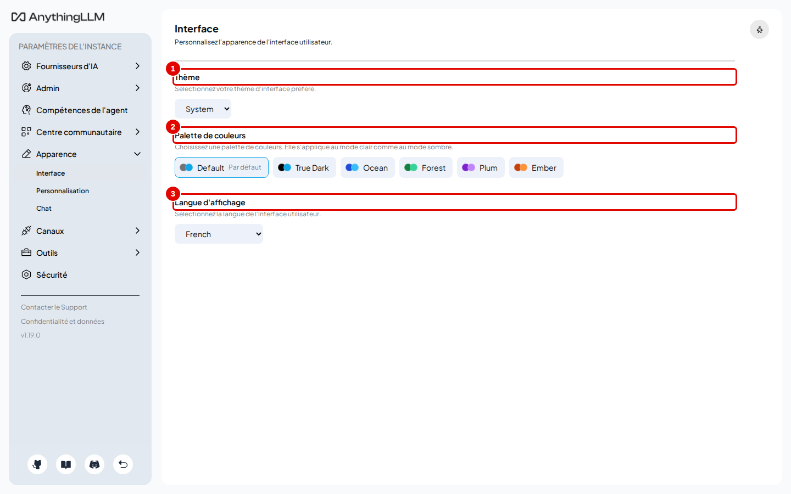
*Écran : « Interface ».*

| N° | Élément | Rôle |
|---|---|---|
| 1 | « Thème » | System, Light ou Dark |
| 2 | « Palette de couleurs » | couleurs d'accent (Default, Ocean, Forest…) |
| 3 | « Langue d'affichage » | langue de l'interface (chapitre 03) |

*Résultat* : le changement s'applique aussitôt, dans ce navigateur seulement.

**Étape 2. Nom et logo de l'instance**
*Où* : Paramètres de l'instance › Apparence › « Personnalisation ».

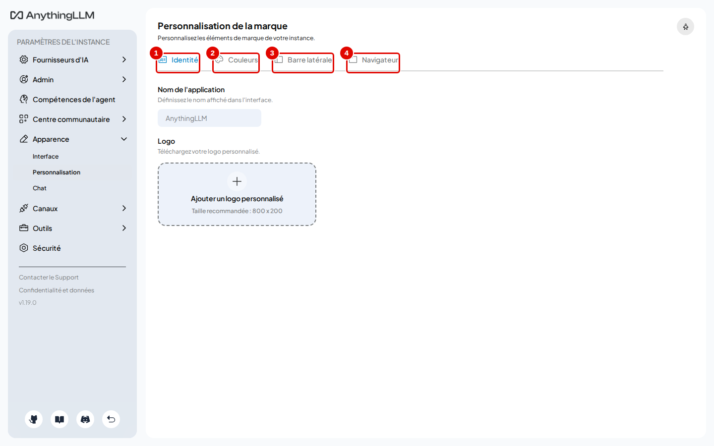
*Écran : « Personnalisation de la marque ».*

| N° | Élément | Rôle |
|---|---|---|
| 1 | « Identité » | nom de l'application et logo (taille conseillée 800 × 200) |
| 2 | « Couleurs » | couleurs de la marque |
| 3 | « Barre latérale » | pied de page de la barre latérale |
| 4 | « Navigateur » | titre de l'onglet et icône du site |

*Résultat* : le nom et le logo choisis remplacent ceux d'AnythingLLM pour toutes les personnes qui ouvrent l'instance.

**Étape 3. Options de la discussion**
*Où* : Paramètres de l'instance › Apparence › « Chat ».

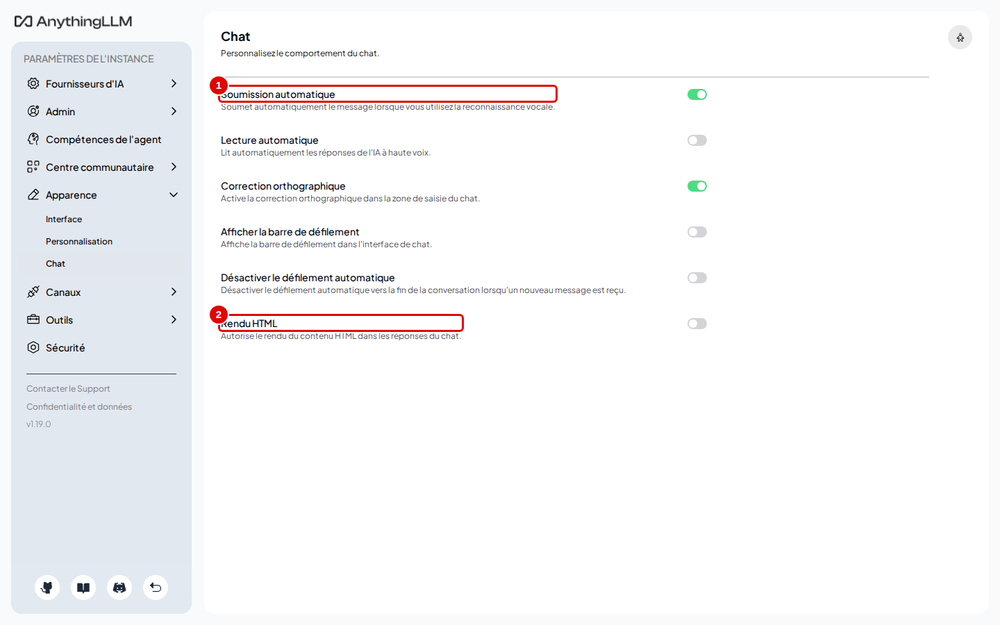
*Écran : options d'affichage de la discussion.*

| N° | Élément | Rôle |
|---|---|---|
| 1 | « Soumission automatique » | envoie la question dictée dès la fin de la dictée |
| 2 | « Rendu HTML » | affiche le HTML contenu dans les réponses au lieu du texte brut |

*Résultat* : ces options valent pour ce navigateur. Les autres options de la page règlent la lecture automatique, la correction orthographique et le défilement.

## Administration

**Étape 4. Liste des espaces**
*Où* : Paramètres de l'instance › Admin › « Espaces de travail ». Cette entrée, comme « Utilisateurs » et « Invitation », n'existe qu'en multi-utilisateur (chapitre 13) ; en mode « Juste moi », le groupe Admin ne contient que « Chat de l'espace de travail » et « Default System Prompt ».

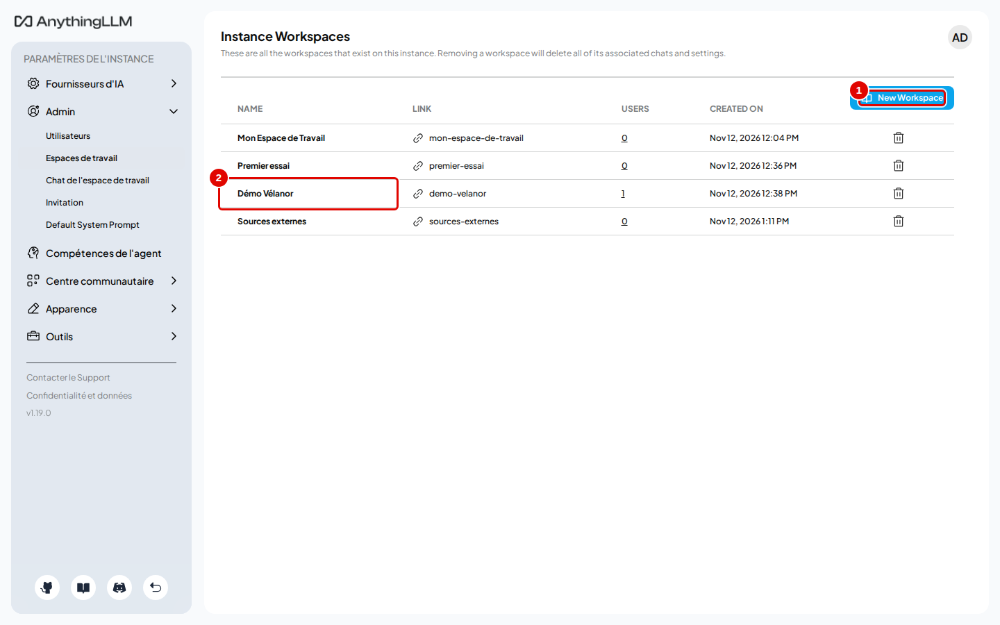
*Écran : « Instance Workspaces » (page en anglais).*

| N° | Élément | Rôle |
|---|---|---|
| 1 | « New Workspace » | crée un espace depuis l'administration |
| 2 | « Démo Vélanor » | un espace de l'instance |

*Résultat* : le tableau liste les espaces (nom, adresse, nombre d'utilisateurs, date de création) ; la corbeille d'une ligne supprime l'espace et ses conversations.

**Étape 5. Historique de toutes les conversations**
*Où* : Paramètres de l'instance › Admin › « Chat de l'espace de travail ».

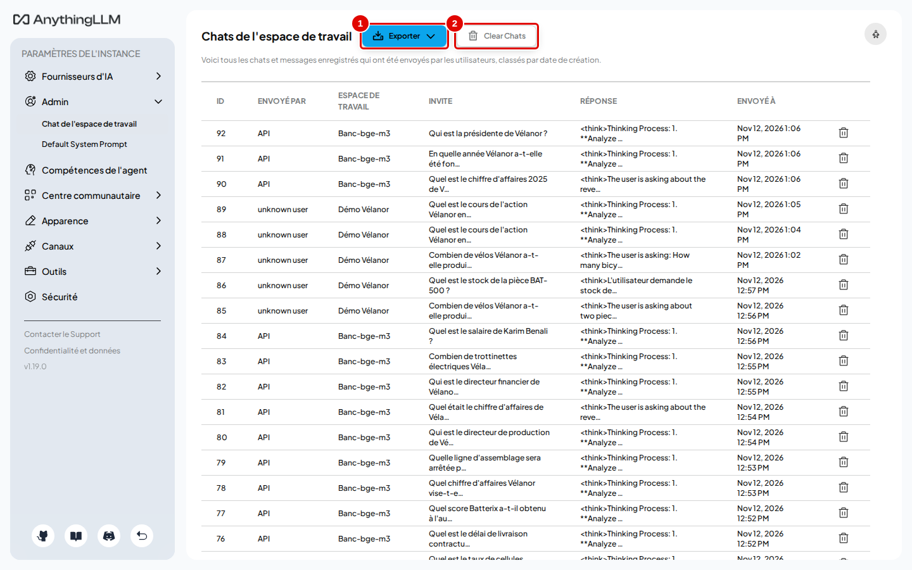
*Écran : « Chats de l'espace de travail ».*

| N° | Élément | Rôle |
|---|---|---|
| 1 | « Exporter » | télécharge tout l'historique |
| 2 | « Clear Chats » | efface tout l'historique enregistré |

*Résultat* : chaque ligne montre l'expéditeur (« API » pour les programmes), l'espace, la question et la réponse. La réponse enregistrée commence par la réflexion du modèle (`<think>…`).

**Étape 6. Consigne par défaut des nouveaux espaces**
*Où* : Paramètres de l'instance › Admin › « Default System Prompt ».

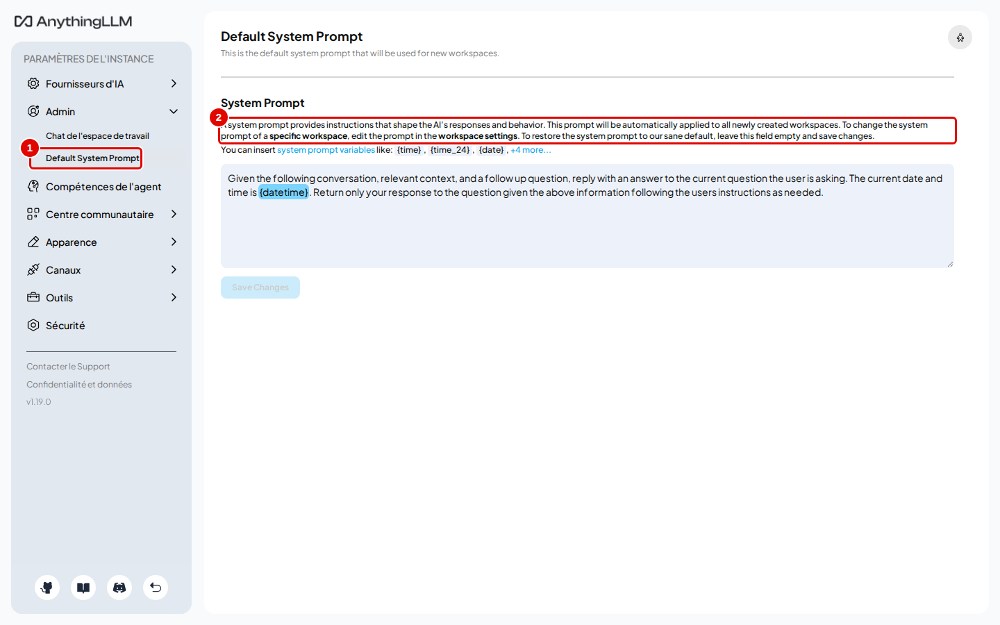
*Écran : « Default System Prompt » (page en anglais).*

| N° | Élément | Rôle |
|---|---|---|
| 1 | « System Prompt » | consigne reprise par chaque nouvel espace |
| 2 | « Save Changes » | enregistre ; un champ vide rétablit la consigne d'origine |

*Résultat* : les espaces existants gardent leur propre consigne (chapitre 07, étape 3).

## Outils

**Étape 7. Journal des événements**
*Où* : Paramètres de l'instance › Outils › « Journaux d'événements ».

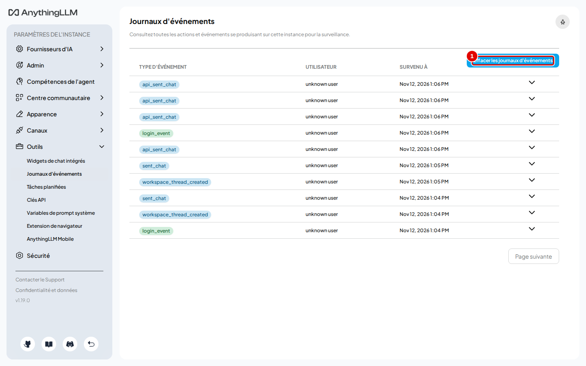
*Écran : « Journaux d'événements ».*

| N° | Élément | Rôle |
|---|---|---|
| 1 | « Effacer les journaux d'événements » | vide le journal |

*Résultat* : le tableau montre chaque événement (connexion, message envoyé par l'API, création de clé…) avec l'utilisateur et l'heure ; « show » en détaille un.

**Étape 8. Ouvrir les clés d'API**
*Où* : Paramètres de l'instance › Outils › « Clés API ».
Cliquer sur « Générer une nouvelle clé API » (pastille 1).

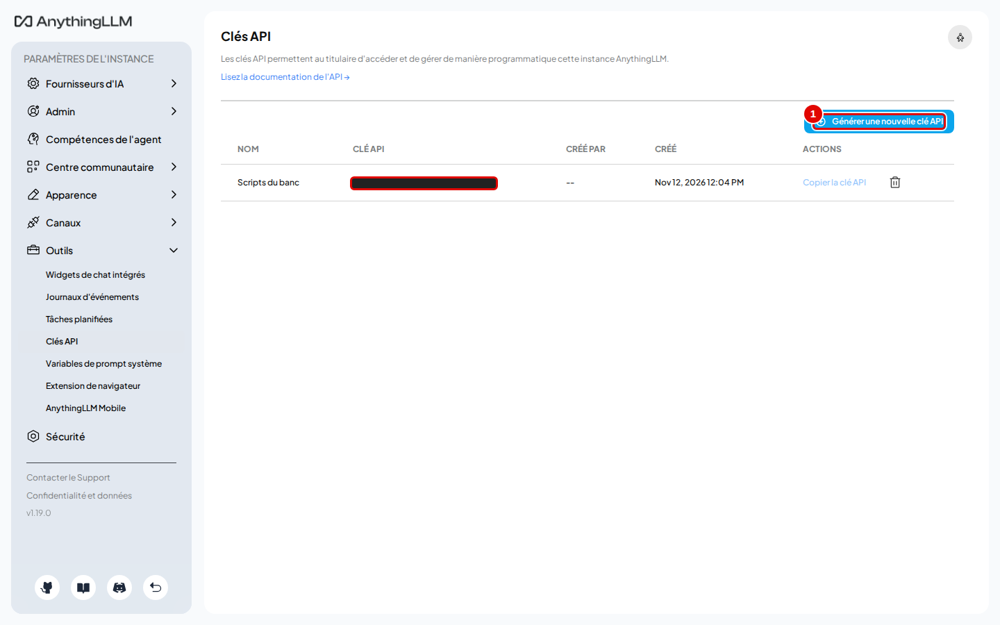
*Écran : « Clés API » (clés masquées sur la capture).*

| N° | Élément | Rôle |
|---|---|---|
| 1 | « Générer une nouvelle clé API » | ouvre la création d'une clé |

*Résultat* : le tableau liste les clés existantes, avec « Copier la clé API » et une corbeille pour la supprimer. Le lien « Lisez la documentation de l'API » ouvre la documentation interactive (étape 15).

**Étape 9. Créer une clé**
*Où* : fenêtre « Créer une nouvelle clé API ».
Cliquer sur « Créer la clé API » (pastille 1).

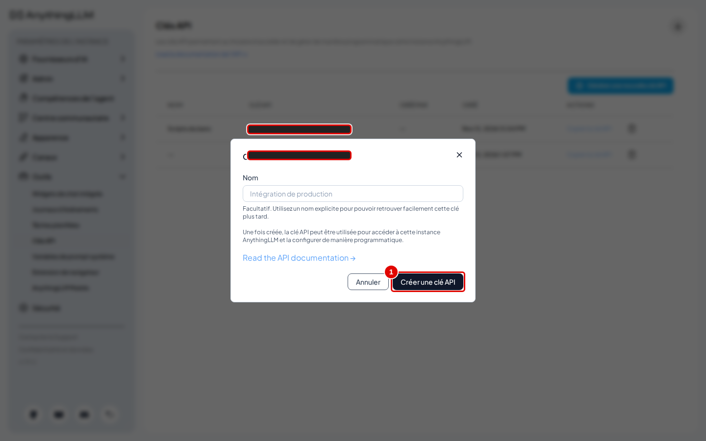
*Écran : fenêtre « Créer une nouvelle clé API ».*

| N° | Élément | Rôle |
|---|---|---|
| 1 | « Créer la clé API » | génère la clé |

*Résultat* : la clé s'affiche dans la fenêtre.

**Étape 10. Copier la clé**
*Où* : même fenêtre.

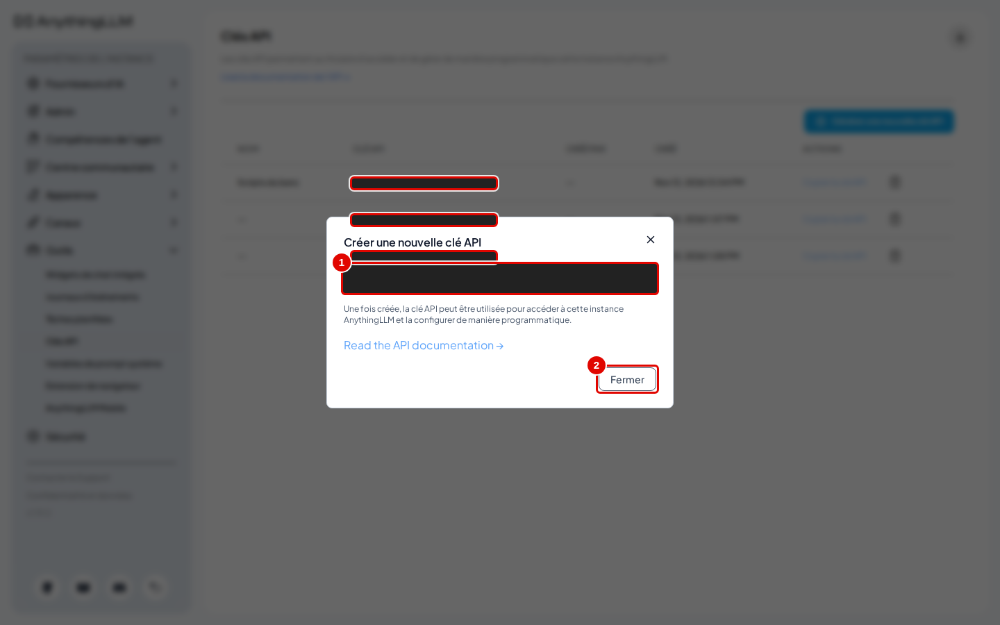
*Écran : fenêtre « Créer une nouvelle clé API », clé générée (masquée).*

| N° | Élément | Rôle |
|---|---|---|
| 1 | clé générée | à copier tout de suite (masquée sur la capture) |
| 2 | « Fermer » | ferme la fenêtre |

*Résultat* : la clé sert aux programmes (annexe A3) dans l'en-tête `Authorization: Bearer <clé>`.

**Étape 11. Variables de consigne**
*Où* : Paramètres de l'instance › Outils › « Variables de prompt système ».

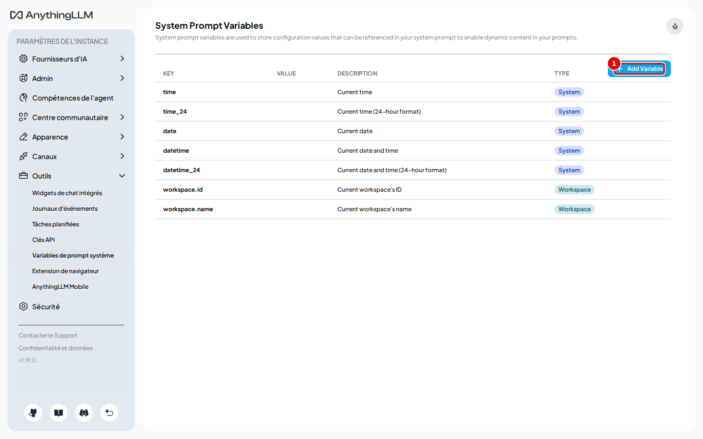
*Écran : « System Prompt Variables » (page en anglais).*

| N° | Élément | Rôle |
|---|---|---|
| 1 | « Add Variable » | crée une variable personnalisée (nom et valeur) |

*Résultat* : le tableau liste les variables prêtes à l'emploi (`{time}`, `{date}`, `{datetime}`, `{workspace.name}`…), à écrire entre accolades dans une consigne.

**Étape 12. Extension de navigateur et application mobile**
*Où* : Paramètres de l'instance › Outils › « Extension de navigateur », puis « AnythingLLM Mobile ».

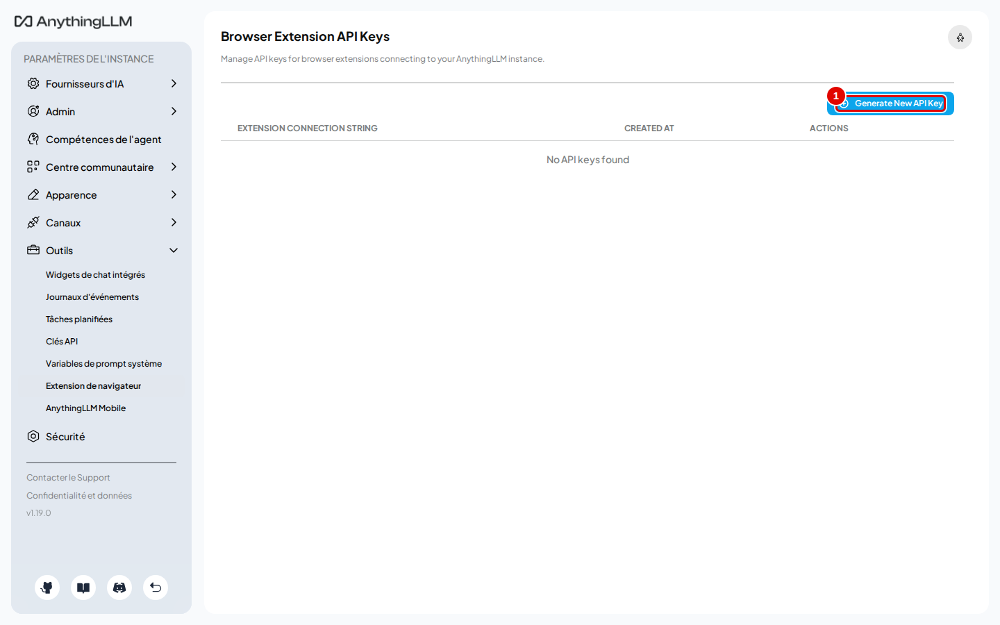
*Écran : « Browser Extension API Keys ».*

| N° | Élément | Rôle |
|---|---|---|
| 1 | « Generate New API Key » | crée la clé à coller dans l'extension de navigateur d'AnythingLLM |

*Résultat* : l'extension permet d'envoyer une page web ou un texte sélectionné vers un espace. Elle n'a pas été installée pendant les essais.

*Où* : Paramètres de l'instance › Outils › « AnythingLLM Mobile ».

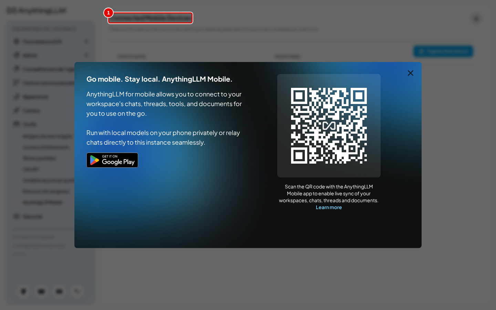
*Écran : « Connected Mobile Devices ».*

| N° | Élément | Rôle |
|---|---|---|
| 1 | « Connected Mobile Devices » | appareils reliés par l'application mobile AnythingLLM (code QR de « Register New Device ») |

*Résultat* : aucun appareil ; l'application mobile est hors du champ de ce manuel.

**Étape 13. Telegram**
*Où* : Paramètres de l'instance › Canaux › « Telegram ».

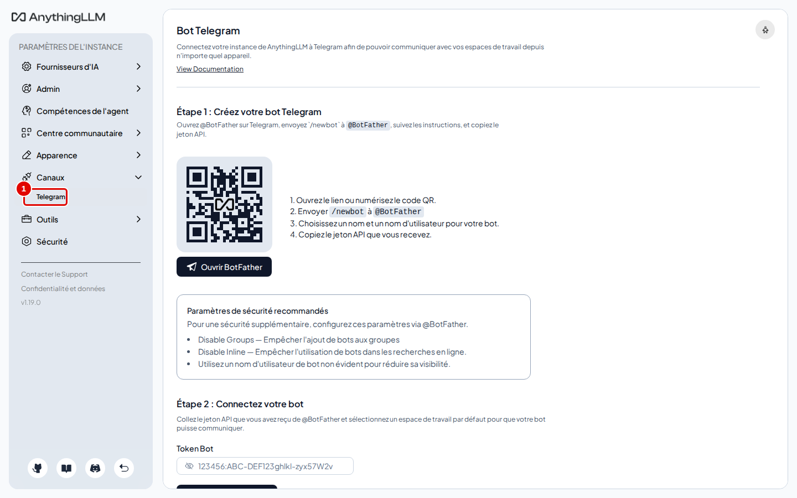
*Écran : « Bot Telegram ».*

| N° | Élément | Rôle |
|---|---|---|
| 1 | « Telegram » | relie l'instance à un robot Telegram, créé avec @BotFather |

*Résultat* : la page guide la création du robot. Elle demande un compte Telegram en ligne : non essayé ici. Ce groupe « Canaux » disparaît en multi-utilisateur.

## Fonctions expérimentales et documentation de l'API

**Étape 14. Débloquer les fonctions expérimentales**
*Où* : n'importe quelle page des paramètres, maintenir la touche Ctrl enfoncée 3 secondes ; l'entrée « Fonctionnalités Expérimentales » apparaît en bas du menu.

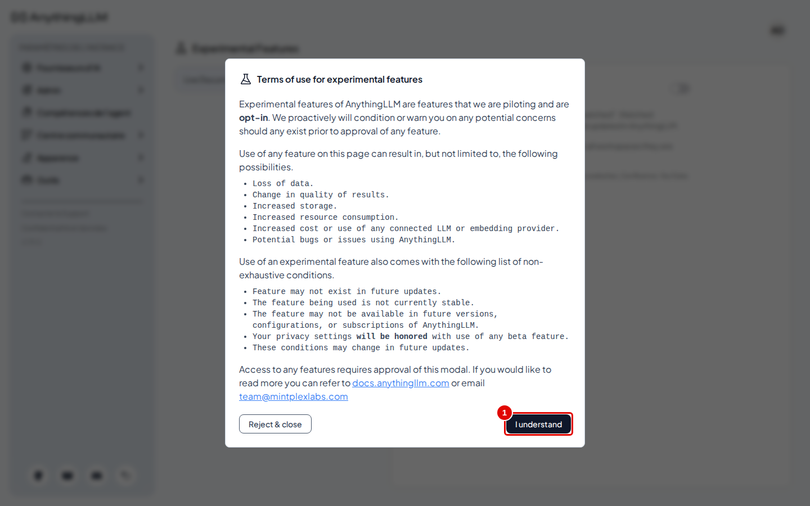
*Écran : « Fonctionnalités Expérimentales » (page en anglais).*

| N° | Élément | Rôle |
|---|---|---|
| 1 | « I understand » | accepte les conditions d'utilisation des fonctions expérimentales |

*Résultat* : la page s'ouvre d'abord sur la fenêtre « Terms of use for experimental features » (risques : perte de données, résultats changeants, consommation accrue). « Reject & close » refuse ; « I understand » accepte (message « Experimental Feature set enabled. Reloading the page. ») et affiche la seule fonction proposée, « Live Document Sync » : elle relit régulièrement les documents venus du web (sites, GitHub, YouTube, Confluence) et met à jour les espaces ; une icône d'œil apparaît alors sur ces documents dans la fenêtre des documents.

**Étape 15. Documentation interactive de l'API**
*Où* : adresse `http://127.0.0.1:3001/api/docs` dans le navigateur.

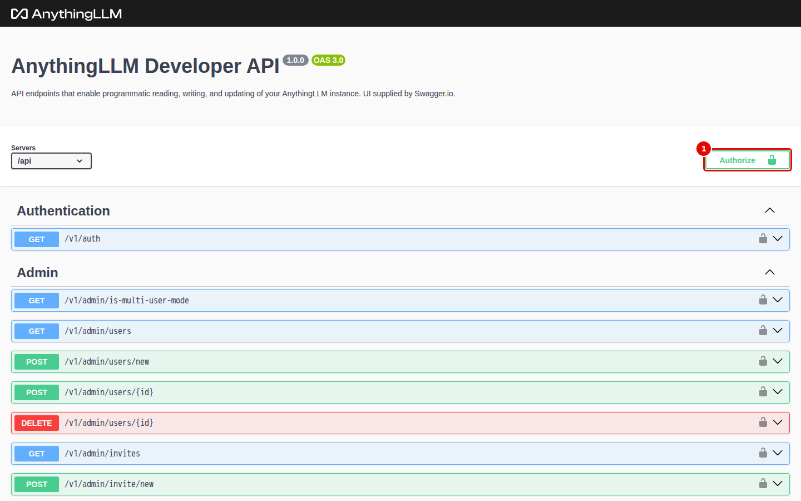
*Écran : documentation Swagger de l'API.*

| N° | Élément | Rôle |
|---|---|---|
| 1 | « Authorize » | saisit la clé d'API pour essayer les routes depuis la page |
| 2 | « Workspaces » | routes des espaces (créer, lister, poser une question…) |

*Résultat* : chaque route peut être essayée depuis la page. L'annexe A3 donne des exemples exécutés.

## Bon à savoir

- Le Centre communautaire (Paramètres de l'instance › « Centre communautaire ») charge son contenu depuis un service en ligne de l'éditeur et demande un compte pour publier : il n'est pas décrit ici.
- La suppression d'une clé d'API coupe immédiatement les programmes qui l'utilisent.

## En cas de problème

| Symptôme | Cause | Que faire |
|---|---|---|
| Un programme reçoit « Invalid API Key » | clé supprimée ou mal copiée | créer une nouvelle clé (étapes 8 à 10) |
| L'entrée « Fonctionnalités Expérimentales » n'apparaît pas | Ctrl relâché trop tôt | maintenir Ctrl 3 secondes, un message confirme le déblocage |

---
*Version décrite : AnythingLLM 1.19.0, essais du 12 novembre 2026. Détails et preuves : [rapport d'essais](../annexes/A6-rapport-d-essais.md).*
