# 13. Comptes, équipe et widget

> Ce chapitre apprend à ouvrir l'instance à une équipe : passer en multi-utilisateur, créer des comptes et leur rôle, donner accès à un espace, inviter, et intégrer une fenêtre de discussion dans un site web.
> **Point de départ** : Paramètres de l'instance › « Sécurité », connecté avec le mot de passe de l'instance (chapitre 03).
> **Durée** : environ 20 minutes. **Avant** : chapitres 03 à 07 ; faire le chapitre 11 avant, car les tâches planifiées disparaissent en multi-utilisateur.

**Attention** : le passage en multi-utilisateur ne peut pas être annulé depuis l'interface. Avant l'étape 1, faire une sauvegarde (terminal Ubuntu, dossier du dépôt : `outils/anythingllm/sauvegarder.sh`) : la restaurer est le seul moyen de revenir en arrière (`outils/anythingllm/restaurer.sh donnees/sauvegardes/<archive>.tar.gz`, après arrêt automatique de l'application ; l'archive est nommée d'après la date et l'heure). Le mot de passe de l'instance est remplacé par des comptes ; les pages « Tâches planifiées », « Canaux » (Telegram) et « Sécurité » disparaissent du menu.

## Ce qu'il faut savoir

En multi-utilisateur, chaque personne a un compte (nom d'utilisateur et mot de passe) et un **rôle** :

| Rôle | Libellé | Ce qu'il peut faire |
|---|---|---|
| Administrateur | « Administrator » | tout : modèles, comptes, réglages de l'instance |
| Gestionnaire | « Manager » | gérer les espaces, leurs documents et leurs membres, voir les comptes |
| Utilisateur | « Default » | discuter dans les espaces dont il est membre ; il ne voit ni les réglages ni les autres espaces |

Un **widget** est une petite fenêtre de discussion liée à un espace, qu'un site web affiche grâce à quelques lignes de code. Elle ne demande pas de compte : n'importe quel visiteur du site peut l'utiliser, dans les limites fixées.

## Passer en multi-utilisateur

**Étape 1. Activer le mode multi-utilisateur**
*Où* : Paramètres de l'instance › « Sécurité », section « Mode multi-utilisateurs ».
Basculer « Activer le mode multi-utilisateurs » (pastille 1), remplir le nom (pastille 2, ici `admin-velanor`) et le mot de passe (pastille 3) du compte administrateur, puis cliquer sur « Enregistrer les modifications » (pastille 4).

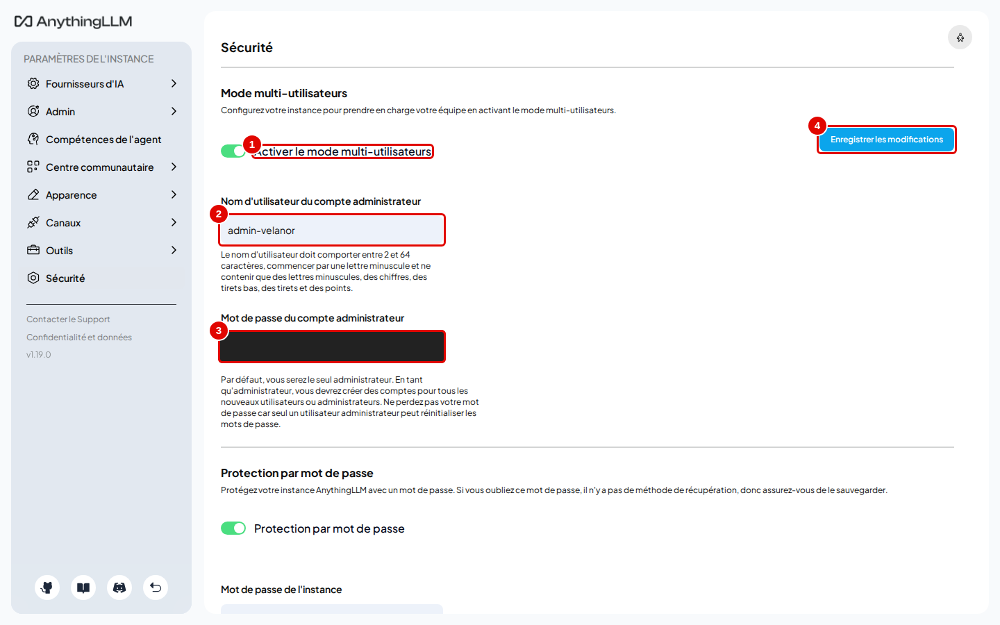
*Écran : « Sécurité », mode multi-utilisateurs.*

| N° | Élément | Rôle |
|---|---|---|
| 1 | « Activer le mode multi-utilisateurs » | affiche les champs du compte administrateur |
| 2 | « Nom d'utilisateur du compte administrateur » | 2 à 64 caractères, minuscule en tête, lettres minuscules, chiffres, `. _ - @` |
| 3 | « Mot de passe du compte administrateur » | 8 caractères au moins (masqué sur la capture) |
| 4 | « Enregistrer les modifications » | active le mode multi-utilisateur |

*Résultat* : le message « Multi-User mode enabled successfully. » s'affiche, puis la session se ferme.

**Étape 2. Se connecter avec le compte administrateur**
*Où* : page de connexion.
Taper le nom d'utilisateur (pastille 1) et le mot de passe (pastille 2), puis « Connexion » (pastille 3).

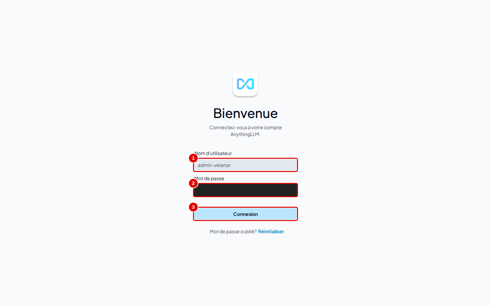
*Écran : connexion en multi-utilisateur.*

| N° | Élément | Rôle |
|---|---|---|
| 1 | « Nom d'utilisateur » | compte à ouvrir |
| 2 | « Mot de passe » | mot de passe du compte (masqué) |
| 3 | « Connexion » | ouvre la session |

*Résultat* : l'écran principal s'affiche ; une pastille aux initiales du compte (« AD ») apparaît en haut à droite. À la première connexion d'un compte, la fenêtre « Recovery Codes » peut s'afficher d'abord : la traiter comme à l'étape 8. Le lien « Mot de passe oublié? Réinitialiser » permet de changer de mot de passe avec les codes de récupération (étape 8).

## Créer des comptes

**Étape 3. Ajouter un utilisateur**
*Où* : Paramètres de l'instance › Admin › « Utilisateurs » › « Add user ».
Remplir le nom (pastille 1) et le mot de passe (pastille 2), choisir le rôle (pastille 3), puis « Add user » (pastille 4).

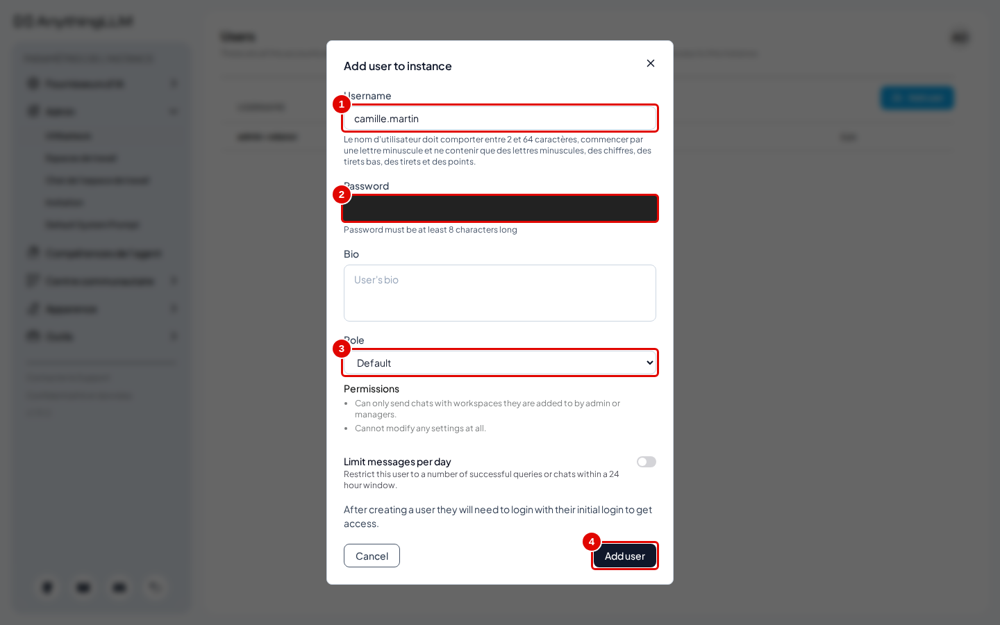
*Écran : fenêtre « Add user to instance » (en anglais).*

| N° | Élément | Rôle |
|---|---|---|
| 1 | « User's username » | nom de connexion, ici `camille.martin` |
| 2 | mot de passe | mot de passe initial (masqué) |
| 3 | rôle | « Default », « Manager » ou « Administrator » |
| 4 | « Add user » | crée le compte |

*Résultat* : le compte est créé. L'interrupteur « Limit messages per day » de la même fenêtre plafonne le nombre de messages par jour.

**Étape 4. Voir les comptes**
*Où* : Paramètres de l'instance › Admin › « Utilisateurs ».

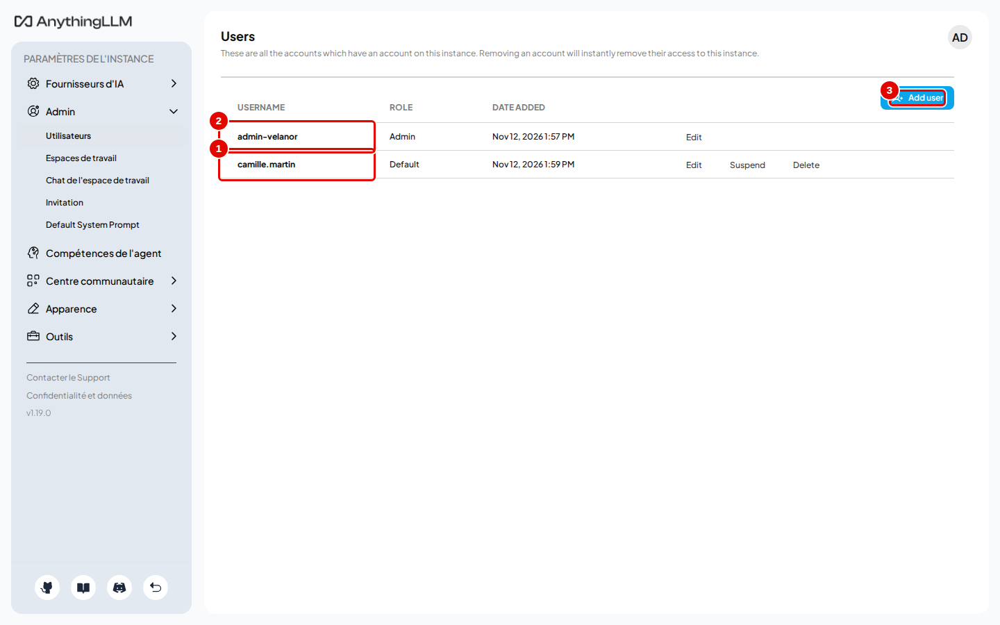
*Écran : « Users ».*

| N° | Élément | Rôle |
|---|---|---|
| 1 | `camille.martin` | compte « Default » créé à l'étape 3 |
| 2 | `admin-velanor` | compte administrateur |
| 3 | « Add user » | ajoute un autre compte |

*Résultat* : chaque ligne propose « Edit » (rôle, mot de passe), « Suspend » et « Delete ».

## Donner accès à un espace

**Étape 5. Ajouter un membre à l'espace**
*Où* : réglages de l'espace « Démo Vélanor » › onglet « Membres » › « Manage Users ».
Cocher `camille.martin` (pastille 1), puis « Save » (pastille 2).

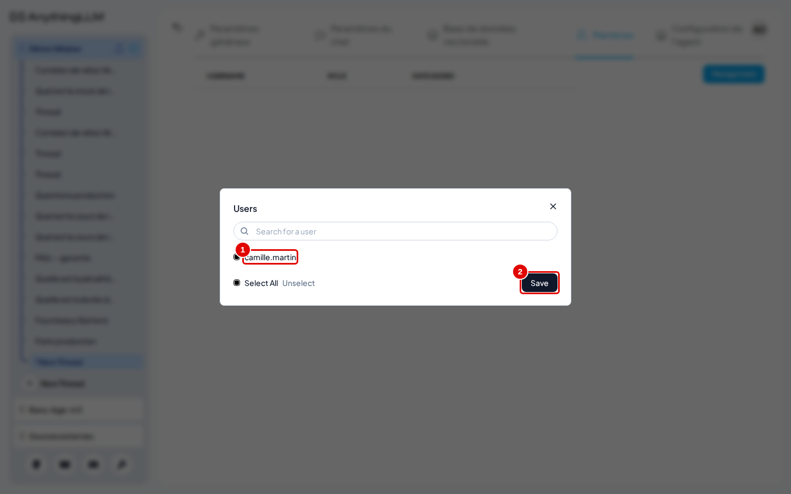
*Écran : fenêtre de gestion des membres de l'espace.*

| N° | Élément | Rôle |
|---|---|---|
| 1 | `camille.martin` | compte coché, qui verra l'espace |
| 2 | « Save » | enregistre les membres |

*Résultat* : l'utilisateur voit désormais l'espace « Démo Vélanor », et seulement lui.

## Inviter une personne

**Étape 6. Créer un lien d'invitation**
*Où* : Paramètres de l'instance › Admin › « Invitation » (la page s'intitule « Invitations ») › « Create Invite Link ».
Cocher éventuellement les espaces à ouvrir d'office (pastille 1), puis « Create Invite » (pastille 2).

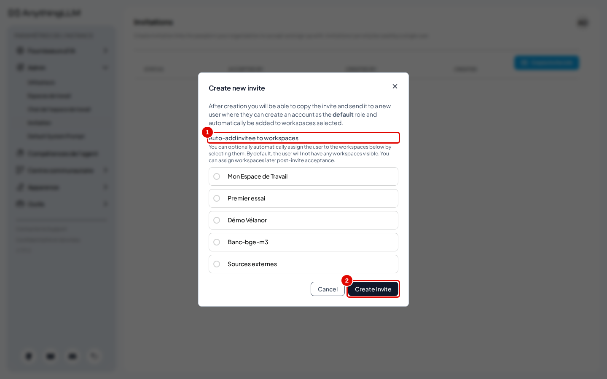
*Écran : fenêtre « Create new invite » (en anglais).*

| N° | Élément | Rôle |
|---|---|---|
| 1 | « Auto-add invitee to workspaces » | espaces auxquels la personne invitée sera ajoutée |
| 2 | « Create Invite » | crée le lien |

*Résultat* : l'invitation apparaît dans la liste.

**Étape 7. Copier le lien**
*Où* : « Invitations ».

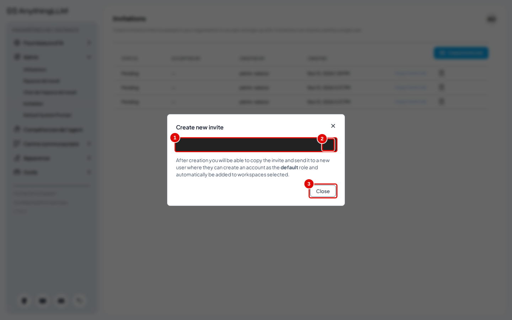
*Écran : « Invitations », une invitation en attente.*

| N° | Élément | Rôle |
|---|---|---|
| 1 | « Copy Invite Link » | copie le lien à envoyer |

*Résultat* : la personne qui ouvre le lien choisit son nom et son mot de passe ; chaque lien ne sert qu'une fois. Le lien commence par l'adresse de l'instance : depuis un autre poste, elle n'est joignable que si l'instance a été ouverte au réseau, ce que cette installation ne fait pas.

## Première connexion d'un utilisateur

**Étape 8. Garder les codes de récupération**
*Où* : se déconnecter de `admin-velanor` (pastille aux initiales en haut à droite › « Déconnexion », voir l'étape 10), puis se connecter avec `camille.martin` et son mot de passe (comme à l'étape 2) : c'est sa première connexion.
Cliquer sur « Download » (pastille 1), puis sur « Close ».

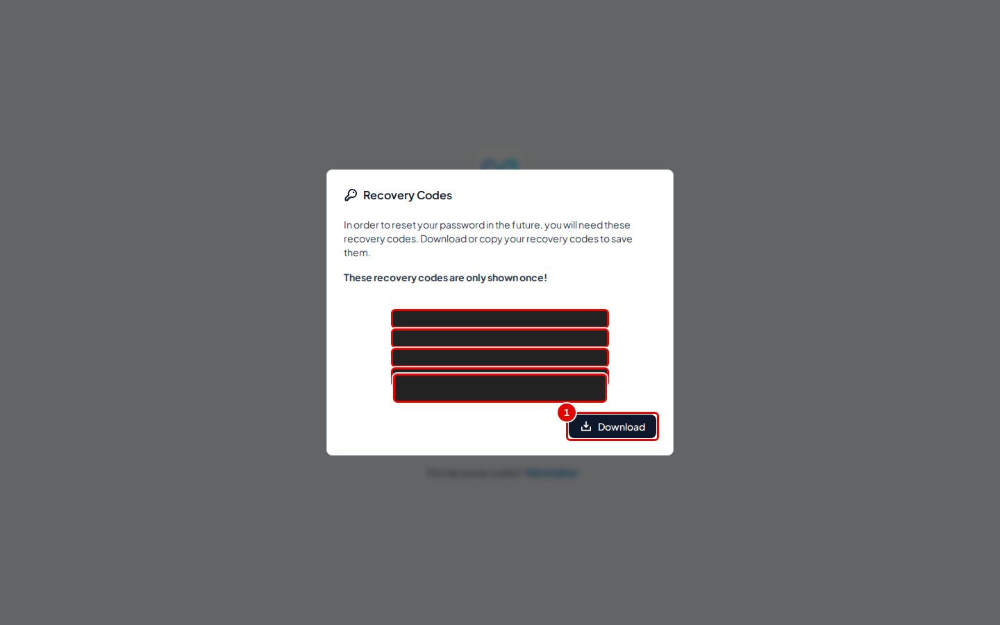
*Écran : fenêtre « Recovery Codes » (en anglais), codes masqués.*

| N° | Élément | Rôle |
|---|---|---|
| 1 | « Download » | télécharge les quatre codes ; « Close » n'apparaît qu'après |

*Résultat* : un fichier texte contient les quatre codes ; ils servent à réinitialiser le mot de passe. La fenêtre ne s'affiche qu'une fois.

**Étape 9. Voir l'écran d'un utilisateur**
*Où* : écran principal de `camille.martin`.

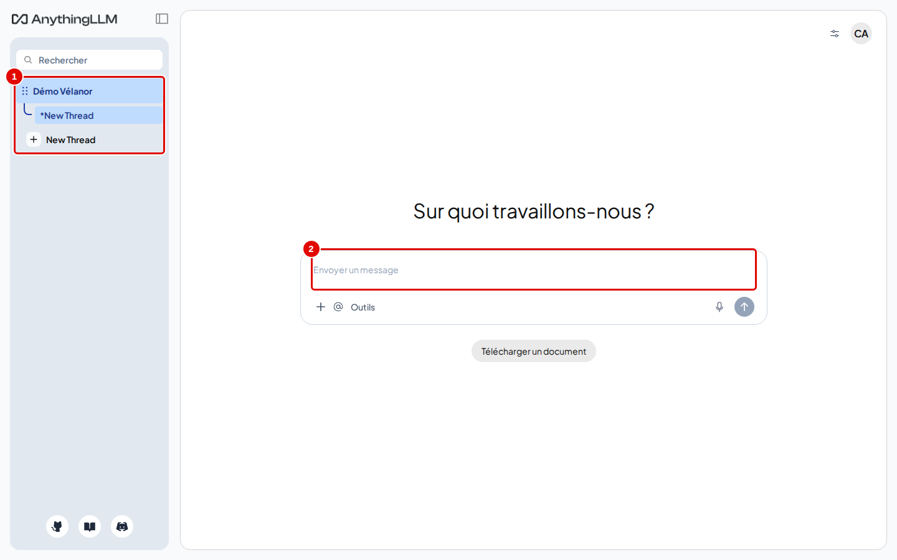
*Écran : écran principal d'un compte « Default ».*

| N° | Élément | Rôle |
|---|---|---|
| 1 | liste des espaces | seulement « Démo Vélanor » |
| 2 | « Envoyer un message » | l'utilisateur peut poser des questions |

*Résultat* : pas de clé des paramètres, pas de bouton « + » : un compte « Default » ne peut que discuter. Se déconnecter, puis se reconnecter avec `admin-velanor` pour la suite du chapitre.

## Régler son compte

**Étape 10. Ouvrir le menu du compte**
*Où* : connecté avec `admin-velanor`, pastille aux initiales (« AD »), en haut à droite.

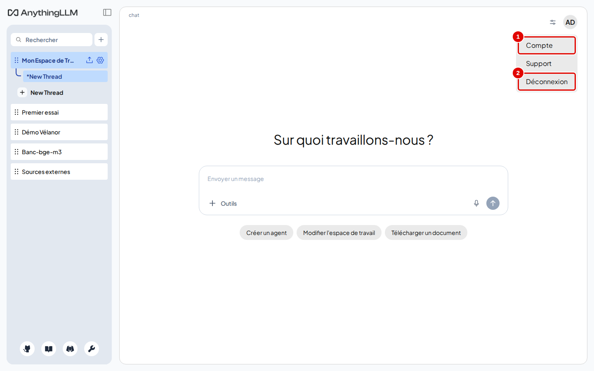
*Écran : menu du compte.*

| N° | Élément | Rôle |
|---|---|---|
| 1 | « Compte » | ouvre la fenêtre du compte |
| 2 | « Déconnexion » | ferme la session |

*Résultat* : le menu propose aussi « Support ».

**Étape 11. Modifier son compte**
*Où* : fenêtre « Compte ».

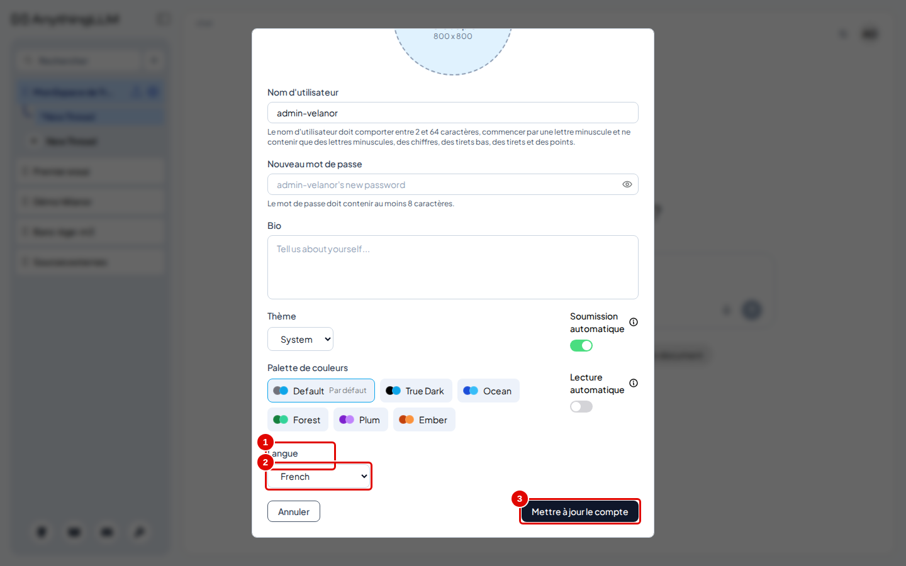
*Écran : fenêtre « Modifier le compte ».*

| N° | Élément | Rôle |
|---|---|---|
| 1 | « Thème » | thème de l'interface pour ce compte |
| 2 | « Langue » | langue de l'interface |
| 3 | « Mettre à jour le compte » | enregistre (nom, photo, nouveau mot de passe) |

*Résultat* : chaque personne règle son propre compte.

## Intégrer une fenêtre de discussion dans un site

**Étape 12. Choisir l'espace du widget**
*Où* : connecté avec `admin-velanor`, Paramètres de l'instance › Outils › « Widgets de chat intégrés » › « Créer un widget intégré ».
En haut de la fenêtre « Create new embed for workspace », choisir « Démo Vélanor » dans la liste « Workspace » (pastille 1).

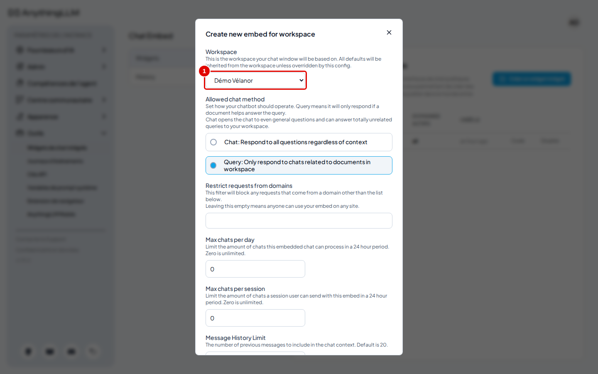
*Écran : fenêtre « Create new embed for workspace », haut de la fenêtre.*

| N° | Élément | Rôle |
|---|---|---|
| 1 | « Workspace » | espace dont les documents servent aux réponses du widget |

*Résultat* : l'espace est choisi ; la suite du réglage est plus bas dans la même fenêtre.

**Étape 12 (suite). Régler et créer le widget**
*Où* : même fenêtre, faire défiler vers le bas.
Plus bas, cocher le mode « Query » (pastille 1), laisser vide « Restrict requests from domains » (pastille 2) pour l'essai de l'étape 15, qui ouvre une page depuis un fichier et non depuis un site ; pour un vrai site, y mettre son nom de domaine (par exemple `intranet.velanor.fr`). Dans tous les cas, renseigner « Max chats per day » (pastille 3, ici `200`) pour limiter le nombre de messages par jour. Cliquer enfin sur « Create embed » (pastille 4).

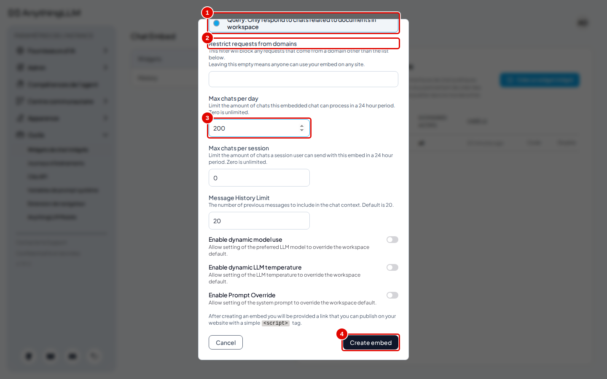
*Écran : fenêtre de création d'un widget.*

| N° | Élément | Rôle |
|---|---|---|
| 1 | mode « Query » | le widget ne répond qu'à partir des documents de l'espace |
| 2 | « Restrict requests from domains » | domaines autorisés à afficher le widget ; vide = tous |
| 3 | « Max chats per day » | nombre maximal de messages par jour, tous visiteurs confondus |
| 4 | « Create embed » | crée le widget |

*Résultat* : le widget apparaît dans la liste. La même fenêtre propose aussi d'autoriser le visiteur à changer le modèle, la température ou la consigne (« Enable dynamic … ») : laisser ces interrupteurs fermés.

**Étape 13. Récupérer le code**
*Où* : « Widgets de chat intégrés », ligne du widget.

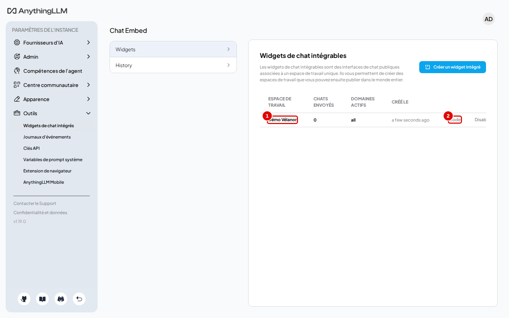
*Écran : « Widgets de chat intégrables ».*

| N° | Élément | Rôle |
|---|---|---|
| 1 | widget de « Démo Vélanor » | nombre de messages reçus, domaines actifs, date |
| 2 | « Code » | affiche le code à coller dans le site |

*Résultat* : « Disable » coupe le widget, « Delete » le supprime ; l'onglet « History » montre les conversations des visiteurs.

**Étape 14. Copier le code**
*Où* : fenêtre « Copy your embed code ».

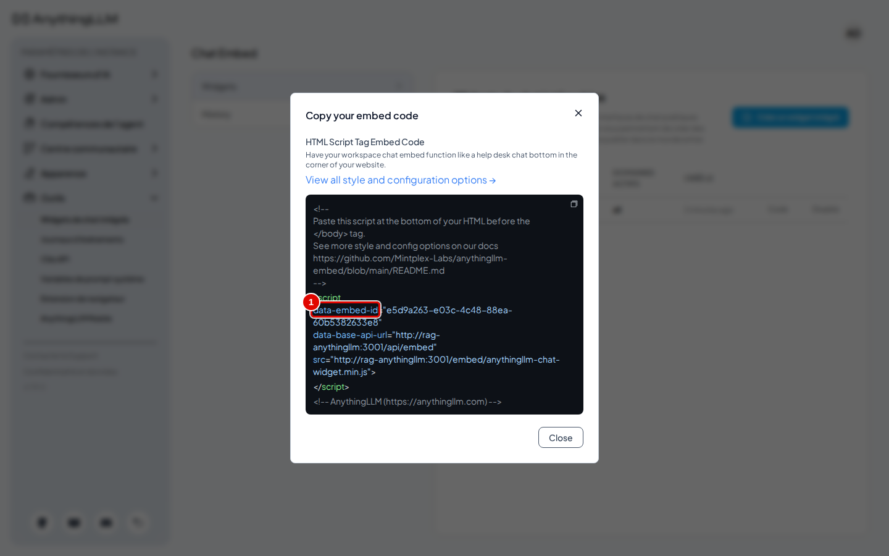
*Écran : code d'intégration du widget.*

| N° | Élément | Rôle |
|---|---|---|
| 1 | code HTML | balise `<script>` avec l'identifiant du widget, à coller avant `</body>` |

*Résultat* : le code est prêt à coller dans une page du site.

**Étape 15. Utiliser le widget dans le site**
*Où* : page web contenant le code copié à l'étape 14. Pour essayer sans site web : ouvrir le Bloc-notes de Windows, écrire `<html><body><h1>Test du widget</h1>`, coller le code copié à l'étape 14, écrire `</body></html>`, enregistrer sous `widget-test.html` sur le Bureau, puis ouvrir ce fichier par un double-clic : il s'ouvre dans le navigateur. Une page de ce type, ouverte directement depuis un fichier, a été essayée avec succès. Sur un vrai site, le code se colle avant `</body>` d'une page de ce site.
Cliquer sur la bulle en bas à droite (pastille 1), poser une question.

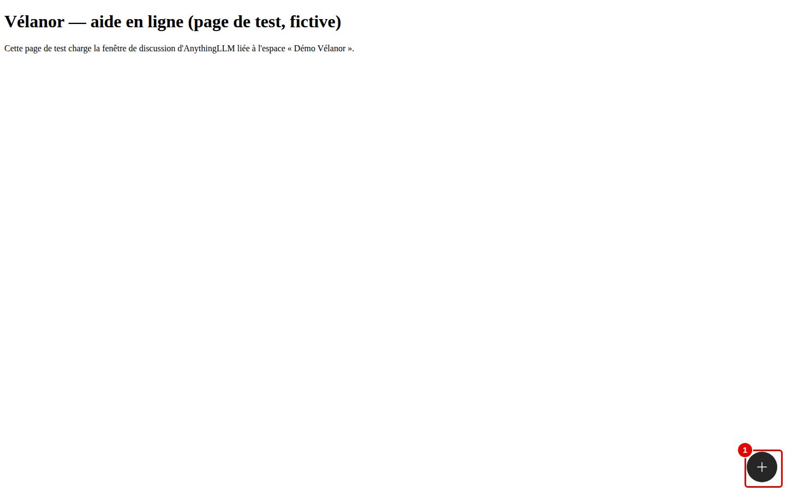
*Écran : page de test, bulle du widget.*

| N° | Élément | Rôle |
|---|---|---|
| 1 | bulle de discussion | ouvre la fenêtre de discussion |

*Où* : même page, fenêtre du widget ouverte ; taper `Quelle est la durée de garantie du cadre ?` puis Entrée.

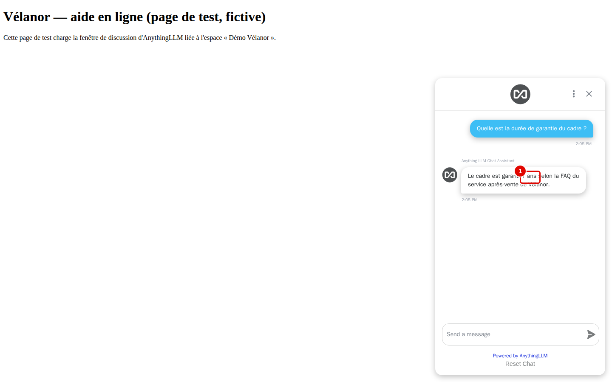
*Écran : page de test, fenêtre du widget ouverte.*

| N° | Élément | Rôle |
|---|---|---|
| 1 | réponse | « Le cadre est garanti 7 ans selon la FAQ du service après-vente de Vélanor. » |

*Résultat* : le visiteur obtient une réponse tirée des documents de l'espace, sans compte. La fenêtre du widget est en anglais (« Send a message », « Reset Chat »).

## Bon à savoir

- Pour revenir à une seule personne, il n'y a pas de bouton : il faudrait restaurer une sauvegarde faite avant le passage (annexe A4).
- Un compte « Manager » peut modifier les espaces et leurs documents mais pas les modèles.
- Un widget dont les domaines autorisés sont vides répond à n'importe quel site qui connaît son identifiant : une fois l'essai fait, renseigner le domaine du vrai site (bouton d'édition du widget).

## En cas de problème

| Symptôme | Cause | Que faire |
|---|---|---|
| « Error: [001] Invalid login credentials. » | nom ou mot de passe incorrect | vérifier ; un administrateur peut changer le mot de passe dans « Utilisateurs » › « Edit » |
| Un utilisateur ne voit aucun espace | il n'est membre d'aucun espace | étape 5 |
| Le widget ne s'affiche pas | adresse de l'instance injoignable depuis le navigateur du visiteur | l'instance n'écoute que sur le poste (`127.0.0.1`) : le widget ne fonctionne que pour un site ouvert sur ce même poste |

---
*Version décrite : AnythingLLM 1.19.0, essais du 12 novembre 2026. Détails et preuves : [rapport d'essais](../annexes/A6-rapport-d-essais.md).*
