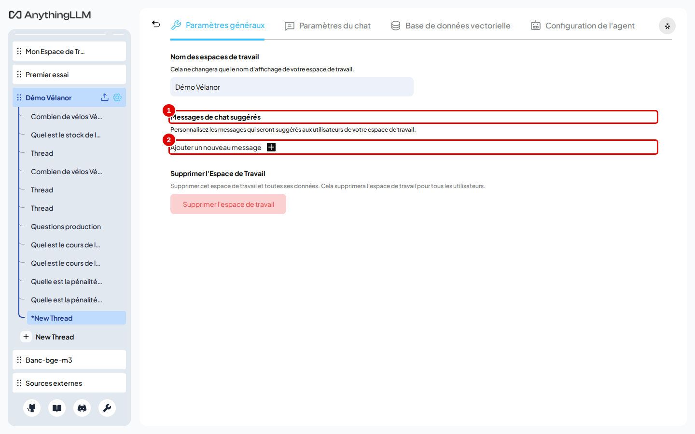
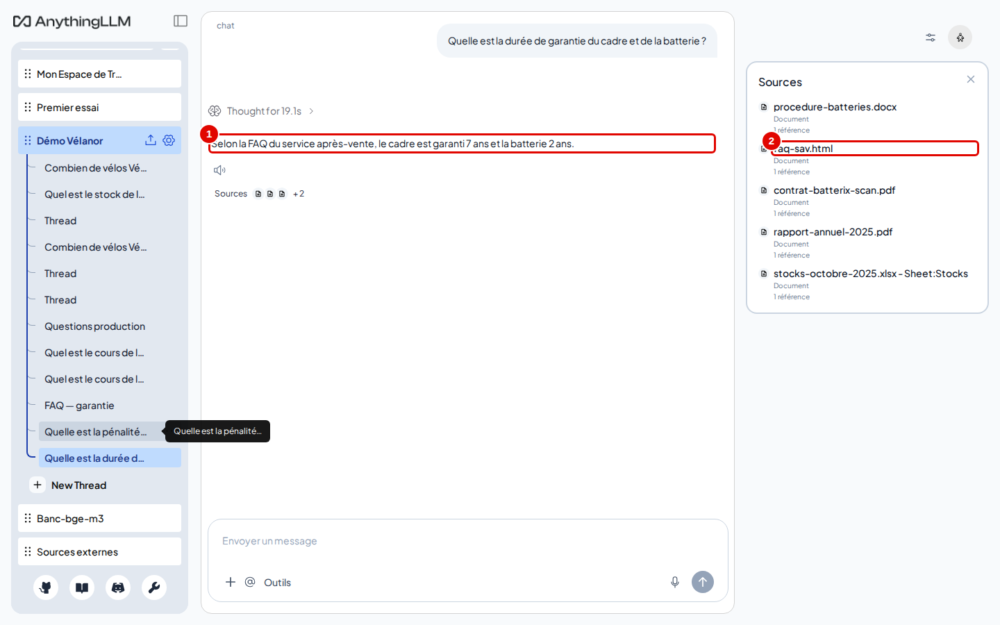
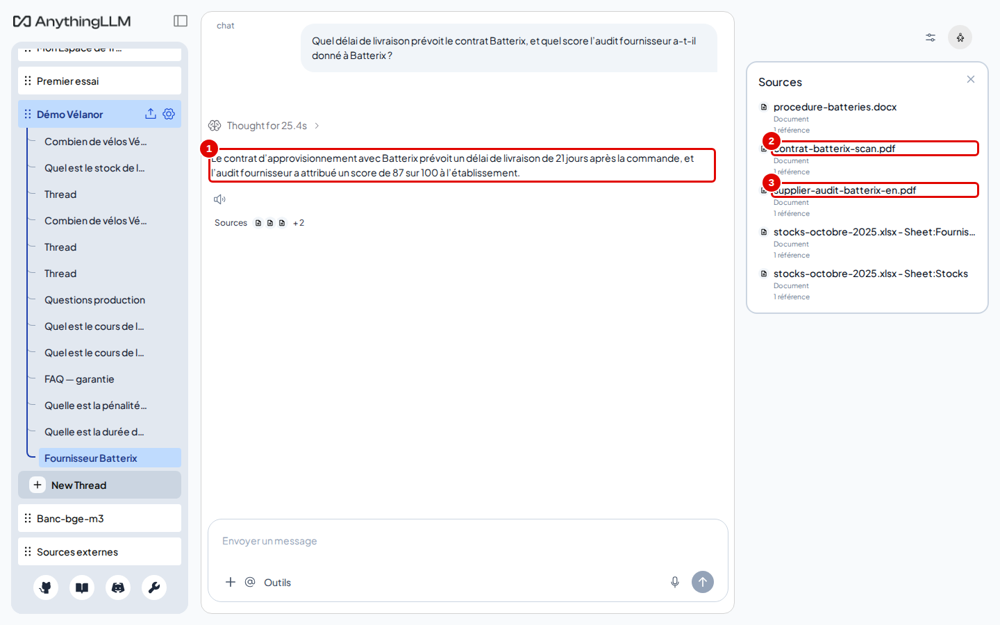
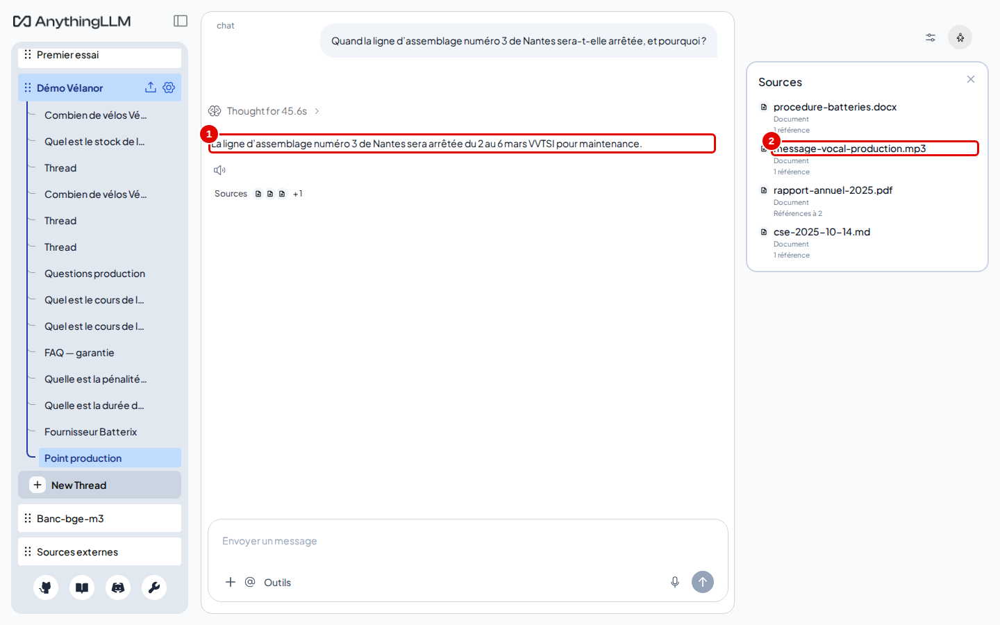

# 14. Cas pratiques

> Ce chapitre met bout à bout les chapitres précédents dans trois usages réels, avec l'espace « Démo Vélanor » : une foire aux questions du service après-vente, le suivi d'un fournisseur à partir de plusieurs documents, et un point de production à partir d'un message vocal.
> **Point de départ** : espace « Démo Vélanor » constitué au chapitre 05, en mode « Requête » (chapitre 04, étape 10).
> **Durée** : environ 20 minutes. **Avant** : chapitres 04 à 07.

## Ce qu'il faut savoir

Les trois cas utilisent les documents fictifs de l'entreprise Vélanor : une FAQ (page HTML), un contrat scanné (PDF image), un audit fournisseur en anglais (PDF), un message vocal (MP3), un rapport annuel, une procédure, un classeur de stocks. Chaque conversation est ouverte dans un **nouveau fil**, renommé d'après son sujet (chapitre 06, étapes 8 et 9) : les trois fils forment le jeu de démonstration laissé dans l'instance.

## Cas 1. Mettre en place une foire aux questions interne

*But* : permettre à l'équipe du service après-vente de trouver une réponse sûre, citée, sans chercher dans les documents.

**Étape 1. Proposer des questions toutes prêtes**
*Où* : réglages de l'espace « Démo Vélanor » › « Paramètres généraux ».
Cliquer sur « Ajouter un nouveau message » (pastille 2) : une carte d'exemple « Expliquez-moi les avantages de AnythingLLM » apparaît. Cliquer sur cette carte, remplacer le texte du champ « Message » par une question fréquente (par exemple `Quelle est la durée de garantie du cadre et de la batterie ?`), puis cliquer sur « Enregistrer les messages ».

*Écran : « Paramètres généraux », messages de chat suggérés.*

| N° | Élément | Rôle |
|---|---|---|
| 1 | « Messages de chat suggérés » | questions proposées en boutons sur l'écran vide de l'espace (4 au plus) |
| 2 | « Ajouter un nouveau message » | ajoute une question |

*Résultat* : les questions apparaissent en boutons quand un fil vide est ouvert ; un clic les envoie.

**Étape 2. Interroger la FAQ**
*Où* : espace « Démo Vélanor », nouveau fil « FAQ — garantie ».
Poser `Quelle est la durée de garantie du cadre et de la batterie ?`, puis ouvrir « Sources ».

*Écran : fil « FAQ — garantie », réponse et sources.*

| N° | Élément | Rôle |
|---|---|---|
| 1 | réponse | « Selon la FAQ du service après-vente, le cadre est garanti 7 ans et la batterie 2 ans. » |
| 2 | `faq-sav.html` | page de la FAQ dont vient la réponse |

*Résultat* : la réponse est juste et citée. Pour l'ouvrir au public, voir le widget au chapitre 13.

## Cas 2. Suivre un fournisseur à partir de plusieurs documents

*But* : réunir en une réponse ce que disent le contrat (scanné, en français) et l'audit (en anglais) d'un fournisseur.

**Étape 3. Poser une question qui croise deux documents**
*Où* : espace « Démo Vélanor », nouveau fil « Fournisseur Batterix ».
Poser `Quel délai de livraison prévoit le contrat Batterix, et quel score l'audit fournisseur a-t-il donné à Batterix ?`, puis ouvrir « Sources ».

*Écran : fil « Fournisseur Batterix », réponse et sources.*

| N° | Élément | Rôle |
|---|---|---|
| 1 | réponse | « … un délai de livraison de 21 jours après la commande, et l'audit fournisseur a attribué un score de 87 sur 100 … » |
| 2 | `contrat-batterix-scan.pdf` | contrat scanné, lu par reconnaissance de caractères |
| 3 | `supplier-audit-batterix-en.pdf` | audit en anglais ; la réponse est rédigée en français |

*Résultat* : une seule question donne les deux informations, chacune avec sa source. Vérifier les chiffres d'un scan dans le passage cité : la lecture optique peut se tromper sur un caractère (chapitre 15).

## Cas 3. Préparer un point production à partir d'un message vocal

*But* : retrouver une information donnée oralement, sans réécouter l'enregistrement.

**Étape 4. Interroger le message vocal**
*Où* : espace « Démo Vélanor », nouveau fil « Point production ».
Poser `Quand la ligne d'assemblage numéro 3 de Nantes sera-t-elle arrêtée, et pourquoi ?`, puis ouvrir « Sources ».

*Écran : fil « Point production », réponse et sources.*

| N° | Élément | Rôle |
|---|---|---|
| 1 | réponse | « La ligne d'assemblage numéro 3 de Nantes sera arrêtée du 2 au 6 mars VVTSI pour maintenance. » |
| 2 | `message-vocal-production.mp3` | message vocal, transcrit par `transcribe` à l'envoi |

*Résultat* : la date et la raison sont justes. « VVTSI » est une erreur de la transcription automatique (l'année dictée), reprise telle quelle par le modèle : la transcription d'un audio se relit dans le passage cité. Pour garder une trace du point, exporter le fil (chapitre 06, étapes 12 et 13).

## Bon à savoir

- Les trois fils restent dans l'espace « Démo Vélanor » pour être rouverts à tout moment.
- Ces réponses ont pris de 20 à 46 secondes, réflexion du modèle comprise, sur une carte graphique de 16 Go.

## En cas de problème

| Symptôme | Cause | Que faire |
|---|---|---|
| Une seule des deux informations dans la réponse | un seul des deux documents retrouvé | passer à 6 ou 8 passages, ou activer « Accuracy Optimized » (chapitre 07) |
| Un chiffre faux venu d'un scan | erreur de lecture optique | voir le [chapitre 15](15-en-cas-de-probleme.md) |

---
*Version décrite : AnythingLLM 1.19.0, essais du 12 novembre 2026. Détails et preuves : [rapport d'essais](../annexes/A6-rapport-d-essais.md).*
