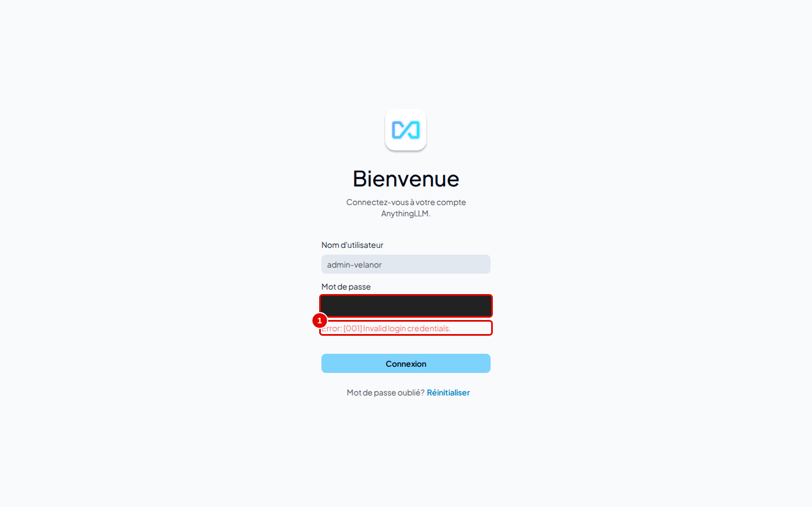
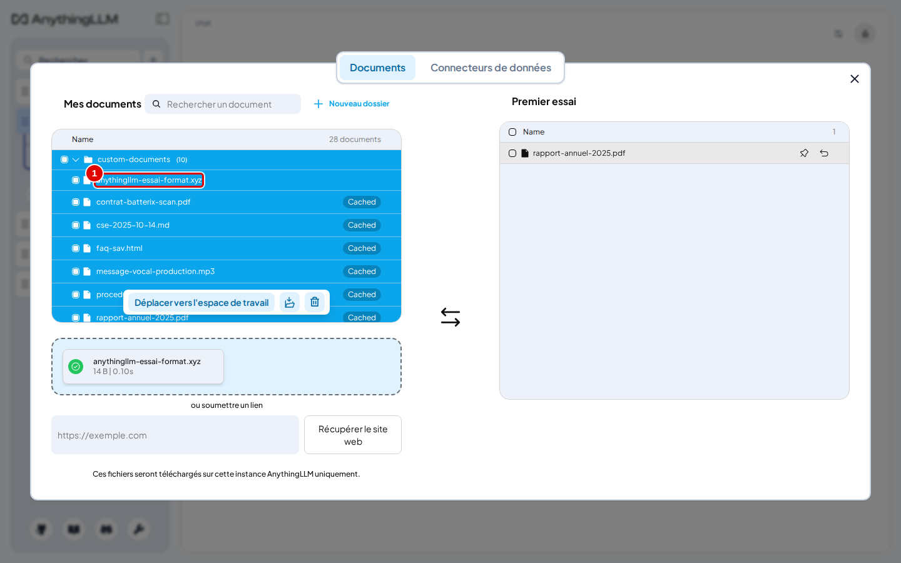
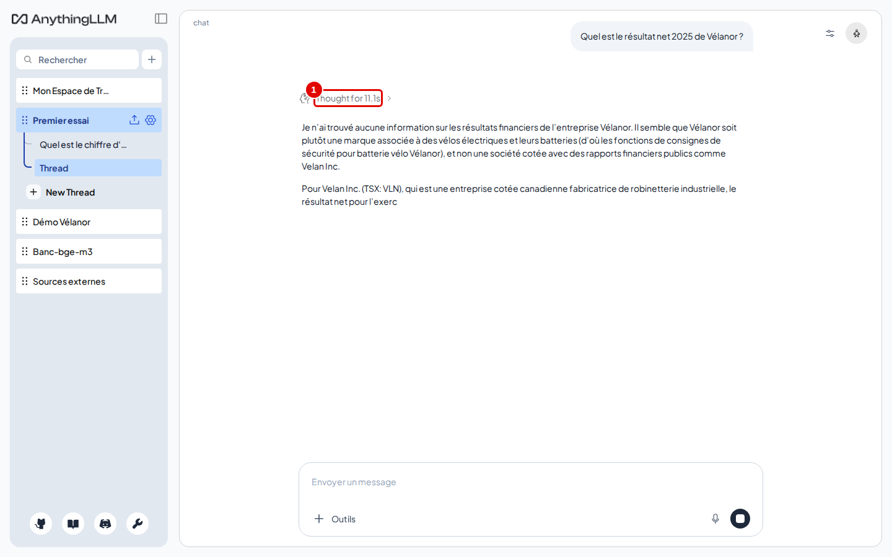
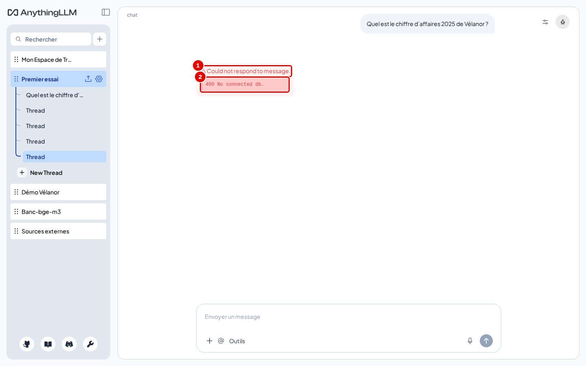
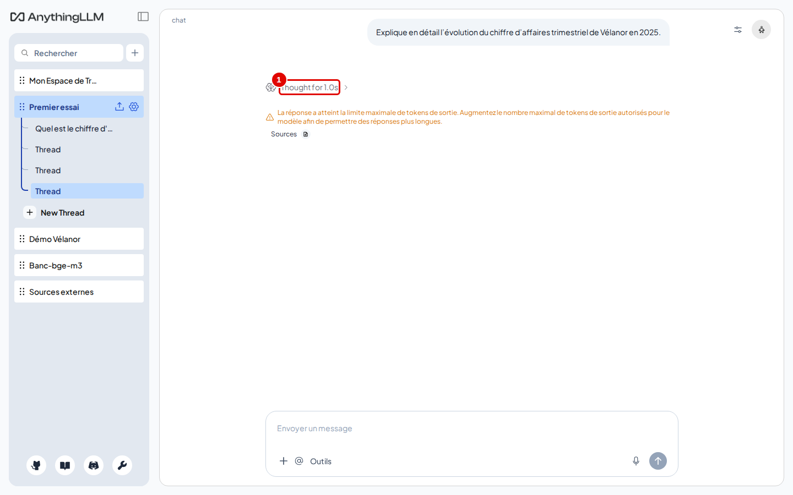
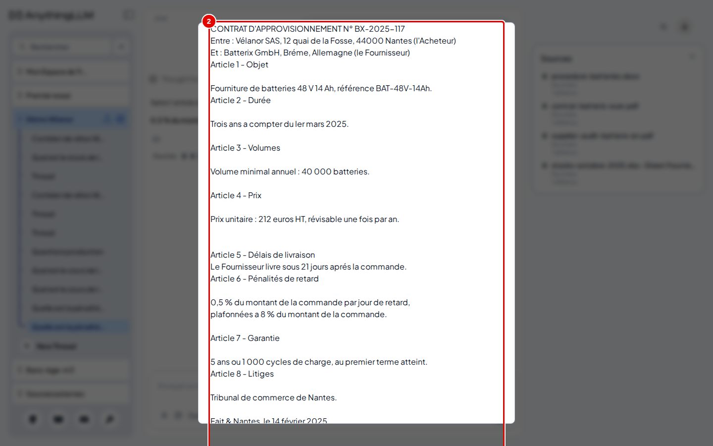

# 15. En cas de problème

> Ce chapitre rassemble les problèmes réellement rencontrés pendant les essais, chacun avec ce qu'on voit, sa cause et son remède.
> **Point de départ** : l'écran où le problème apparaît.
> **Durée** : à la demande. **Avant** : chapitres 02 à 04.

## Ce qu'il faut savoir

Trois commandes donnent l'essentiel du diagnostic, depuis le dossier du dépôt :

```bash
outils/anythingllm/etat.sh
docker logs --tail 50 rag-anythingllm
outils/communs/llm_central_sante.sh --essai
```

La première dit si AnythingLLM tourne, la deuxième montre ses derniers messages, la troisième vérifie le service de modèles. Les problèmes ci-dessous ont tous été provoqués ou observés sur le poste d'essai.

## Connexion refusée

**Étape 1. Reconnaître l'erreur de connexion**
*Où* : page de connexion.


*Écran : connexion refusée.*

| N° | Élément | Rôle |
|---|---|---|
| 1 | message d'erreur | « Error: [001] Invalid login credentials. » |

*Cause* : nom d'utilisateur ou mot de passe incorrect.
*Que faire* : vérifier la saisie (majuscules). En multi-utilisateur, « Mot de passe oublié? Réinitialiser » demande les codes de récupération (chapitre 13, étape 8), ou un administrateur change le mot de passe dans « Utilisateurs » › « Edit ».

## Un fichier qu'on croyait refusé est accepté

**Étape 2. Repérer un fichier d'un type inattendu**
*Où* : fenêtre des documents, « Mes documents ».


*Écran : fenêtre des documents après l'envoi d'un fichier `.xyz`.*

| N° | Élément | Rôle |
|---|---|---|
| 1 | `anythingllm-essai-format.xyz` | fichier d'extension inconnue, accepté |

*Cause* : AnythingLLM ne refuse pas les extensions inconnues : il lit le fichier comme du texte brut. Un fichier binaire donnerait un document illisible.
*Que faire* : supprimer le fichier (corbeille, chapitre 05, étape 12) et envoyer un format pris en charge (chapitre 05, « Ce qu'il faut savoir »).

## Le bouton « Déplacer vers l'espace de travail » ne fait rien

*Où* : fenêtre des documents, juste après un envoi de fichiers.
*Cause* : dans la version 1.19.0, un fichier envoyé dans la fenêtre encore ouverte ne peut pas être placé dans l'espace.
*Que faire* : fermer la fenêtre avec la croix, la rouvrir, cocher de nouveau le fichier (chapitre 04, étape 5).

## Le mode « Agent » répond à côté, ou ne répond pas

**Étape 3. Reconnaître une réponse d'agent hors des documents**
*Où* : espace en mode « Agent » (mode par défaut d'un nouvel espace).


*Écran : espace « Premier essai » en mode « Agent », question sur le résultat net.*

| N° | Élément | Rôle |
|---|---|---|
| 1 | réflexion | l'agent a raisonné puis cherché ailleurs que dans les documents |

*Cause* : en mode « Agent », le modèle choisit ses outils. Pendant les essais, il a une fois laissé la réponse vide, une autre fois cherché sur Internet et répondu sur une autre entreprise au nom proche, alors que le rapport annuel de l'espace donnait la réponse (3,1 M€).
*Que faire* : passer l'espace en mode « Requête » (chapitre 04, étape 10) et n'appeler l'agent qu'à la demande avec `@agent` (chapitre 10). Désactiver la compétence « Recherche web en direct et navigation » si l'agent ne doit pas sortir des documents.

## Le service de modèles refuse la clé

**Étape 4. Reconnaître une clé refusée**
*Où* : zone de discussion, après une question.


*Écran : espace « Premier essai », réponse en erreur.*

| N° | Élément | Rôle |
|---|---|---|
| 1 | « Could not respond to message. » | la question n'a pas pu être traitée |
| 2 | « 400 No connected db. » | message renvoyé par le service de modèles quand la clé est fausse |

*Cause* : la clé saisie dans « Préférence LLM » ne correspond pas à celle du service (message peu explicite du service, essayé avec une clé volontairement fausse).
*Que faire* : Paramètres de l'instance › « Préférence LLM » › « API Key » : recoller la clé du fichier `.env`, « Save changes ». Faire de même dans « Préférences d'intégration » et « Modèle de transcription » si la clé a changé.

## La réponse est coupée

**Étape 5. Reconnaître une réponse tronquée**
*Où* : zone de discussion.


*Écran : réponse coupée avec un plafond de 64 jetons.*

| N° | Élément | Rôle |
|---|---|---|
| 1 | réflexion | le modèle a commencé à réfléchir, puis s'est arrêté |

*Cause* : « Max Tokens » trop bas. Le modèle `chat` réfléchit avant de répondre et sa réflexion compte dans ce plafond. Avec 64, AnythingLLM affiche « La réponse a atteint la limite maximale de tokens de sortie. Augmentez le nombre maximal de tokens de sortie autorisés pour le modèle afin de permettre des réponses plus longues. » ; la valeur proposée par défaut, 1024, expose au même risque sur une question qui demande du raisonnement.
*Que faire* : « Préférence LLM » › « Max Tokens » : 8192 (chapitre 03, étape 3).

## Un document scanné est mal lu

**Étape 6. Repérer une erreur de lecture optique**
*Où* : « Sources » › document scanné › passages cités.


*Écran : passages cités du contrat scanné.*

| N° | Élément | Rôle |
|---|---|---|
| 1 | « Bréme » | « Brême » mal lu |
| 2 | « I'Acheteur » | « l'Acheteur » mal lu |

*Cause* : la lecture optique (OCR) est réglée en anglais par défaut ; les accents et certaines lettres françaises sont mal reconnus. Les chiffres du contrat ont été bien lus dans les essais.
*Que faire* : ce réglage n'existe pas dans l'interface. Depuis le dossier du dépôt, écrire la ligne `TARGET_OCR_LANG=fra,eng` dans le fichier `donnees/anythingllm/options.env`, puis relancer `outils/anythingllm/demarrer.sh` (le conteneur est recréé avec ce réglage). Supprimer ensuite le document scanné et l'envoyer de nouveau : la lecture donne alors « Brême » et « l'Acheteur ». Écrire la même ligne dans `donnees/anythingllm/storage/.env` ne suffit pas : l'outil de lecture ne la voit pas.

## Message trop long

*Où* : zone de saisie, message très long (un document entier collé).
*Ce qu'on voit* : la question échoue ; le journal (`docker logs rag-anythingllm`) indique « input (20418 tokens) is too large to process ».
*Cause* : avant de chercher les passages, AnythingLLM transforme la question entière avec le modèle `embed`, qui accepte au plus 8 192 jetons (environ 30 000 caractères). Le modèle `chat` accepte 16 384 jetons.
*Que faire* : envoyer un long texte comme document (chapitre 05), puis poser une question courte.

## Autres situations rencontrées

| Symptôme | Cause | Que faire |
|---|---|---|
| L'assistant de premier lancement ne s'affiche pas sur une installation neuve | une clé de session (`JWT_SECRET`) existait dans les réglages au premier démarrage | ne pas la renseigner d'avance (le script d'installation ne le fait pas) ; sinon tout supprimer et réinstaller (chapitre 02, étape 10) |
| Tous les espaces répondent par un refus après un changement d'embedder | les représentations des documents ont été effacées | intégrer de nouveau les documents de chaque espace (chapitre 05, étapes 5 et 6) |
| « Selected Model » reste vide et grisé | adresse ou clé du service incorrecte | vérifier `http://llm-central:8080/v1` et la clé |
| La page « Tâches planifiées » renvoie à l'accueil | instance en multi-utilisateur | fonction propre au mode « Juste moi » |
| L'arrêt prend une dizaine de secondes | le conteneur ne s'arrête pas de lui-même, Docker le force au bout de 10 s | sans conséquence constatée : les données sont intactes au redémarrage |

## Résultat

Chaque problème rencontré pendant les essais a son remède ; l'annexe A6 donne les journaux qui les montrent.

---
*Version décrite : AnythingLLM 1.19.0, essais du 12 novembre 2026. Détails et preuves : [rapport d'essais](../annexes/A6-rapport-d-essais.md).*
