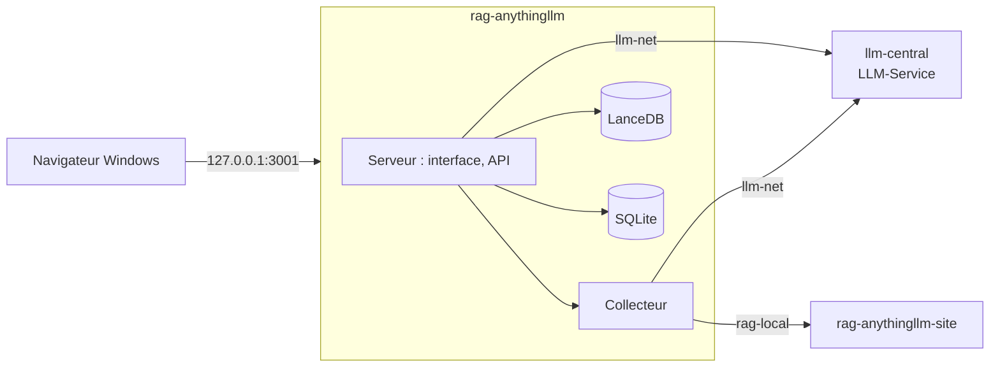

# AnythingLLM : fiche technique

Architecture, réglages, API, versions et licences. Le guide d'utilisation est dans [le manuel](README.md).

## Sommaire

- [Architecture](#architecture)
- [Installation : prérequis et commandes](#installation--prérequis-et-commandes)
- [Configuration](#configuration)
- [API / Endpoints](#api--endpoints)
- [Tests](#tests)
- [Licences & composants](#licences--composants)
- [Données du banc](#données-du-banc)
- [Les pièges que ce banc documente](#les-pièges-que-ce-banc-documente)
- [Versions](#versions)
- [Ressources](#ressources)

## Architecture

| Service | Conteneur | Image | Rôle |
|---|---|---|---|
| AnythingLLM | `rag-anythingllm` | `mintplexlabs/anythingllm:1.19.0` (figée par empreinte) | interface, API, collecteur de documents (OCR, transcription, pages web), base SQLite, vecteurs LanceDB |
| Modèles | `llm-central`, `llm-swap`, `llm-speaches` | LiteLLM v1.109.0, llama-swap v272 (llama.cpp), speaches 0.8.3 | `chat`, `embed`, `rerank`, `transcribe`, servis par [LLM-Service](https://github.com/floSa/llm-service) (dépôt séparé, géré à part) |
| Site de test | `rag-anythingllm-site` | `nginx:alpine` | trois pages fictives pour le connecteur « site web » et la page de test du widget (sans port publié) |



Réseaux : `llm-net` (service de modèles, externe) et `rag-local` (captures Playwright, site de test). Un seul port publié, sur `127.0.0.1`.

## Installation : prérequis et commandes

**Prérequis :** Windows 11 avec WSL2 (Ubuntu 24.04) et Docker Desktop ; 16 Go de mémoire ; LLM-Service démarré ; la clé propre au banc dans `service/.env` (copie de `service/.env.example`), créée par `cle.sh` de LLM-Service.

```bash
cp service/.env.example service/.env
~/mes_projets/Projet-IA/LLM-Service/service/scripts/cle.sh creer anythingllm-test-bench --dans "$PWD/.env" --noms LLM_CENTRAL_URL,LLM_CENTRAL_KEY   # clé propre au banc, écrite sans affichage
banc-essai/communs/llm_central_sante.sh --essai
service/installer.sh
```

| Service | URL | Note |
|---|---|---|
| AnythingLLM | http://127.0.0.1:3001 | compte et mot de passe fictifs : `donnees/IDENTIFIANTS-LOCAUX.txt` (non versionné) |
| Documentation de l'API | http://127.0.0.1:3001/api/docs | clé d'API : `donnees/anythingllm/cle-api.txt` |
| Service de modèles | http://127.0.0.1:8080/v1 | LLM-Service, clé dans `service/.env` |

Le compte, la langue et les modèles se règlent ensuite dans l'interface ([chapitre 03](manuel/03-premiers-pas.md)).

## Configuration

- Variables générées par `installer.sh` dans `donnees/anythingllm/storage/.env` : `SIG_KEY`, `SIG_SALT`, `DISABLE_TELEMETRY="true"` ; **pas** de `JWT_SECRET` (il ferait sauter l'assistant de premier lancement ; l'application le crée elle-même).
- Options passées au conteneur : `donnees/anythingllm/options.env` (facultatif), ici `TARGET_OCR_LANG=fra,eng` pour lire les scans en français.
- Écarts au compose officiel (`service/compose.yml`) : image officielle figée au lieu d'une construction locale, port sur `127.0.0.1`, un seul dossier de données `donnees/anythingllm/storage`, réseaux `llm-net` et `rag-local`. Relecture : `banc-essai/resultats/anythingllm/relecture.md`.
- Branchement au service LLM central : fournisseur « Generic OpenAI », adresse `http://llm-central:8080/v1`, noms fixes `chat` (contexte 16384, « Max Tokens » 8192) et `embed` ; transcription « OpenAI Compatible » avec `transcribe`. AnythingLLM n'accepte pas de reranker externe : `rerank` n'est pas utilisé, le tri de précision intégré l'est.
- Clé : `LLM_CENTRAL_KEY` dans `service/.env` (jamais versionné) ; AnythingLLM la recopie dans son propre `service/.env` sous `donnees/` (non versionné).

## API / Endpoints

| Route | Rôle |
|---|---|
| `GET /api/ping` | santé (sans clé) |
| `GET /api/v1/auth` | vérifier une clé d'API |
| `GET /api/v1/workspaces`, `POST /api/v1/workspace/new`, `POST /api/v1/workspace/{slug}/update` | espaces |
| `POST /api/v1/document/upload` (`addToWorkspaces`) | envoyer et intégrer un document |
| `POST /api/v1/workspace/{slug}/chat` (`mode` : `query`, `chat`, `automatic`) | poser une question |
| `POST /api/v1/workspace/{slug}/vector-search` | chercher des passages sans le modèle |
| `/api/v1/openai/chat/completions` | route compatible OpenAI (le modèle est le nom court de l'espace) |

Exemples exécutés : [annexe A3](annexes/A3-automatiser-par-l-api.md).

## Tests

```bash
python3 banc-essai/communs/verifier_docs.py          # 0 point
bash banc-essai/exemples/lancer.sh              # 7 exemples, code 0, sortie dans sorties_verifiees.txt
python3 banc-essai/anythingllm/banc.py --etiquette essai --espace Banc-bge-m3
```

Sorties obtenues : `0 point(s)` ; `banc-essai/exemples/sorties_verifiees.txt` ; `banc-essai/resultats/anythingllm/banc-*.json`.

## Licences & composants

| Composant | Licence |
|---|---|
| AnythingLLM | MIT |
| LiteLLM, llama.cpp, llama-swap, speaches (LLM-Service) | MIT |
| Qwen3.5-4B (`chat`), bge-m3 (`embed`), faster-whisper-small (`transcribe`) | licences de leurs auteurs, voir LLM-Service |
| Playwright (captures) | Apache 2.0 |

Ce projet : MIT — Copyright (c) 2026 floSa ([LICENSE](../LICENSE)).

## Données du banc

Corpus `banc-essai/corpus/documents/` : rapport annuel PDF avec tableaux, contrat PDF scanné, procédure DOCX, présentation PPTX, classeur XLSX, FAQ HTML, compte rendu Markdown, audit en anglais, message vocal MP3 (empreintes dans `banc-essai/corpus/MANIFEST.json`). Questions `banc-essai/corpus/questions.json` : 34 avec réponse attendue, 4 pièges sans réponse dans le corpus.

## Les pièges que ce banc documente

- Un `JWT_SECRET` écrit d'avance fait sauter l'assistant de premier lancement.
- « Max Tokens » vaut 1024 par défaut : trop peu pour un modèle qui réfléchit.
- Un nouvel espace est en mode « Agent » : réponse vide, ou réponse tirée d'Internet, dans l'interface ; préférer « Requête ».
- Un fichier envoyé ne peut être placé dans l'espace qu'après fermeture et réouverture de la fenêtre des documents.
- L'embedder intégré, surtout anglais, perd 8 réponses sur 34 face à `embed`.
- Pas de reranker externe ; le tri de précision intégré fait gagner la dernière question.
- L'OCR est en anglais ; `TARGET_OCR_LANG` n'agit que passé au conteneur.
- Une question de plus de 8 192 jetons échoue à l'embedding.
- Télémétrie coupée, mais deux tables publiques restent téléchargées au démarrage.

## Versions

| Composant | Version |
|---|---|
| AnythingLLM | 1.19.0 (`sha256:daf5a6ae9d363ed578e7d41e2d0668c7eaa604bd90b0ff27435f893b0906833e`) |
| Playwright (captures) | 1.65.1 (`mcr.microsoft.com/playwright/python:v1.65.1-noble`) |
| LiteLLM / llama-swap / speaches | v1.109.0 / v272 (llama.cpp build 12282) / 0.8.3 |
| Docker / Compose | 29.9.3 / 5.7.0 |

Relevé : `banc-essai/resultats/anythingllm/versions-2026-11-12.json`.

## Ressources

- Dépôt : https://github.com/Mintplex-Labs/anything-llm — documentation : https://docs.anythingllm.com
- Rapport de mission : [documentations/rapport.md](rapport.md) ; journal : [documentations/journal.md](journal.md)
